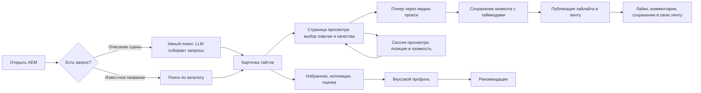

# Видение продукта AEM

## Описание

Документ отвечает на три вопроса: зачем существует **AEM** (Anime Epic Moments),
кому и какую ценность он даёт и где заканчиваются границы продукта. Он не
описывает реализацию — за это отвечает
[обзор архитектуры](../01-architecture/overview.md).

## Как это работает

### Проблема

Аниме-каталогов много, а «моментов» — нет. Человеку, который хочет вернуться к
любимой сцене или показать её другу, приходится объяснять словами, в какой серии
и на какой минуте это было, и вручную искать таймкод в плеере. При этом:

- каталог, озвучки и плееры живут на разных сайтах, и единого входа нет;
- поиск по каталогу требует точного названия: описание сцены или настроения он не
  понимает;
- найденная ссылка на поток живёт недолго и часто не открывается из браузера
  из-за политики CORS и проверки реферера.

### Что делает AEM

AEM превращает просмотр в коллекцию моментов: одну карточку тайтла, один плеер,
который собирает озвучки всех подключённых провайдеров, и публичную библиотеку
моментов с таймкодами.

| Возможность | Что получает пользователь |
| --- | --- |
| Каталог тайтлов | Карточки с русским и оригинальным названием, годом, жанрами и рейтингом |
| Умный поиск | Описание сцены на естественном языке превращается в поисковые запросы и выдачу |
| Просмотр | Плеер, который сам подбирает доступные озвучки и качества для конкретной серии |
| Моменты и хайлайты | Сохранение отрезка серии с подписью, эмоцией и признаком спойлера и публикация в общую ленту |
| Коллекции | Собственные подборки с возможностью поделиться ссылкой |
| Избранное и оценки | Личная библиотека и оценка тайтлов |
| Рекомендации | Подборка тайтлов на основе вкусового профиля пользователя |
| Профиль и активность | Прогресс по тайтлам, история просмотров, лента хайлайтов пользователя и подписки |
| Поддержка | Обращение из интерфейса, уходящее в Telegram и на почту |

### Для кого

| Аудитория | Что важно |
| --- | --- |
| Зритель аниме | Быстро найти тайтл по описанию, досмотреть с того же места, сохранить момент |
| Автор хайлайтов | Поделиться сценой с таймкодами так, чтобы её открыли в той же озвучке |
| Владелец коллекции | Собрать и показать подборку, не пересказывая её словами |
| Мобильный клиент | Стабильный JSON-контракт и доступ по токену вместо cookie |
| Владелец AEM | Управлять источниками контента флагами окружения, не меняя код |

### Пользовательские сценарии

Ключевой путь — от описания сцены до воспроизведения. Всё остальное усиливает
его: библиотеки помогают возвращаться, рекомендации — находить новое, хайлайты —
делиться.

### Границы скоупа

Входит в AEM:

- каталог тайтлов и поиск (включая поиск по описанию через LLM);
- агрегация источников просмотра и проксирование HLS-потока;
- моменты, хайлайты, ленты, комментарии, лайки и сохранения;
- избранное, коллекции, оценки, реакции, статусы и сессии просмотра;
- рекомендации, профиль и публичная активность;
- регистрация, вход, подтверждение почты, восстановление пароля, роли поддержки.

Не входит в AEM:

| Что | Почему |
| --- | --- |
| Хранение и раздача видеоконтента | AEM хранит ссылки на источники; видео остаётся у провайдера |
| Собственный каталог-первоисточник | Каталог и метаданные приходят из внешних сервисов и кэшируются |
| Платная подписка и биллинг | Продуктовых требований нет; флаги `/api/v1/config` оставлены как точка расширения |
| Модерация контента внешних провайдеров | Ответственность источника; AEM ограничивает только собственный пользовательский контент |
| Мобильное приложение | AEM поставляет ему JSON API и контракт OpenAPI, но не клиент |

### Принципы продукта

1. **Момент важнее таймлайна.** Продукт измеряется не длиной просмотра, а числом
   сохранённых и открытых моментов.
2. **Ничего не ломается без ключа.** Если LLM, Redis или отдельный провайдер
   недоступны, базовые сценарии продолжают работать — см.
   [умный поиск](../02-integrations-and-services/llm-search.md).
3. **Источники — внешняя конфигурация.** Включение и выключение провайдера — это
   переменная окружения, а не правка кода.
4. **Один факт — одно место.** Каталог, озвучки и ссылки не дублируются между
   подсистемами: источником правды остаётся провайдер.

### Ограничения, которые принимаются осознанно

| Ограничение | Следствие |
| --- | --- |
| Ссылки провайдеров живут недолго | Источники с разовыми ссылками перезапрашиваются, старые записи удаляются |
| Внешние API меняют защиту и формат | Часть провайдеров выключена по умолчанию, включение — решение владельца |
| 18+ контент требует профильных провайдеров | Для adult-тайтлов опрашиваются только Hanime, Hentaigasm и Eporner |
| Anti-bot защита у части источников | Используются браузерный TLS-отпечаток и, при необходимости, внешний прокси |
| Мобильный клиент не умеет cookie-сессию | Для него есть отдельная Bearer-схема с теми же проверками |

## Почему это сделано так

- Продукт строится вокруг моментов, а не вокруг каталога: каталогов много,
  сохранённых сцен с таймкодами — почти нет. Это и есть отличие AEM.
- Источники не копируются в собственную базу видео: юридически и технически проще
  хранить ссылку и перезапрашивать её, чем поддерживать раздачу.
- Деградация вместо отказа: недоступность LLM или Redis не должна превращать
  сайт в нерабочий, поэтому у каждой внешней зависимости есть резервный путь.

## Где в коде

- `src/backend/domain/` — сущности и правила продукта
- `src/backend/application/use_cases/` — сценарии по зонам продукта
- `src/backend/presentation/api/v1/` — точки входа для браузера и JSON API
- `src/frontend/templates/` — страницы продукта
- `src/backend/config/sections/features.py` — фиче-флаги для клиентов

## Связанные документы

- [Глоссарий](glossary.md)
- [Обзор архитектуры](../01-architecture/overview.md)
- [Провайдеры источников](../02-integrations-and-services/providers.md)
- [Умный поиск](../02-integrations-and-services/llm-search.md)
