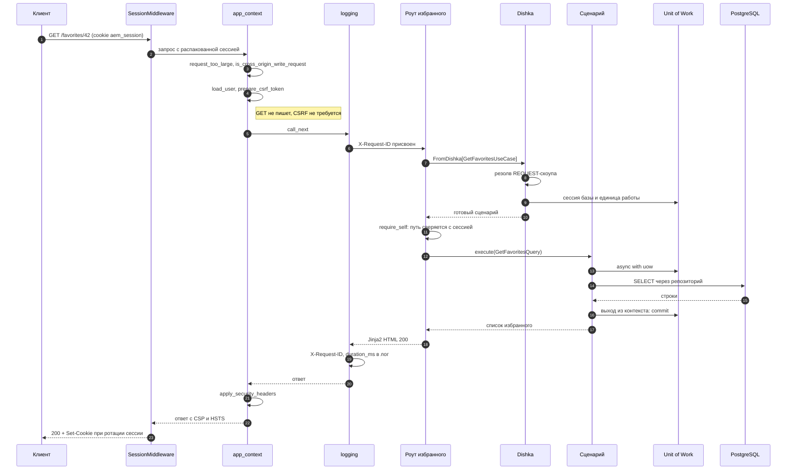
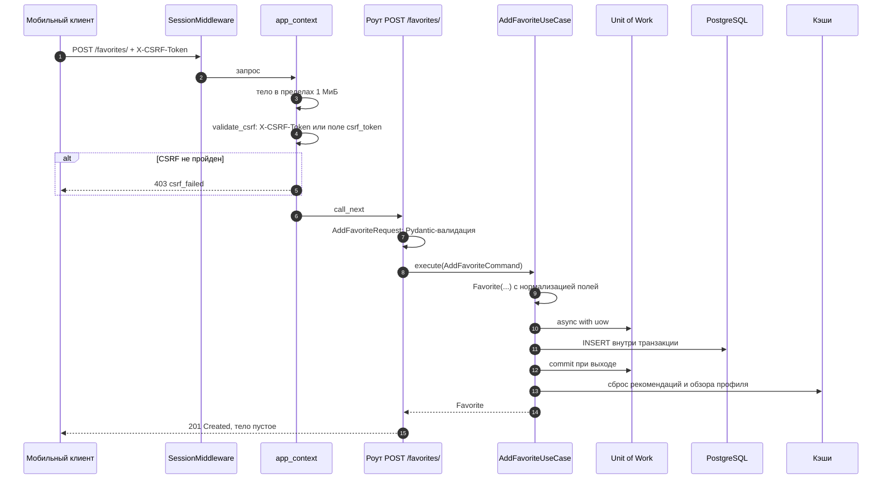

# Поток запроса

## Описание

Документ прослеживает путь одного HTTP-запроса в **AEM** от входа в ASGI-приложение
до ответа: какие звенья middleware его видят, в какой момент создаётся сессия базы,
кто открывает и закрывает транзакцию и как исключение превращается в HTTP-статус.
Правила слоёв здесь предполагаются известными —
см. [слои и правила](layers-and-rules.md).

## Как это работает

### Порядок middleware

Звенья добавляются в обратном порядке: в Starlette последний добавленный middleware
становится самым внешним. Поэтому порядок в `create_app()` и порядок выполнения —
зеркальны.

| Шаг | Класс или функция | Что делает | Где |
| --- | --- | --- | --- |
| 1 | `SessionMiddleware` | Подписывает и распаковывает cookie `aem_session` | `presentation/app_factory.py` |
| 2 | `app_context_middleware` | Сбрасывает `request.state`, отсекает большое тело и чужой origin, загружает пользователя, готовит и проверяет CSRF, навешивает заголовки безопасности на любой ответ | `presentation/app_factory.py` |
| 3 | `request_logging_middleware` | Назначает `X-Request-ID`, кладёт идентификаторы в `contextvars`, замеряет длительность | `presentation/app_factory.py` |
| 4 | `static_revalidation_middleware` | Ставит `Cache-Control: no-cache` для `/static/*` | `presentation/app_factory.py` |
| 5 | `BodyLimitMiddleware` | Считает принятые байты и прерывает чтение сверх `MAX_REQUEST_BYTES` | `presentation/app_factory.py` |
| 6 | `ExceptionMiddleware` FastAPI | Выбирает обработчик из `register_exception_handlers` | `presentation/api/errors.py` |
| 7 | Роут | Разбирает вход, вызывает сценарий, собирает ответ | `presentation/api/v1/` |

Ответ проходит те же звенья обратно. Поэтому `apply_security_headers` стоит в
`app_context_middleware` после `call_next`: заголовки получают все ветки, включая
ранние отказы CSRF и ответы обработчиков исключений.

Порядок `SessionMiddleware` не случаен. Он регистрируется последним и потому
выполняется первым: `request.scope["session"]` должен существовать к моменту
`prepare_csrf_token` и `validate_csrf`.

### HTML-страница: `GET /favorites/{user_id}`

### JSON-запрос на запись: `POST /favorites/`

Два свойства этой схемы важны для чтения кода:

1. **Коммит происходит до формирования ответа.** Транзакция закрывается на выходе из
   `async with self._uow as uow:` внутри сценария. Всё, что роут делает после
   `execute`, уже не может откатить запись — поэтому решения, способные отказать,
   принимаются до вызова сценария (проверка сессии, валидация, права).
2. **Сброс кэшей идёт после коммита.** Инвалидация в `AddFavoriteUseCase` стоит
   снаружи блока единицы работы: сбрасывать кэш раньше, чем зафиксирована запись,
   значит отдать клиенту старое значение.

### Единица работы и вложенность

`UnitOfWorkInterface` считает глубину входа. Повторный `async with` того же
экземпляра не открывает вторую транзакцию:

| Глубина на выходе | Действие |
| --- | --- |
| больше нуля | Ничего: внешний контекст ещё держит границу |
| ноль, исключения нет | `commit()` |
| ноль, исключение есть | `rollback()` |

Счётчик нужен потому, что прикладной сервис получает ту же единицу работы, что и
вызывающий сценарий, и тоже входит в контекст. Без счётчика внутренний выход
коммитил бы половину работы.

`__aexit__` всегда возвращает `False`: исключение не подавляется, а поднимается в
`ExceptionMiddleware`, где его превращает в ответ соответствующий обработчик.

### Сессия базы и жизненный цикл

| Что | Когда создаётся | Когда освобождается |
| --- | --- | --- |
| `AsyncSession` | При резолве `REQUEST`-скоупа, перед вызовом роута | На закрытии `REQUEST`-скоупа, после ответа |
| `SqlAlchemyUnitOfWork` | Там же, поверх готовой сессии | Вместе со скоупом; транзакция уже закрыта выходом из контекста |
| Репозиторий | `uow.repository(Port)` или провайдер зоны | Вместе со скоупом |
| HTTP-клиенты, пулы, кэши | Один раз на процесс, `APP`-скоуп | На остановке приложения |

Подробности скоупов — в [DI на Dishka](di-dishka.md).

### Как исключение становится ответом

`register_exception_handlers` вызывается один раз при сборке приложения. Маршруты
не собирают тела ошибок вручную.

| Исключение | HTTP | Код в теле |
| --- | --- | --- |
| `RequestValidationError` | 422 | `validation_failed` с перечнем полей |
| `ValidationError` | 400 | `validation_failed` |
| `NotFoundError` | 404 | `not_found` |
| `AuthenticationError` | 401 | `unauthorized` |
| `AuthorizationError`, `PermissionError` | 403 | `forbidden` |
| `DuplicateError` | 409 | `conflict` |
| `ExternalServiceError` | 502 | `external_service_error` |
| `ImageStorageError` | 400 | `validation_failed` |
| `ValueError` | 400 | `bad_request` |
| Любое другое | 500 | `internal_server_error` |

Статус ищется по иерархии классов (`__mro__`), поэтому новый наследник
`DomainError` попадает в 400 без правки таблицы, а код ошибки выводится из имени
класса в `snake_case`.

Форма ответа выбирается по пути: `/api/*` всегда получает `{code, message,
details}`, остальные — HTML-шаблон из `templates/errors/` с тем же статусом. Так
мобильный клиент, присылающий `Accept: */*`, не получает HTML-заглушку.

### Что видно в логах

| Событие | Запись |
| --- | --- |
| Начало и конец запроса | `request_started`, `request_finished` с методом, путём, статусом и `duration_ms` |
| Отказ обработчика | `request_failed path=... code=... status=...` |
| Ошибка валидации | `request_invalid` с числом проблемных полей |
| Превышение тела | `request_body_limit_exceeded` |
| Чужой origin | `cross_origin_write_blocked` с `Origin` и `Referer` |
| Непредвиденное исключение | `internal_server_error` с трассировкой |

`X-Request-ID` берётся из одноимённого заголовка, если он безопасен по шаблону
`[A-Za-z0-9._-]{1,64}`, иначе генерируется. Идентификатор возвращается клиенту и
связывает все записи запроса через `contextvars`.

## Почему это сделано так

- Проверки безопасности стоят в одном звене, а не в каждом роуте: новый маршрут
  получает CSRF, заголовки и лимит тела автоматически.
- Пользователь загружается до CSRF, потому что Bearer-токен и cookie требуют разных
  правил, а решение «проверять или нет» принимается по факту аутентификации.
- Логирование обёрнуто снаружи `app_context`, чтобы в записи попадал и финальный
  статус отказа, сформированного внутри.
- Лимит тела реализован как чистое ASGI-звено, а не через `Content-Length`:
  заголовку можно не поверить, а счётчик байтов — нет.
- Транзакцией владеет сценарий, потому что граница бизнес-операции — это он, а не
  HTTP-запрос целиком: два сценария в одном роуте не должны делить коммит.

## Где в коде

- `src/backend/presentation/app_factory.py` — цепочка middleware и сборка приложения
- `src/backend/presentation/security_helpers.py` — пользователь, CSRF, заголовки
- `src/backend/presentation/api/errors.py` — таблицы статусов и обработчики
- `src/backend/presentation/api/v1/favorite_route.py` — пример тонкого роута
- `src/backend/application/use_cases/favorite/add_favorite.py` — пример сценария
- `src/backend/application/interface/unit_of_work.py` — порт и счётчик вложенности
- `src/backend/infrastructure/database/unit_of_work.py` — адаптер поверх сессии
- `src/backend/utils/logging.py` — `request_id_var`, `user_id_var`

## Связанные документы

- [Обзор архитектуры](overview.md)
- [Слои и правила](layers-and-rules.md)
- [DI на Dishka](di-dishka.md)
- [Безопасность](security.md)
- [Модель данных](data-model.md)
- [Глоссарий](../00-foundation/glossary.md)
