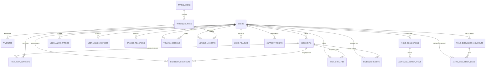

# Модель данных

## Описание

Источник истины для **AEM** — PostgreSQL 16. В базе 20 таблиц, они описывают
пользователей, их контент и ссылки на просмотр. Каталог тайтлов в базе не хранится:
он приходит из внешних сервисов, а в таблицах остаётся только внешний
идентификатор `anime_id`.

Документ фиксирует схему, ограничения целостности и причины денормализации.
Правила доступа — в [безопасности](security.md), порядок изменения схемы — в
[обслуживании](../03-ops/maintenance.md).

## Как это работает

### Связи между таблицами

`anime_id` во всех таблицах — внешний идентификатор тайтла (MAL/Shikimori).
Внешнего ключа на таблицу тайтлов нет, потому что такой таблицы нет: каталог
кэшируется в Redis с TTL.

### Таблицы по зонам

| Таблица | Назначение | Зона репозитория |
| --- | --- | --- |
| `users` | Аккаунты, хеш пароля, настройки приватности | `UserRepository` |
| `user_follows` | Подписки пользователя на пользователя | `UserRepository` |
| `favorites` | Снимок тайтла, добавленного в избранное | `FavoriteRepository` |
| `highlights` | Опубликованный хайлайт с таймкодами | `HighlightRepository` |
| `highlight_contexts` | Привязка хайлайта к источнику и озвучке | `HighlightRepository` |
| `highlight_comments` | Комментарии к хайлайту | `HighlightRepository` |
| `highlight_likes` | Лайки хайлайтов | `HighlightRepository` |
| `saved_highlights` | Сохранённые в личную ленту хайлайты | `HighlightRepository` |
| `anime_collections` | Пользовательская подборка тайтлов | `CollectionRepository` |
| `anime_collection_items` | Состав подборки | `CollectionRepository` |
| `translations` | Озвучка тайтла: название, тип, язык | `WatchRepository` |
| `watch_sources` | Ссылка на поток конкретной серии | `WatchRepository` |
| `viewing_sessions` | Позиция, громкость, качество в плеере | `WatchRepository` |
| `viewing_moments` | Черновик момента: таймкод и подпись | `MomentRepository` |
| `user_anime_statuses` | Статус просмотра и прогресс по серии | `WatchRepository` |
| `episode_reactions` | Реакция на таймкод эпизода | `ReactionRepository` |
| `user_anime_ratings` | Оценка тайтла | `RatingRepository` |
| `anime_discussion_comments` | Комментарий к тайтлу | `WatchRepository` |
| `anime_discussion_likes` | Лайк комментария к тайтлу | `WatchRepository` |
| `support_tickets` | Обращение в поддержку и статус доставки | `SupportRepository` |

### Пользователи и связи

| `users` | Тип | Ограничение | Смысл |
| --- | --- | --- | --- |
| `id` | `Integer` | PK, автоинкремент | Идентификатор |
| `email` | `String` | UNIQUE, NOT NULL | Логин и адрес доставки |
| `username` | `String(20)` | NOT NULL | Отображаемое имя |
| `password_hash` | `String` | NOT NULL | Хеш bcrypt, открытого пароля в базе нет |
| `avatar_url` | `String` | NULL | Ссылка на аватар |
| `status` | `String(80)` | NULL | Короткая подпись профиля |
| `show_watch_activity` | `Boolean` | NOT NULL | Показывать активность просмотра |
| `show_recent_episodes` | `Boolean` | NOT NULL | Показывать недавние серии |
| `created_at` | `DateTime` | NULL | Дата регистрации |

| `user_follows` | Тип | Ограничение | Смысл |
| --- | --- | --- | --- |
| `follower_user_id` | `Integer` | FK → `users.id`, CASCADE | Кто подписан |
| `followed_user_id` | `Integer` | FK → `users.id`, CASCADE | На кого подписан |
| — | — | UNIQUE(`follower_user_id`, `followed_user_id`) | Повторная подписка невозможна |

### Хайлайты и социальное взаимодействие

| `highlights` | Тип | Ограничение | Смысл |
| --- | --- | --- | --- |
| `user_id` | `Integer` | FK → `users.id`, CASCADE | Автор |
| `anime_id` | `Integer` | NOT NULL | Внешний идентификатор тайтла |
| `episode` | `Integer` | NOT NULL | Номер серии |
| `start_timestamp` | `Float` | NOT NULL | Начало отрезка, секунды |
| `end_timestamp` | `Float` | NOT NULL | Конец отрезка, секунды |
| `title` | `String(120)` | NOT NULL | Подпись хайлайта |
| `category` | `String(40)` | NULL | Категория сцены |
| `description` | `String` | NULL | Описание |
| `is_spoiler` | `Boolean` | NULL | Признак спойлера |
| `emotion` | `String` | NULL | Эмоция сцены |
| `likes_count` | `Integer` | NULL | Денормализованный счётчик |
| `views_count` | `Integer` | NULL | Денормализованный счётчик |
| `created_at` | `DateTime` | NULL | Дата публикации |

| `highlight_contexts` | Тип | Ограничение | Смысл |
| --- | --- | --- | --- |
| `highlight_id` | `Integer` | FK → `highlights.id`, CASCADE | Хайлайт |
| `watch_source_id` | `Integer` | FK → `watch_sources.id`, CASCADE | Источник, где сцена найдена |
| `translation_id` | `Integer` | FK → `translations.id`, CASCADE | Озвучка |
| `title`, `original_title` | `String` | `title` NOT NULL | Снимок названий на момент публикации |

Таблица `highlight_contexts` существует потому, что один и тот же момент звучит
по-разному в разных озвучках. Контекст хранит, в какой именно озвучке и на каком
источнике автор показывал сцену, — по нему плеер открывает хайлайт на той же
дорожке.

| Таблица | Колонки сверх ключей | Ограничение |
| --- | --- | --- |
| `highlight_likes` | `highlight_id`, `user_id`, `created_at` | UNIQUE(`highlight_id`, `user_id`) |
| `saved_highlights` | `highlight_id`, `user_id`, `saved_at` | UNIQUE(`highlight_id`, `user_id`) |
| `highlight_comments` | `highlight_id`, `user_id`, `content(600)`, `created_at` | Без уникальности: комментариев много |
| `anime_discussion_comments` | `anime_id`, `user_id`, `content(600)`, `created_at` | Без уникальности |
| `anime_discussion_likes` | `comment_id`, `user_id`, `created_at` | UNIQUE(`comment_id`, `user_id`) |

### Избранное и коллекции

| `favorites` | Тип | Ограничение | Смысл |
| --- | --- | --- | --- |
| `user_id` | `Integer` | FK → `users.id`, CASCADE | Владелец |
| `anime_id` | `Integer` | NOT NULL | Внешний идентификатор тайтла |
| `title`, `original_title` | `String` | NULL | Снимок названий |
| `description` | `String` | NULL | Снимок описания |
| `cover_url` | `String` | NULL | Снимок обложки |
| `genres_json` | `String` | NULL | Жанры в JSON: каталог отдаёт список |
| `added_at` | `DateTime` | NULL | Дата добавления |

Уникального ограничения на паре `user_id` + `anime_id` нет: интерфейс не предлагает
добавить тайтл дважды, и СУБД это не запрещает. При чтении дубликаты не
схлопываются, поэтому такое добавление остаётся обязанностью вызывающего кода.

| `anime_collections` | Тип | Ограничение |
| --- | --- | --- |
| `user_id` | `Integer` | FK → `users.id`, CASCADE |
| `title` | `String(80)` | NOT NULL |
| `description` | `String(400)` | NULL |
| `is_public` | `Boolean` | NOT NULL |
| `cover_url` | `String(500)` | NULL |

| `anime_collection_items` | Тип | Ограничение |
| --- | --- | --- |
| `collection_id` | `Integer` | FK → `anime_collections.id`, CASCADE |
| `anime_id` | `Integer` | NOT NULL |
| `title` | `String(120)` | NOT NULL |
| `original_title`, `description`, `cover_url`, `genres_json` | `String` | NULL |
| — | — | UNIQUE(`collection_id`, `anime_id`) |

### Просмотр и поток

| `translations` | Тип | Смысл |
| --- | --- | --- |
| `anime_id` | `Integer` | Внешний идентификатор тайтла |
| `name` | `String` | Название озвучки |
| `translation_type` | `String` | Тип: озвучка, субтитры, внешняя дорожка |
| `language` | `String` | Язык |
| `created_at` | `DateTime` | Когда запись появилась |

| `watch_sources` | Тип | Ограничение | Смысл |
| --- | --- | --- | --- |
| `anime_id` | `Integer` | NOT NULL | Тайтл |
| `episode` | `Integer` | NOT NULL | Серия |
| `translation_id` | `Integer` | FK → `translations.id`, CASCADE | Озвучка |
| `provider_name` | `String` | NOT NULL | Провайдер, который отдал ссылку |
| `source_name` | `String` | NOT NULL | Имя источника внутри провайдера |
| `stream_url` | `String` | NOT NULL | Ссылка на манифест или файл |
| `quality_label` | `String` | NOT NULL | Подпись качества |
| `source_type` | `String` | NOT NULL | `stream`, `embed` или `external` |

`source_type` определяет, как плеер обращается с ссылкой: `stream` идёт через
[медиа-прокси](../02-integrations-and-services/media-proxy.md), `embed` встраивается
как чужой плеер, `external` открывается переходом на сайт-источник.

| `viewing_sessions` | Тип | Ограничение | Смысл |
| --- | --- | --- | --- |
| `user_id` | `Integer` | FK → `users.id`, CASCADE | Зритель |
| `anime_id`, `episode` | `Integer` | NOT NULL | Место просмотра |
| `watch_source_id` | `Integer` | FK → `watch_sources.id`, CASCADE | Источник |
| `position_seconds` | `Float` | NOT NULL | Позиция в плеере |
| `volume` | `Float` | NOT NULL | Громкость |
| `quality_label` | `String` | NOT NULL | Выбранное качество |
| `is_paused` | `Boolean` | NOT NULL | Пауза |
| `updated_at` | `DateTime` | NULL | Время последнего сохранения |

| `viewing_moments` | Тип | Ограничение | Смысл |
| --- | --- | --- | --- |
| `user_id` | `Integer` | FK → `users.id`, CASCADE | Автор |
| `anime_id`, `episode` | `Integer` | NOT NULL | Место |
| `timestamp` | `Float` | NOT NULL | Один таймкод-метка |
| `watch_source_id` | `Integer` | FK → `watch_sources.id`, SET NULL | Источник исчезает — момент остаётся |
| `caption` | `String(200)` | NULL | Подпись |
| `sticker` | `String(40)` | NULL | Стикер |
| `screenshot_url` | `String` | NULL | Кадр |

`viewing_moments` — черновик момента с одной меткой; `highlights` — опубликованный
момент с интервалом `[start_timestamp, end_timestamp]`. Разница в модели
намеренная: черновик привязан к плееру, публикация — к сцене.

### Прогресс, реакции, оценки

| `user_anime_statuses` | Тип | Смысл |
| --- | --- | --- |
| `user_id` | `Integer`, FK → `users.id` CASCADE | Владелец |
| `anime_id` | `Integer` | Тайтл |
| `status` | `String` | Смотрю, просмотрено, отложено, брошено |
| `current_episode` | `Integer` | Текущая серия |
| `rating` | `Float` | Оценка из профиля статуса |
| `note` | `String(500)` | Заметка |
| `started_at`, `completed_at`, `last_watched_at`, `updated_at` | `DateTime` | Вехи |

| `episode_reactions` | Тип | Ограничение |
| --- | --- | --- |
| `user_id` | `Integer` | FK → `users.id`, CASCADE |
| `anime_id`, `episode` | `Integer` | NOT NULL |
| `reaction_type` | `String` | NOT NULL |
| `timestamp` | `Float` | NOT NULL |
| — | — | UNIQUE(`user_id`, `anime_id`, `episode`, `name=uq_episode_reaction`) |

| `user_anime_ratings` | Тип | Ограничение |
| --- | --- | --- |
| `user_id` | `Integer` | FK → `users.id`, CASCADE |
| `anime_id` | `Integer` | NOT NULL |
| `score` | `Integer` | NOT NULL |
| `rated_at` | `DateTime` | NULL |
| — | — | UNIQUE(`user_id`, `anime_id`) |

### Поддержка

| `support_tickets` | Тип | Ограничение | Смысл |
| --- | --- | --- | --- |
| `user_id` | `Integer` | FK → `users.id`, SET NULL | Гость может обратиться без аккаунта |
| `email` | `String(254)` | NOT NULL | Куда отвечать |
| `username` | `String(40)` | NOT NULL | Как обращаться |
| `subject` | `String(120)` | NOT NULL | Тема |
| `message` | `String(4000)` | NOT NULL | Текст |
| `channel` | `String(20)` | NOT NULL | Куда доставлено: почта или Telegram |
| `page_url` | `String(500)` | NULL | Страница, с которой пришло обращение |
| `status` | `String(20)` | NOT NULL | Состояние обращения |
| `delivery_status` | `String(20)` | NOT NULL | Результат внешней доставки |
| `delivery_error` | `String(500)` | NULL | Текст ошибки доставки |

`SET NULL` вместо `CASCADE` — сознательное решение: удаление аккаунта не должно
удалять историю обращений, по которой уже отвечали.

### Каскады

| Правило | Где | Что даёт |
| --- | --- | --- |
| `CASCADE` от `users` | Весь пользовательский контент | Удаление аккаунта не оставляет сирот |
| `CASCADE` от `highlights` | Комментарии, лайки, сохранения, контексты | Удаление хайлайта убирает обсуждение |
| `CASCADE` от `anime_collections` | Состав подборки | Подборка атомарна |
| `CASCADE` от `translations` | Источники и контексты | Озвучка и её ссылки живут вместе |
| `CASCADE` от `watch_sources` | Сессии просмотра | Плеер не хранит позицию для исчезнувшего источника |
| `SET NULL` от `watch_sources` | `viewing_moments` | Черновик момента переживает исчезновение ссылки |
| `SET NULL` от `users` | `support_tickets` | История поддержки сохраняется |

### Денормализация и почему она принята

| Поле | Источник истины | Зачем копия |
| --- | --- | --- |
| `favorites.title`, `cover_url`, `genres_json` | Каталог (Jikan, AniList) | Карточка избранного рисуется без запроса к внешнему API |
| `anime_collection_items.*` | Каталог | Подборка остаётся читаемой при недоступности каталога |
| `highlight_contexts.title`, `original_title` | Каталог | Хайлайт показывает то название, которое видел автор |
| `highlights.likes_count`, `views_count` | `highlight_likes`, просмотры | Лента не считает агрегат на каждый хайлайт |
| `users.show_watch_activity`, `show_recent_episodes` | Профиль | Приватность решается одним чтением строки |

Снимки не обновляются задним числом: изменившееся название тайтла в каталоге не
перепишет историю пользователя. Это осознанный размен: карточка может показать
устаревшее название, зато не зависит от внешнего сервиса.

### Индексы

Индекс есть на каждом внешнем ключе и на поле, по которому строится выборка
пользователя: `favorites.user_id`, `highlights.user_id`, `anime_collections.user_id`,
`user_follows.*`, `highlight_comments.highlight_id`, `highlight_likes.highlight_id`,
`saved_highlights.highlight_id`, `viewing_sessions.user_id`,
`viewing_sessions.watch_source_id`, `viewing_moments.user_id`,
`watch_sources.translation_id`, `highlight_contexts.*`, `support_tickets.user_id`,
`user_anime_ratings.user_id`, `user_anime_statuses.user_id`,
`episode_reactions.user_id`, `anime_discussion_comments.user_id`,
`anime_discussion_likes.*`, `anime_collection_items.collection_id`.

### Репозитории и единица работы

Девять портов репозиториев зарегистрированы в единице работы и достаются сценарием
через `uow.repository(Port)`; конкретный адаптер подбирается по таблице
`_REPOSITORY_TYPES`.

| Порт | Адаптер | Таблицы |
| --- | --- | --- |
| `UserRepository` | `UserRepository` | `users`, `user_follows` |
| `FavoriteRepository` | `FavoriteRepository` | `favorites` |
| `HighlightRepository` | `HighlightRepository` | `highlights` и четыре спутника |
| `CollectionRepository` | `CollectionRepository` | `anime_collections`, `anime_collection_items` |
| `WatchRepository` | `WatchRepository` | `translations`, `watch_sources`, `viewing_sessions`, `user_anime_statuses`, `anime_discussion_*` |
| `MomentRepository` | `MomentRepository` | `viewing_moments` |
| `RatingRepository` | `RatingRepository` | `user_anime_ratings` |
| `ReactionRepository` | `ReactionRepository` | `episode_reactions` |
| `SupportRepository` | `SupportRepository` | `support_tickets` |

## Почему это сделано так

- Каталог не персистится: метаданные тайтлов меняются у источника, и хранить их
  копию значило бы поддерживать синхронизацию без выгоды. В базе остаются только
  пользовательские снимки — избранное, подборки, хайлайты.
- `highlight_contexts` вынесена в отдельную таблицу, а не в колонки `highlights`:
  у одного хайлайта может быть несколько озвучек, и нормализация позволяет показать
  выбор без миграции.
- Черновик момента и публикация разведены по двум таблицам: у них разные владельцы
  в коде (`MomentRepository` и `HighlightRepository`) и разные жизненные циклы.
- Денормализованные счётчики оставлены, потому что лента читается на порядок чаще,
  чем ставятся лайки; расхождение чинится пересчётом, а не миграцией.
- `SET NULL` для поддержки и моментов — следствие продуктового правила: обращение и
  сохранённая сцена не должны исчезать вместе с источником.

## Где в коде

- `src/backend/infrastructure/database/models/<зона>/` — ORM-модели
- `src/backend/infrastructure/database/repositories/<зона>/` — адаптеры портов
- `src/backend/infrastructure/database/unit_of_work.py` — карта портов и адаптеров
- `src/backend/infrastructure/database/session.py` — фабрика сессии, `init_db`, `verify_schema`
- `migrations/versions/a0c0657fa309_initial_schema.py` — первичная схема
- `tests/integration/infrastructure/repositories/` — проверки репозиториев

## Связанные документы

- [Слои и правила](layers-and-rules.md)
- [Поток запроса](data-flow.md)
- [Безопасность](security.md)
- [Обслуживание: миграции и бэкапы](../03-ops/maintenance.md)
- [Провайдеры источников](../02-integrations-and-services/providers.md)
