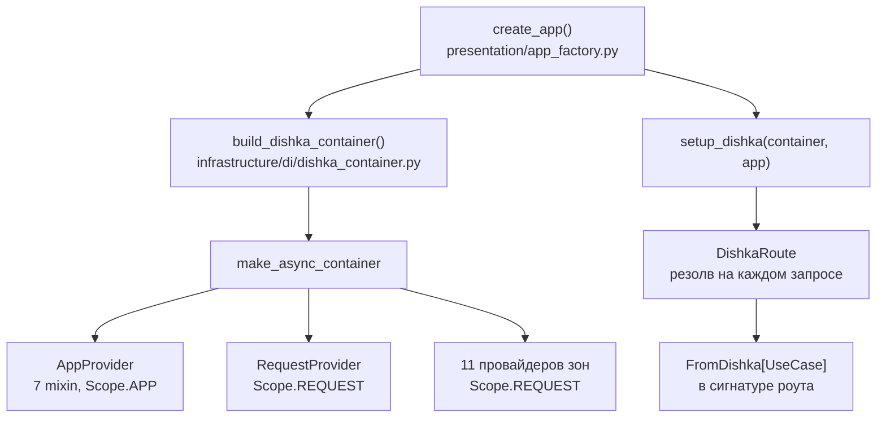
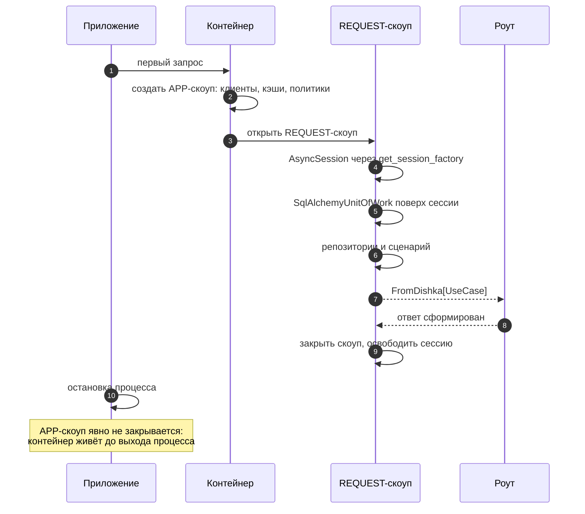

# DI на Dishka

## Описание

**AEM** собирает зависимости через Dishka — IoC-контейнер, который разрешает граф
объектов по запросу, а не по цепочке `Depends` в каждом маршруте. Документ
объясняет, как устроена композиция, почему выбран этот подход вместо встроенного
DI FastAPI и чем `Scope.APP` отличается от `Scope.REQUEST`.

Термины IoC, DI и DIP — в [глоссарии](../00-foundation/glossary.md). Правила
размещения провайдеров — в [слоях и правилах](layers-and-rules.md).

## Как это работает

### Точка сборки

Контейнер создаётся один раз, в композиционном корне приложения, и передаётся
FastAPI интеграции Dishka.

| Элемент | Роль |
| --- | --- |
| `build_dishka_container()` | Единственное место, где перечислены все провайдеры |
| `make_async_container(...)` | Создаёт асинхронный контейнер, поддерживающий `async`-провайдеры |
| `setup_dishka(container, app)` | Подменяет класс маршрута и подключает middleware закрытия скоупа |
| `DishkaRoute` | `route_class` роутеров: даёт доступ к `FromDishka` в сигнатурах |
| `FromDishka[Type]` | Просит у контейнера зависимость нужного типа |

Роутеры объявляются как `APIRouter(prefix="/favorites", route_class=DishkaRoute)`,
а сценарий приходит параметром `use_case: FromDishka[AddFavoriteUseCase]`.
Маршрут не знает, как сценарий создан, и не собирает его вручную.

### Почему не `FastAPI.Depends`

Встроенный механизм FastAPI решает задачу «получить объект в обработчике», но не
решает задачу «управлять временем жизни графа».

| Критерий | `FastAPI.Depends` | Dishka |
| --- | --- | --- |
| Граф зависимостей | Собирается руками в цепочке функций-провайдеров | Описывается типами: сигнатура запрашивает тип, контейнер находит провайдер |
| Скоупы | `yield`-зависимости и кэш на запрос; уровня приложения нет | Явные `APP` и `REQUEST`, REQUEST закрывается middleware гарантированно |
| Композиция | Зависит от порядка и от того, что объявлено в `dependencies=[...]` роутера | Один список провайдеров на всё приложение |
| Повторное использование | Каждый роутер переписывает свою цепочку | Сценарий один и тот же в HTML-роуте, JSON-роуте и тесте |
| Проверка графа | Ошибка в цепочке всплывает при первом запросе | Разрыв связи виден в тесте полноты графа: он резолвит каждый сценарий до выката |
| Замена в тестах | Через `app.dependency_overrides` | Заменой провайдера в контейнере |

Решающий аргумент — единый граф. В AEM около 120 провайдеров; держать их
согласованность через `Depends`-цепочки в 17 роутерах означало бы, что добавление
параметра в конструктор сценария ломает каждый маршрут, который его использует.

`Depends` в проекте остался ровно там, где он про HTTP, а не про объекты:
`Depends(require_self)` сверяет `user_id` из пути с сессией. Это проверка запроса,
а не сборка зависимости.

### Два скоупа

| Скоуп | Время жизни | Что живёт | Как закрывается |
| --- | --- | --- | --- |
| `Scope.APP` | От первого запроса до выхода процесса | HTTP-клиенты, кэши, JWT и CSRF, rate limiter, политики, хранилище изображений, health check | Явно не закрывается: `container.close()` в lifespan не вызывается, ресурсы освобождаются вместе с процессом |
| `Scope.REQUEST` | Один HTTP-запрос | Сессия БД, единица работы, репозитории, сервисы запроса, все сценарии | Контейнер закрывает скоуп после того, как ответ отдан |

Принцип разграничения простой: **скоуп определяется ресурсом, который нужно
освобождать**. Пул соединений и HTTP-клиент дорого создавать на каждый запрос —
это `APP`. Сессия SQLAlchemy не потокобезопасна и обязана умереть вместе с
запросом — это `REQUEST`.

Ранее созданная сессия не переиспользуется между запросами: `RequestProvider.session`
отдаёт `AsyncSession` через `AsyncIterator`, поэтому закрытие скоупа закрывает
сессию.

### Что где зарегистрировано

**`AppProvider`** — семь mixin-классов, каждый в своём модуле; сам `AppProvider`
только смешивает их, чтобы список провайдеров оставался коротким.

| Mixin | Провайдеров | Примеры |
| --- | --- | --- |
| `CacheProvidersMixin` | 6 | `KeyValueStore`, `RecommendationCache`, `WatchSourceCaches` |
| `ClientProvidersMixin` | 8 | `AnimeApiClient`, `KodikClient`, `AniLibriaClient`, `MediaProxyClient`, `FailoverLLMClient` |
| `VideoSourceProvidersMixin` | 9 | AnimeGo, SameBand, AniBoom, Hanime, Kinobox, HDRezka, Sibnet, Eporner, Hentaigasm |
| `SecurityProvidersMixin` | 10 | `PasswordService`, `JwtService`, `TokenBlocklist`, `CsrfService`, `RateLimiter`, `AccountLockService` |
| `PolicyProvidersMixin` | 7 | `RequestPolicy`, `CookiePolicy`, `ProxyTrustPolicy`, `ApiFeatureFlags` |
| `StorageProvidersMixin` | 2 | `ImageStorage`, `HealthCheck` |
| `NotificationProvidersMixin` | 5 | Почтовые отправщики, Telegram-уведомления, хранилище кодов подтверждения |

**`RequestProvider`** — фундамент запроса: сессия, единица работы, девять
репозиториев, `RecommendationService` и `WatchSourceSyncService`. Сценарии зон
живут в отдельных провайдерах, по одному на зону домена.

| Провайдер зоны | Провайдеров | Зона |
| --- | --- | --- |
| `AuthUseCaseProvider` | 10 | Регистрация, вход, токены, пароль |
| `HighlightUseCaseProvider` | 16 | Хайлайты, лента, комментарии, лайки |
| `WatchUseCaseProvider` | 10 | Просмотр, источники, сессии |
| `AnimeUseCaseProvider` | 10 | Каталог и карточка тайтла |
| `CollectionUseCaseProvider` | 5 | Коллекции |
| `FavoriteUseCaseProvider` | 4 | Избранное |
| `MomentUseCaseProvider` | 4 | Моменты просмотра |
| `RatingUseCaseProvider` | 2 | Оценки |
| `ReactionUseCaseProvider` | 2 | Реакции на эпизод |
| `UserUseCaseProvider` | 2 | Профиль и активность |
| `SupportUseCaseProvider` | 1 | Обращения в поддержку |

Итого 47 провайдеров уровня приложения и 80 уровня запроса.

### Алиасы портов

Иногда один объект нужен под двумя ключами: конкретным классом и абстракцией.

| Провайдер | Отдаёт |
| --- | --- |
| `anime_api_client_interface` | Тот же `AnimeApiClient` под `AnimeApiClientInterface` |
| `jwt_service_interface` | `JwtService` под портом |
| `csrf_service_interface` | `CsrfService` под портом |
| `token_blocklist_interface` | `TokenBlocklist` под портом |
| `rate_limiter_interface` | `RateLimiter` под портом |
| `user_repository_port` | `UserRepository` под `UserRepositoryPort` |

Алиас не создаёт второй экземпляр: провайдер принимает уже готовый объект и
возвращает его же. Так сценарий зависит от протокола, а инфраструктурный код
рядом может пользоваться конкретным классом, не дублируя состояние.

Остальные репозитории сценарии получают не через контейнер, а через единицу
работы: `uow.repository(FavoriteRepository)` возвращает экземпляр, привязанный к
текущей транзакции. Это гарантирует, что читатель и писатель работают в одной
сессии.

### Правила для нового провайдера

1. **Скоуп по ресурсу.** Есть `aclose`, пул или общий кэш — `APP`. Есть сессия,
   транзакция или данные запроса — `REQUEST`.
2. **Модуль по зоне.** Сценарии зоны — в `di/providers/<зона>.py`, инфраструктура —
   в тематический mixin.
3. **Конструктор без `Settings`.** Значения читаются в провайдере и передаются
   аргументами, чтобы сценарий оставался тестируемым без окружения.
4. **Один тип — один провайдер.** Два провайдера одного типа делают резолв
   неоднозначным: контейнер не знает, какой выбрать, и ошибка всплывает при
   первом запросе типа — её ловит тест полноты графа.
5. **Генератор, если ресурс нужно вернуть внутри скоупа.** Для `REQUEST`
   (сессия БД) — `AsyncIterator` с `yield` и освобождением после него: middleware
   дойдёт до `aclose()` даже при исключении в роуте. Для `APP`-ресурсов явный
   `aclose()` не пишется: контейнер при остановке не закрывается, поэтому в
   `APP` держат только то, чьё освобождение переживает выход процесса —
   HTTP-клиенты, пулы соединений, кэши.
6. **Регистрация в контейнере.** Новый провайдер попадает в
   `build_dishka_container()`; без этой строки он не существует для приложения.

## Почему это сделано так

- DI выбран ради тестируемости: домен и сценарии проверяются без базы и сети,
  потому что зависимость подставляется в конструктор, а не создаётся внутри.
- Единый контейнер убирает расхождение между HTML- и JSON-маршрутами: оба берут
  один и тот же сценарий из одного графа.
- `APP`-скоуп для HTTP-клиентов — это ещё и экономия: повторное создание
  TLS-соединений на каждый запрос к каталогу удваивало бы время ответа.
- Разделение провайдеров по зонам появилось после того, как один файл на 100+
  провайдеров стало невозможно читать: теперь диф правки фичи касается одного
  модуля.
- `setup_dishka` вместо ручного `request.state.container` — гарантия, что скоуп
  закроется даже при исключении в роуте.

## Где в коде

- `src/backend/infrastructure/di/dishka_container.py` — сборка контейнера
- `src/backend/infrastructure/di/providers/app.py` — `AppProvider` из mixin
- `src/backend/infrastructure/di/providers/{cache,clients,security,policies,storage,notifications,video_sources}.py` — провайдеры `APP`
- `src/backend/infrastructure/di/providers/request.py` — сессия, единица работы, сервисы
- `src/backend/infrastructure/di/providers/<зона>.py` — сценарии зон
- `src/backend/presentation/app_factory.py` — `setup_dishka` и `DishkaRoute` в роутерах
- `tests/integration/infrastructure/di/` — проверки сборки контейнера

## Связанные документы

- [Слои и правила](layers-and-rules.md)
- [Поток запроса](data-flow.md)
- [Обзор архитектуры](overview.md)
- [Модель данных](data-model.md)
- [ADR 0002: Dishka](../06-adr/0002-dishka-di.md)
- [Глоссарий](../00-foundation/glossary.md)
