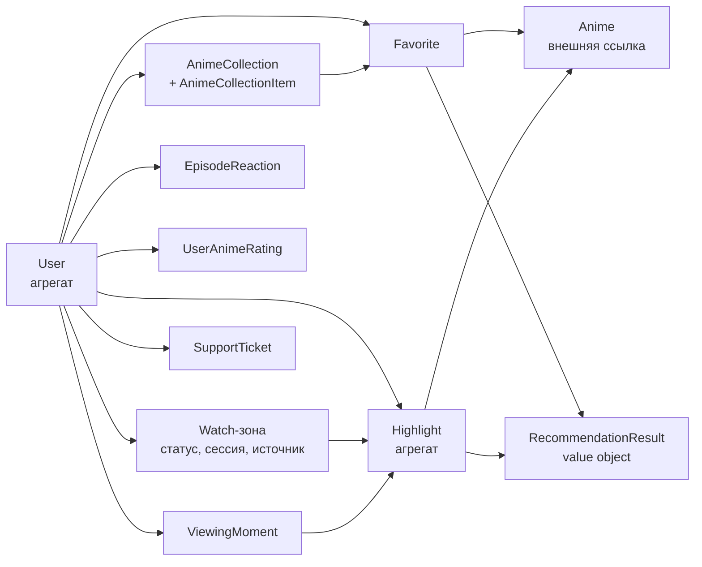

# Модель предметной области

## Описание

Документ описывает доменное ядро **AEM**: сущности и агрегаты, value objects,
политики, порты репозиториев и сервисов, иерархию доменных ошибок. Это
справочник «какое правило где живёт» для разработчика и для ревью.

Ключевой принцип предметной области: AEM **не хранит каталог аниме локально**.
В базе живут пользовательские данные (избранное, коллекции, хайлайты, моменты,
реакции, статусы просмотра, обращения), а метаданные тайтла приходят из внешних
API и сохраняются как snapshot там, где страница не должна ломаться от
недоступности провайдера.

Термины (Moment, Title, Episode, Provider, Smart Search) закреплены в
[глоссарии](../00-foundation/glossary.md); табличное представление схемы —
в [модели данных](data-model.md).

## Как это работает

### Карта домена



Зоны домена: `user`, `anime`, `favorite`, `collection`, `highlight`, `moment`,
`rating`, `reaction`, `watch`, `support`, `recommendation`. Общие модули —
`domain/exceptions.py`, `domain/clock.py`, `domain/policies/`.

### Агрегаты и сущности

Агрегат отличается от сущности тем, что у него есть инвариантная граница или
дети: `User`, `Highlight`, `AnimeCollection` лежат в `domain/aggregates/`,
остальное — в `domain/entities/`.

| Имя | Файл | Роль | Инварианты и поведение |
| --- | --- | --- | --- |
| `User` | `aggregates/user/user.py` | учётные данные, профиль, видимость активности | email проверяется по `EMAIL_PATTERN` из `user_credentials_policy`, имя — диапазон `3–20`, пароль только в виде `password_hash`; статус профиля не длиннее `STATUS_MAX_LENGTH = 80`, иначе `ValidationError`; методы `update_avatar`, `change_username`, `change_status`, `toggle_watch_activity_visibility`, `toggle_recent_episodes_visibility` |
| `Highlight` | `aggregates/highlight/highlight.py` | момент серии, снятый пользователем: `anime_id`, `episode`, `start_timestamp`, `end_timestamp`, `title`, `category`, `description`, `emotion`, `is_spoiler`, счётчики `likes_count`/`views_count` | `episode >= 1` и `start_timestamp < end_timestamp`, иначе `ValidationError` (проверяется и в конструкторе, и в `edit()`); `ensure_editable_by` бросает `AuthorizationError`, если пользователь не автор; пустые `category`/`emotion` нормализуются в `None` |
| `AnimeCollection` | `aggregates/collection/collection.py` | коллекция тайтлов: `title`, `description`, `is_public` | элемент коллекции — отдельная сущность `AnimeCollectionItem` со snapshot-метаданными; уникальность пары `(collection_id, anime_id)` обеспечивает схема БД |
| `Anime` | `entities/anime/anime.py` | внешняя ссылка на тайтл: `external_id`, `title`, `original_title`, `description`, `genres`, `year`, `rating`, `cover_url`, `episode_count` | `mal_id` возвращает числовой Shikimori/MAL-идентификатор либо `None` для нечисловых (`AniList`); `is_adult` опирается на `has_adult_genres` и набор `ADULT_GENRE_MARKERS`; `add_genre`/`remove_genre` идемпотентны |
| `Favorite` | `entities/favorite/favorite.py` | отметка «в избранном» со snapshot карточки (`title`, `description`, `cover_url`, `genres`, `original_title`) | snapshot нужен, чтобы страница избранного работала при недоступном внешнем API; `added_at` берётся из `domain/clock.utc_now` |
| `ViewingMoment` | `entities/moment/viewing_moment.py` | черновик хайлайта, снятый во время просмотра: `timestamp`, `caption`, `sticker`, `screenshot_url`, `watch_source_id` | жизненный цикл `draft → publish_viewing_moment → Highlight` либо удаление; отдельная таблица нужна, чтобы захват не создавал мусорных публикаций |
| `UserAnimeRating` | `entities/rating/anime_rating.py` | оценка тайтла пользователем | порт `RatingRepository` и ограничение схемы на пару `(user_id, anime_id)` |
| `EpisodeReaction` | `entities/reaction/episode_reaction.py` | реакция на момент эпизода, тип — `EpisodeReactionType` | один тип на `(user_id, anime_id, episode)` обеспечивает уникальность схемы; эмодзи-отображение — `EpisodeReactionEmoji` в `value_objects/reaction/reaction_type.py` |
| `SupportTicket` | `entities/support/support_ticket.py` | обращение в поддержку: `email`, `username`, `subject`, `message`, `channel`, `page_url`, `status`, `delivery_status`/`delivery_error` | канал и поля нормализует и проверяет `policies/support_ticket_policy.py`; `delivery_*` — результат доставки уведомления админам |
| Watch-зона | `entities/watch/` | пять сущностей просмотра | `UserAnimeStatus` (статус тайтла, текущая серия, даты, оценка, заметка), `Translation` (озвучка: имя, тип, язык), `WatchSource` (источник серии: `provider_name`, `source_name`, `stream_url`, `quality_label`, `source_type`; имена нормализуются в конструкторе), `ViewingSession` (состояние плеера: позиция не отрицательная, громкость в `[0, 1]`, серия не меньше первой), `HighlightContext` (привязка хайлайта к источнику и озвучке, чтобы шареная ссылка открывала нужный плеер) |

### Value objects

Неизменяемые read-модели без идентичности: сценарии возвращают их вместо
«сырых» словарей, чтобы форма ответа была типизирована и кэшируема.

| Зона | Классы |
| --- | --- |
| `highlight` | `HighlightCard`, `HighlightStats`, `HighlightLikeUser`, `HighlightCommentItem`, `HighlightEngagement`, `HighlightDashboard`, `HighlightFeedPage`, `HighlightAnimeGroup`, `HighlightProfileSummary`, `HighlightActivityItem` |
| `user` | `SmartProfile`, `GenreAffinity`, `ProfileMoodInsight`, `TopAnimeEntry`, `ViewingHeatmapCell`, `AchievementBadge`, `ProfileLevel`, `ProfileOverview`, `RecentEpisodeCard`, `UserRatingCard`, `FollowUserCard`, `PublicProfileOverview`, `PendingEmailVerification` |
| `watch` | `WatchPageData`, `WatchSourceCard`, `WatchHighlightCard`, `WatchedAnimeStat`, `DiaryEntry`, `ViewingHeatmapPoint`, `TranslationEpisodeCount`, `DiscoveredWatchSource`, `TranslationEpisodeAvailability` |
| `anime` | `CatalogPage`, `GenreFacet`, `GenreFilter`, `GenreMatchMode`, `SearchAnimeByDescriptionResult`, `AnimeDiscussionBoard`, `AnimeDiscussionComment` |
| `collection` | `CollectionCard`, `CollectionItemCard`, `CollectionDetails` |
| `favorite` | `FavoriteAnimeCard` |
| `reaction` | `EpisodeReactionType`, `EpisodeReactionEmoji`, `EpisodeReactionCount`, `EpisodeReactionSummary` |
| `recommendation` | `RecommendationResult`, `CandidateScore` |

`DiscoveredWatchSource` — результат работы провайдера до превращения в
`WatchSource`: именно его возвращает порт `WatchSourceProviderInterface`
(подробности — в [провайдерах источников](../02-integrations-and-services/providers.md)).

### Политики

Политики — правила, которые продукт меняет чаще, чем инварианты сущностей.
Все лежат в `domain/policies/` и не знают ни о базе, ни о HTTP.

| Модуль | Что решает |
| --- | --- |
| `highlight_policy.py` | `HighlightPolicy.GUEST_MAX_PER_HOUR = 5` — лимит хайлайтов для гостя (`can_add_highlight`); `is_content_allowed` — поиск запрещённых паттернов по границам слов («математика» не нарушение); `should_hide_spoiler` |
| `anime_safety_policy.py` | `AnimeSafetyPolicy.has_explicit_adult_intent` — маркеры 18+ в запросе, `is_probably_nsfw` — фильтр карточек, `suggest_title_hints` — извлечение подсказок названия из описания |
| `anime_season_policy.py` | `season_of(moment)` — сезон по дате (для ранжирования и шаблонов выдачи) |
| `email_verification_policy.py` | `generate_verification_code` — код подтверждения через `secrets.randbelow`, `normalize_theme` — тема письма |
| `user_credentials_policy.py` | `EMAIL_PATTERN`, границы длины имени, `normalize_email`, `normalize_username` |
| `support_ticket_policy.py` | нормализация и валидация полей обращения: email, username, subject, message, channel, `page_url` |
| `user_profile_policy.py` | «умный профиль»: `compute_hours_watched`, `rank_top_anime`, `compute_profile_level`, `build_genre_affinities`, `detect_profile_mood`, `build_achievement_badges` |
| `watch_policy.py` | статусы просмотра, нормализация и каноническое имя озвучки, `get_translation_priority`, `quality_rank`, `source_type_priority` |
| `recommendation_policy.py` + `recommendation_lexicon.py` | скоринг кандидатов (`score_candidate`, `score_term_overlap`, `score_taste_similarity`), план поиска (`build_search_plan`, `search_limit_for`), причина рекомендации, финальная сортировка; словарь (нормализация терминов, стоп-слова) отделён от скоринга |

Именование здесь последовательное не везде: `HighlightPolicy` и
`AnimeSafetyPolicy` — классы со `@staticmethod`, остальные политики — модульные
функции. Это историческое исключение, а не правило: новый модуль с несколькими
связанными правилами оформляется классом `<Область>Policy`.

### Порты

Порт — контракт в прикладном слое; реализация живёт в инфраструктуре.

| Группа | Файлы | Контракт |
| --- | --- | --- |
| Репозитории | `application/interface/repositories/` | девять ABC по одному на агрегат: `UserRepository`, `HighlightRepository`, `FavoriteRepository`, `CollectionRepository`, `MomentRepository`, `RatingRepository`, `ReactionRepository`, `SupportRepository`, `WatchRepository`. Методы асинхронные и говорят на языке домена (`add(highlight)`, `get_by_email(...)`), терминов SQLAlchemy не содержат |
| Граница транзакции | `application/interface/unit_of_work.py` | `UnitOfWorkInterface`: контекст-менеджер транзакции и метод `repository(Port)` |
| Технические службы | `application/interface/services/` | `PasswordServiceInterface`, `JWTServiceInterface`, `TokenBlocklistInterface`, `CSRFServiceInterface`, `RateLimiterInterface`, `AccountLockServiceInterface`, `EmailVerificationStoreInterface`, `EmailVerificationMailerInterface`, `PasswordResetMailerInterface`, `SupportEmailMailerInterface`, `TelegramSupportNotifierInterface`, `ImageStoragePort`, `HealthCheckPort`, `TTLCacheInterface`, `RecommendationCacheInterface`, `HighlightDashboardCacheInterface`, `ProfileOverviewCacheInterface`, `AnimeApiClientInterface`, `LLMClientInterface`, `WatchSourceProviderInterface`, `WatchSourceSyncServiceInterface`, `RecommendationServiceInterface` |

Сценарии получают репозитории через единицу работы, а не из контейнера: так
читатель и писатель гарантированно работают в одной сессии. Исключение —
`UserRepository`: он нужен middleware аутентификации вне транзакции сценария,
поэтому опубликован портом `user_repository_port`.

### Доменные ошибки

```
DomainError (domain/exceptions.py)
├── NotFoundError
├── ValidationError
│   ├── InvalidEmailError   (aggregates/user/exceptions.py)
│   └── InvalidUsernameError (aggregates/user/exceptions.py)
├── AuthenticationError
│   └── InvalidTokenError
├── AuthorizationError
├── DuplicateError
└── ExternalServiceError
```

Все ошибки агрегатов и сущностей находятся в этой иерархии: отказ вида «email не
проходит проверку» — это `ValidationError`, поэтому представление различает его
по типу и отвечает `400`, а не разбирает текст сообщения. В `domain/exceptions.py`
документировано иерархическое положение каждого класса; свои ошибки вне неё в
домене запрещены.

## Почему это сделано так

**Snapshot вместо live-данных.** Избранное, коллекции и карточки хайлайтов
хранят снимок метаданных тайтла, потому что внешние API лимитированы и
нестабильны: пользовательская страница обязана открываться, когда провайдер
лежит.

**Хайлайты, избранное и watch-state — активы, а не кэш.** Это то, ради чего
возвращаются, поэтому они первоклассные агрегаты с репозиториями и
миграциями, а не производные структуры.

**Инварианты в конструкторе.** Нельзя получить `Highlight` с `end_timestamp`
меньше `start_timestamp`, минуя правило: защита на уровне типа, а не на
дисциплине вызывающего кода.

**Политики отдельно от сущностей.** Лимит гостя и age-gate меняются по
продуктовому решению и часто; их правка не должна затрагивать инварианты
агрегата, а чистая функция проверяется без сборки объекта.

**Порты технических служб в прикладном слое.** Сценарий зависит от контракта
«отправщик письма», а не от SMTP: реализация подставляется DI-контейнером,
поэтому тест сценария не поднимает сеть, а замена провайдера не трогает логику.

**Время через `domain/clock.utc_now`.** Домен не вызывает `datetime.utcnow`
напрямую, чтобы правило можно было проверить с фиксированным временем.

**Рекомендации из собственного поведения.** Они строятся по избранному и текстам
хайлайтов пользователя, а не по глобальной популярности: продукт персонален
даже без ML-модели.

## Где в коде

- `src/backend/domain/aggregates/{user,highlight,collection}/` — корни агрегатов
- `src/backend/domain/entities/{anime,favorite,moment,rating,reaction,support,watch,collection}/` — сущности
- `src/backend/domain/value_objects/<зона>/` — неизменяемые read-модели
- `src/backend/domain/policies/` — бизнес-правила, отделённые от сущностей
- `src/backend/domain/exceptions.py` — иерархия доменных ошибок
- `src/backend/domain/clock.py` — источник текущего времени
- `src/backend/application/interface/` — порты репозиториев, сервисов и границы транзакции

## Связанные документы

- [Глоссарий](../00-foundation/glossary.md)
- [Видение продукта](../00-foundation/product-vision.md)
- [Слои и правила](layers-and-rules.md)
- [Модель данных](data-model.md)
- [Поток запроса](data-flow.md)
- [DI на Dishka](di-dishka.md)
- [Умный поиск](../02-integrations-and-services/llm-search.md)
- [Как добавить фичу](../04-dev-guide/feature-workflow.md)
