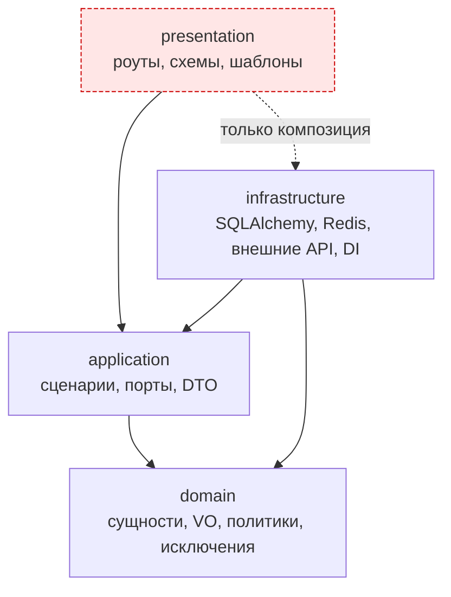

# Слои и правила архитектуры

## Описание

**AEM** построен по Clean Architecture: четыре слоя, зависимости направлены
внутрь, домен ничего не знает о внешнем мире. Документ фиксирует, что каждому
слою можно, что нельзя, и как эти границы удерживаются автоматически, а не на
честном слове.

Термины слоёв — в [глоссарии](../00-foundation/glossary.md).

## Как это работает

### Четыре слоя

| Слой | Ответственность | Что разрешено | Что запрещено | Примеры |
| --- | --- | --- | --- | --- |
| **domain** | Бизнес-правила и типы предметной области | Стандартная библиотека, `dataclasses`, `abc`, `datetime` | FastAPI, SQLAlchemy, Redis, httpx, Pydantic, любые адаптеры | `domain/entities/highlight/`, `domain/policies/`, `domain/exceptions.py` |
| **application** | Сценарии и порты | Домен, порты, DTO, `asyncio`, `logging`, `dataclasses` | SQLAlchemy, Redis, httpx, FastAPI-роуты, конкретные адаптеры | `application/use_cases/`, `application/interface/`, `application/services/` |
| **infrastructure** | Адаптеры: база, кэш, внешние API, DI | Всё, что нужно для интеграции, включая application и domain | Роуты и Pydantic-схемы ответов presentation | `infrastructure/database/`, `infrastructure/external/`, `infrastructure/di/` |
| **presentation** | HTTP, HTML, схемы, middleware | Application (сценарии и DTO), FastAPI, Jinja2; инфраструктуру — только в композиционном корне | Обращение к репозиториям и сессиям БД напрямую | `presentation/api/v1/`, `presentation/api/requests/`, `presentation/app_factory.py` |

### Направление зависимостей



Стрелка означает «знает о». Обратных стрелок быть не может: домен не импортирует
application, application — infrastructure, infrastructure — presentation.
Пунктир `presentation → infrastructure` разрешён только в двух местах, оба
перечислены ниже.

### Чем удерживаются границы

Контракты описаны в `pyproject.toml` и проверяются import-linter за один проход.

| Контракт | Тип | Смысл |
| --- | --- | --- |
| `Layer Boundaries` | `layers` | Порядок `presentation → infrastructure → application → domain`: слой знает только нижележащие |
| `Presentation does not reach Infrastructure` | `forbidden` | Прямой импорт `backend.infrastructure` из `backend.presentation` запрещён, косвенные цепочки не проверяются |

Проверка:

```bash
uv run python scripts/check_imports.py
```

Скрипт делает то же, что `uv run lint-imports`, но сам добавляет `src` в путь
импорта, поэтому команда одинаково работает в любой ОС. Оба варианта есть в CI.

Два исключения из второго контракта намеренно оставлены и обоснованы в
[importlinter-baseline.md](importlinter-baseline.md):

| Исключение | Причина |
| --- | --- |
| `presentation.api.v1.watch_route.media_proxy → infrastructure.external.video.hls_proxy` | Ответ проксируемого потока — это HTTP-транспорт Starlette. Порт в application не может его описать, не протащив HTTP-типы в прикладной слой |
| `presentation.app_factory → infrastructure.di.dishka_container` | Композиционный корень: собрать контейнер зависимостей может только точка входа приложения |

### Осознанные пересечения границ

Не всё, что похоже на нарушение, является нарушением. Ниже — места, где граница
пересечена сознательно, с причиной.

| Место | Что происходит | Почему это принимается |
| --- | --- | --- |
| `from starlette import status` в сценариях | Application использует константы HTTP-статусов из Starlette | Согласованный компромисс: сценарий возвращает `UseCaseResult` с `status_code`, а переписывать коды в собственный словарь ради формальной чистоты признано нецелесообразным. Замена библиотеки не планируется |
| `presentation/api/v1/watch_route/media_proxy.py` | Роут сам отдаёт `StreamingResponse` из HLS-адаптера | Прокси — это транспортная операция: разбор манифеста и стриминг живут рядом с HTTP-ответом, порт в application был бы фиктивным |
| `presentation/app_factory.py` | Импортирует контейнер Dishka | Композиционный корень — единственное место, где слои соединяются |
| `presentation/security_helpers.py` | Работает с `RequestPolicy`, `CookiePolicy` из application | Политика — часть контракта приложения; представление лишь применяет её к заголовкам |
| `events/lifecycle.py` | Lifespan вызывает `init_db` и `verify_schema` из infrastructure | Запуск процесса — операция уровня композиции, а не сценарий пользователя |

Импорт `Settings` из `config` в presentation разрешён только там, где значение
нужно до создания контейнера: `app_factory.py`, `api/v1/auth/session.py`,
`api/v1/auth/token.py`, `api/v1/auth/google.py`, `api/v1/support_route.py`. В остальных местах
настройка приходит через порт или провайдер.

### Правила размещения кода

| Что появляется | Куда | Признак правильного места |
| --- | --- | --- |
| Новое бизнес-правило, инвариант, формула | `domain/policies/` или метод сущности | Можно протестировать без базы, сети и HTTP |
| Новая сущность или value object | `domain/entities/<зона>/`, `domain/value_objects/<зона>/` | Не содержит `await` и не знает про сессию |
| Новый вариант использования | `application/use_cases/<зона>/` | Начинается с `Command`/`Query`, возвращает `UseCaseResult` или доменный тип |
| Нужен доступ к данным | Порт в `application/interface/repositories/` | Порт описывает только методы, которые реально вызываются |
| Нужен внешний сервис | Порт в `application/interface/services/` | Ни в сигнатурах, ни в типах нет типов фреймворков |
| Реализация порта | `infrastructure/database/repositories/` или `infrastructure/external/` | Класс наследует порт и живёт в своей зоне |
| Новый HTTP-маршрут | `presentation/api/v1/<зона>_route.py` или пакет `presentation/api/v1/<зона>/` | Тонкий: разобрать вход, вызвать сценарий, собрать ответ; в пакете функции разнесены по сценариям, а роутер собран в `__init__.py` |
| Новая схема ответа | `presentation/api/responses/` | Участвует в контракте OpenAPI |
| Новая зависимость в контейнере | `infrastructure/di/providers/` | Скоуп соответствует времени жизни |

### Правило единицы работы

Транзакцией владеет сценарий, а не сервис и не репозиторий.

| Кто | Что делает |
| --- | --- |
| Сценарий | Открывает `async with self._uow as uow:` и работает с репозиториями внутри |
| Прикладной сервис | Получает `unit_of_work` параметром и пишет через него — своей транзакции не открывает |
| Репозиторий | Никогда не коммитит: только добавляет, читает, удаляет внутри чужой транзакции |

Причина в том, что сервис, открывший собственный контекст, коммитит раньше
вызывающего сценария, и последующие ошибки сценария уже не откатывают запись.
Именно так выглядела ошибка потери данных в синхронизации источников просмотра,
закрытая регрессионным тестом.

### Что считается ревью-блокером

1. Импорт адаптера из сценария или домена.
2. Запрос к базе в обход репозитория и единицы работы.
3. Открытие транзакции внутри прикладного сервиса.
4. Бизнес-правило, спрятанное в роуте или в SQL-запросе.
5. Новый `ignore_imports` в `pyproject.toml` без записи в
   [importlinter-baseline.md](importlinter-baseline.md).
6. Порт, объявляющий метод, который никто не вызывает.

## Почему это сделано так

- Домен выделен, потому что правила моментов, озвучек и рекомендаций меняются по
  продуктовым причинам, а не по причинам фреймворка. Изоляция позволяет менять их,
  не трогая HTTP и SQL.
- Порты живут в **application**, а не в domain: контракт «дай мне источники
  серии» — это потребность сценария, а не свойство сущности.
- Граница `presentation → infrastructure` закрыта, потому что иначе роут начинает
  ходить в базу напрямую, и транзакция перестаёт быть предсказуемой.
- Два исключения оставлены явно вместо ослабления контракта: список из двух строк
  виден на ревью, а `allow_indirect_imports` держит проверку дешёвой.

## Где в коде

- `pyproject.toml` — контракты `[tool.importlinter]`
- `scripts/check_imports.py` — переносимая проверка границ
- `src/backend/application/interface/` — порты
- `src/backend/infrastructure/di/` — единственное место сборки графа объектов
- `src/backend/presentation/app_factory.py` — композиционный корень

## Связанные документы

- [Обзор и C4](overview.md)
- [Поток запроса](data-flow.md)
- [DI на Dishka](di-dishka.md)
- [Обоснование исключений import-linter](importlinter-baseline.md)
- [Соглашения разработки](../04-dev-guide/conventions.md)
- [ADR 0001: Clean Architecture](../06-adr/0001-clean-architecture.md)
