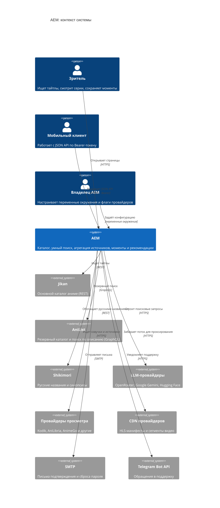
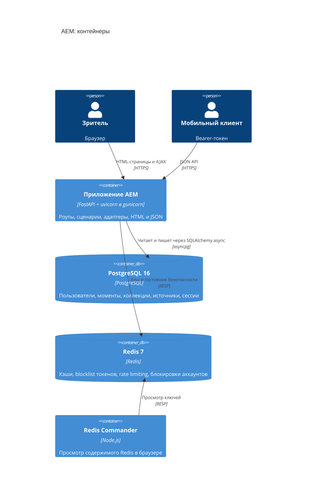

# Обзор архитектуры AEM

## Описание

Документ показывает **AEM** в двух масштабах: C4 Context — какие внешние системы
влияют на продукт, и C4 Container — из каких исполняемых частей состоит система.
Детали слоёв описаны в [слоях и правилах](layers-and-rules.md), порядок
прохождения запроса — в [потоке запроса](data-flow.md).

## Как это работает

### C4 Context

### C4 Container

### Внешние системы и их роль

| Система | Роль в AEM | Отказ приводит к |
| --- | --- | --- |
| Jikan | Основной источник карточек каталога и сезонных подборок | Переключению на AniList |
| AniList | Резервный каталог и поиск по описанию (GraphQL) | Пустой выдаче с коротким TTL-кэшем и подсказке повторить |
| Shikimori | Русские названия, синопсисы, `mal_id` для адресации | Карточкам без русского названия |
| OpenRouter, Gemini, Hugging Face | Превращение описания сцены в поисковые запросы; описание вкусов | Поиску по ключевым словам без LLM, см. [умный поиск](../02-integrations-and-services/llm-search.md) |
| Kodik, AniLibria и остальные провайдеры | Озвучки, качества и ссылки на поток | Меньшему числу доступных источников, страница продолжает работать |
| CDN провайдеров | HLS-манифесты и сегменты | Ошибке `stream_unavailable` в плеере |
| SMTP, Telegram Bot API | Подтверждение почты, сброс пароля, поддержка | Локальной записи события без внешней доставки |

### Компоненты внутри контейнера приложения

| Компонент | Ответственность | Где |
| --- | --- | --- |
| Точка входа ASGI | Создание приложения, lifespan, монтирование статики | `presentation/app_factory.py`, `main.py` |
| Middleware-цепочка | Лимит тела, проверка origin, пользователь, CSRF, заголовки, логирование | `presentation/app_factory.py`, `presentation/security_helpers.py` |
| Роуты JSON API и страниц | Перевод HTTP в `Command`/`Query` и обратно в ответ | `presentation/api/v1/` |
| Схемы запросов и ответов | Валидация входа и контракт OpenAPI | `presentation/api/requests/`, `presentation/api/responses/` |
| Шаблоны страниц | HTML-представление | `src/frontend/templates/`, `presentation/web/` |
| Сценарии | Варианты использования по зонам домена | `application/use_cases/` |
| Прикладные сервисы | Рекомендации, синхронизация источников, кэши | `application/services/` |
| Порты | Абстракции репозиториев, сервисов и единицы работы | `application/interface/` |
| Домен | Сущности, value objects, политики, исключения | `domain/` |
| Адаптеры хранения | SQLAlchemy-модели и репозитории, единица работы | `infrastructure/database/` |
| Адаптеры внешнего мира | Каталог, LLM, провайдеры, медиа-прокси, почта, Telegram | `infrastructure/external/`, `infrastructure/notifications/` |
| Кэши и состояние | TTL-кэши, blocklist, rate limiter, блокировки аккаунтов | `infrastructure/cache/`, `infrastructure/security/` |
| Композиция зависимостей | Контейнер Dishka и провайдеры по зонам | `infrastructure/di/` |
| Конфигурация | `Settings` и секции переменных окружения | `config/` |

### Границы и инварианты

1. **Приложение не хранит видео.** В базе лежат ссылки на источники; поток
   проходит через [медиа-прокси](../02-integrations-and-services/media-proxy.md)
   и не оседает на диске.
2. **Каталог не персистится.** Карточки тайтлов приходят из Jikan и AniList с
   TTL-кэшем; в базе остаются только пользовательские снимки (избранное).
3. **Приложение stateless.** Состояние сессии — подписанная cookie, состояние
   безопасности и кэши — в Redis. Поэтому воркеров можно масштабировать без
   sticky-сессий.
4. **Один экземпляр БД — источник истины.** Схема меняется только через Alembic;
   `DATABASE_AUTO_INIT` выключен по умолчанию.
5. **Внешняя зависимость не роняет базовый сценарий.** У каталога, LLM и Redis есть
   резервные пути.

### Нефункциональные характеристики

| Свойство | Значение | Откуда |
| --- | --- | --- |
| Модель исполнения | Полностью асинхронная: `asyncio`, SQLAlchemy async, httpx | `pyproject.toml`, `infrastructure/database/session.py` |
| Воркеры | 2 процесса gunicorn с `UvicornWorker` по умолчанию | `GUNICORN_WORKERS`, `scripts/entrypoint.sh` |
| Лимит тела запроса | 1 МиБ | `MAX_REQUEST_BYTES` |
| Время жизни access-токена | 30 минут | `ACCESS_TOKEN_EXPIRE_MINUTES` |
| Кэш каталога | 5 минут на результаты поиска, 15 минут на сезонные подборки | `infrastructure/external/catalog/anime_api_client.py` |
| Кэш доступности озвучек | 30 минут | `application/services/watch_source_service.py` |
| Готовность | `/ready` проверяет БД и включённые зависимости, `/health` — только процесс | `presentation/api/v1/health_route.py` |

## Почему это сделано так

- C4 выбран потому, что проект читают и разработчики, и владелец: первый уровень
  объясняет систему без кода, второй — без чтения слоёв.
- Каталог, LLM и провайдеры вынесены за границу системы намеренно: AEM не
  претендует на роль первоисточника метаданных и не дублирует чужие базы.
- Монитор Redis (Redis Commander) включён в Compose как инструмент эксплуатации, а
  не как часть продукта: в продакшене его порт закрывается сетевыми правилами.

## Где в коде

- `src/backend/main.py` — ASGI-приложение для gunicorn и uvicorn
- `src/backend/presentation/app_factory.py` — сборка приложения
- `src/backend/infrastructure/di/dishka_container.py` — композиция зависимостей
- `src/backend/infrastructure/external/catalog/anime_api_client.py` — фасад каталога
- `src/backend/application/services/watch_source_service.py` — агрегация провайдеров
- `docker-compose.yml`, `Dockerfile`, `scripts/entrypoint.sh` — контейнеры и запуск

## Связанные документы

- [Слои и правила](layers-and-rules.md)
- [Модель предметной области](domain-model.md)
- [Поток запроса](data-flow.md)
- [DI на Dishka](di-dishka.md)
- [Модель данных](data-model.md)
- [Развёртывание](../03-ops/deployment.md)
- [Видение продукта](../00-foundation/product-vision.md)
