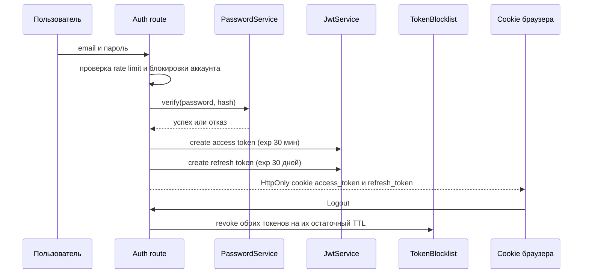

# Безопасность

## Описание

Документ фиксирует, что в **AEM** защищено и по какому механизму, а что осознанно
оставлено на следующую итерацию. Цель — точность: каждый пункт подтверждён кодом
и тестом, а не намерением.

Общая картина запроса — в [потоке запроса](data-flow.md), правила доступа к
данным — в [модели данных](data-model.md).

## Как это работает

### Модель доступа

В AEM две схемы аутентификации, и обе проходят через один код проверки.

| Схема | Кто использует | Где токен | Проверка |
| --- | --- | --- | --- |
| Cookie | Браузер | `access_token`, `HttpOnly` | Подпись, срок, blocklist |
| Bearer | Мобильный клиент | Заголовок `Authorization` | Подпись, срок, blocklist |

`resolve_access_token` — единственная точка разбора: если заголовок `Authorization`
содержит Bearer, побеждает он, иначе читается cookie. Дальше путь общий:
`TokenBlocklist` → `JWTService.decode_token` → `UserRepository.get_by_id`.
Поэтому отзыв токена одинаково работает для обеих схем, а отказ отличается только
тем, что для cookie дополнительно ставится признак очистки.

### Поток входа



Продление — `POST /api/v1/auth/token/refresh`: refresh-токен однократно потребляется
через `TokenBlocklist.consume`, поэтому повторный обмен того же значения невозможен.
Выход — `POST /api/v1/auth/token/revoke`.

### Cookie и токены

| Переменная | Значение по умолчанию | Смысл |
| --- | --- | --- |
| `ACCESS_TOKEN_EXPIRE_MINUTES` | 30 | Срок жизни access-токена |
| `REFRESH_TOKEN_EXPIRE_DAYS` | 30 | Срок жизни refresh-токена |
| `COOKIE_SECURE` | 0 | Флаг `Secure`; включает HSTS |
| `COOKIE_SAMESITE` | `Lax` | Политика `SameSite` |
| `COOKIE_DOMAIN` | не задан | Домен cookie |
| `HSTS_MAX_AGE` | 63072000 | `max-age` для HSTS |
| `SECRET_KEY` | не задан | Ключ подписи токенов и сессии |

Cookie всегда ставится с `HttpOnly` и `path=/`; `Secure` и `SameSite` берутся из
политики. `SECRET_KEY` обязателен при `APP_DEBUG=0`: `secret_key()` выбрасывает
`RuntimeError`, если переменная пуста. В отладке генерируется случайный ключ на
процесс — этого достаточно локально, но значение не переживает перезапуск.

### Защита от CSRF

Токен живёт в подписанной сессии как пара «значение + момент истечения»
(32 байта, 30 минут) и сверяется в постоянном времени через
`secrets.compare_digest`.

| Свойство | Реализация |
| --- | --- |
| Где создаётся | `prepare_csrf_token` в `app_context_middleware`, для всех запросов, кроме статики и медиа-прокси |
| Как передаётся | Заголовок `X-CSRF-Token` или поле формы `csrf_token` |
| Когда проверяется | `POST`, `PUT`, `PATCH`, `DELETE`, кроме исключений ниже |
| Что при отказе | 403: `csrf_failed` для API, обычный текст для формы |
| Просроченный токен | Удаляется из сессии и создаётся заново |

Исключения обоснованы и закреплены тестом:

| Исключение | Причина |
| --- | --- |
| `/static/*` | Статика не меняет состояние |
| `/watch/proxy` | Прокси читает чужой HLS по разовому адресу и не трогает данные пользователя |
| `/api/v1/auth/token*` | Выпуск, продление и отзыв токенов: cookie-сессии ещё нет, CSRF-токена у клиента тоже |
| Запросы с `Authorization: Bearer` | Браузер не подставляет такой заголовок автоматически, межсайтовая подделка неприменима |

Ранее действовавший обход «любой JSON-запрос освобождён от CSRF» удалён: формы
`/auth/*` обязаны нести `csrf_token`.

### Проверка источника записи

До CSRF проверяется источник запроса на изменение. `Origin` берётся первым,
`Referer` — запасным; значение нормализуется до `scheme://host` и сравнивается с
`APP_BASE_URL` и `APP_ALLOWED_ORIGINS`. Заголовок `Host` намеренно не учитывается:
он контролируется клиентом, и производный от него origin превратил бы проверку в
тавтологию. Отказ — 403 `forbidden_origin` с записью `cross_origin_write_blocked`
в лог.

### Заголовки ответа

| Заголовок | Значение | Условие |
| --- | --- | --- |
| `X-Frame-Options` | `DENY` | Всегда |
| `X-Content-Type-Options` | `nosniff` | Всегда |
| `Referrer-Policy` | `same-origin` | Всегда |
| `Content-Security-Policy` | См. ниже | Всегда |
| `Strict-Transport-Security` | `max-age=…; includeSubDomains` | Только при `COOKIE_SECURE=1` |

Заголовки ставятся через `setdefault`, поэтому маршрут может переопределить
значение, но не может случайно его потерять. `apply_security_headers` вызывается
после `call_next`, поэтому заголовки получает и ответ обработчика ошибок.

```text
default-src 'self';
img-src 'self' data: https: blob:;
style-src 'self' 'unsafe-inline' https:;
style-src-elem 'self' 'unsafe-inline' https:;
script-src 'self' 'unsafe-inline';
connect-src 'self' https:;
media-src 'self' https: blob:;
worker-src 'self' blob:;
frame-src 'self' https:;
font-src 'self' data: https:;
frame-ancestors 'none';
base-uri 'self';
form-action 'self'
```

`'unsafe-eval'` в политике отсутствует: собственный JS не использует `eval` и
`new Function`, сторонние скрипты из сети не подключаются. `'unsafe-inline'` пока
остаётся из-за одного inline-блока в `highlight/list.html` и атрибутов `style=`.

### Лимиты и блокировки

| Механизм | Значение по умолчанию | Переменная |
| --- | --- | --- |
| Предел тела запроса | 1 МиБ | `MAX_REQUEST_BYTES` |
| Попыток входа за окно | 5 | `AUTH_LOGIN_ATTEMPTS_LIMIT` |
| Попыток регистрации | 3 | `AUTH_REGISTER_ATTEMPTS_LIMIT` |
| Попыток сброса пароля | 3 | `AUTH_PASSWORD_RESET_ATTEMPTS_LIMIT` |
| Попыток подтверждения почты | 10 | `AUTH_VERIFY_EMAIL_ATTEMPTS_LIMIT` |
| Повторных отправок кода | 3 | `AUTH_VERIFY_EMAIL_RESEND_LIMIT` |
| Продлений токена из API | 30 | `AUTH_API_REFRESH_ATTEMPTS_LIMIT` |
| Окно подсчёта | 300 секунд | `AUTH_WINDOW_SECONDS` |
| Длительность блокировки аккаунта | 1800 секунд | `ACCOUNT_LOCK_DURATION_SECONDS` |
| Срок ссылки сброса пароля | 30 минут | `PASSWORD_RESET_EXPIRE_MINUTES` |
| Срок кода подтверждения | 10 минут | `EMAIL_VERIFICATION_EXPIRE_MINUTES` |

Лимит тела проверяется дважды: по `Content-Length` в `app_context_middleware` и
счётчиком фактически принятых байтов в `BodyLimitMiddleware`. Второй нужен потому,
что `chunked`-запрос может не нести заголовок длины.

Счётчики частоты живут в Redis; при недоступности Redis используется
процесс-локальный запасной вариант. Блокировки аккаунтов хранятся в `AccountLockService`
и работают по принципу fail-closed: если состояние блокировки неизвестно, вход не
разрешается.

### Приватность ресурсов

Приватные данные адресуются двумя способами, и оба сходятся к одному правилу —
`user_id` берётся из сессии, а значение из пути с ним сверяется.

| Механизм | Где | Поведение |
| --- | --- | --- |
| `require_self` | `presentation/dependencies/auth.py` | Несовпадение пути и сессии — 403, гость — 401 |
| `get_current_user` | `presentation/api/helpers.py` | Возвращает пользователя или `None`; роут сам решает, отдавать ли 401 |

### Медиа-прокси и SSRF

`/watch/proxy` берёт удалённый адрес из query-параметра, поэтому он ограничен
списком разрешённых хостов CDN — `ALLOWED_MEDIA_HOST_SUFFIXES` в
`infrastructure/external/video/hls_proxy/url_policy.py`.

| Правило | Деталь |
| --- | --- |
| Схемы | Только `http` и `https` |
| Хосты | Точное совпадение или суффикс через точку |
| Редиректы | `follow_redirects=False`: переход на другой хост не обходит политику |
| Манифест | Переписывается на собственные адреса прокси, размер ограничен 1 МиБ |
| Ответ при запрете | 403; недоступный источник — 502 |

Остаточный риск описан честно: сравнение идёт по имени хоста до резолвинга,
поэтому DNS-rebinding на разрешённое имя этой проверкой не отсекается.

### Загрузка изображений

`ImageStorage` определяет формат по сигнатуре содержимого, а не по расширению или
`Content-Type`.

| Проверка | Как |
| --- | --- |
| Формат | PNG, JPEG, GIF, WEBP по магическим байтам |
| Расширение | Берётся из определённого формата |
| Каталог | Ограничен slug-шаблоном |
| Имя файла | UUID |
| Размер | Считается на потоке, а не по заголовку |

### Секреты и конфигурация

| Утверждение | Факт |
| --- | --- |
| Секретов в репозитории нет | `.env.example` содержит только плейсхолдеры, `.env` в `.gitignore` |
| Значения-заглушки не принимаются | `_clean_secret` отбрасывает значения, начинающиеся с `your-`, `change-me`, `xxx` |
| `SECRET_KEY` обязателен в продакшене | `RuntimeError` при `APP_DEBUG=0` без ключа |
| Отладочный режим выключен по умолчанию | `APP_DEBUG` по умолчанию `0` |
| `kodik_tokens/tokens.json` — не секрет приложения | Это хранилище публичных токенов Kodik, которое читает `KodikTokenStore` |

### Проверенные утверждения аудита

| № | Утверждение | Вердикт | Где закреплено |
| --- | --- | --- | --- |
| S3.1 | `X-Forwarded-For` доверяется только доверенному прокси | ок | `presentation/dependencies/client_ip.py`: сокет-пир сверяется с `TRUSTED_PROXIES` (CIDR и одиночные адреса, некорректные записи считаются недоверенными), `tests/unit/presentation/test_client_ip.py` |
| S3.2 | В `script-src` нет `'unsafe-eval'` | ок, `'unsafe-inline'` остаётся | `apply_security_headers`, `tests/unit/presentation/test_security_headers.py` |
| S3.3 | CSRF-исключения обоснованы | ок | Три исключения и освобождение Bearer-запросов, `tests/unit/presentation/test_security_helpers.py` |
| S3.4 | Загрузка файлов проверяет реальный тип | ок | `infrastructure/storage/image_storage.py`, `tests/unit/infrastructure/storage/test_image_storage.py` |
| S3.5 | Секретов в репозитории нет | требует решения владельца | Проверка истории git не выполнялась; текущее состояние — плейсхолдеры и `.gitignore` |

### Что осталось

| Зона | Статус | Чего не хватает |
| --- | --- | --- |
| Валидация HTML-форм | Частично | JSON-тело описано схемами Pydantic, формы разбираются мапперами с `FormValidationError` |
| CSP на nonce | Отсутствует | `script-src` допускает `'unsafe-inline'` |
| Защита Swagger UI | Отсутствует | `/docs`, `/redoc`, `/openapi.json` доступны и вне `APP_DEBUG=1` |
| Медиа-прокси против DNS-rebinding | Отсутствует | Хост сверяется до резолвинга адреса |
| `/api/v1/config` | Открыт | Состав флагов не влияет на биллинг, поэтому закрытие отложено |

Порядок планируемых работ:

1. Перевести CSP на nonce и убрать `'unsafe-inline'` из `script-src`.
2. Закрыть `/docs`, `/redoc`, `/oauth2-redirect` и `/openapi.json` вне отладки.
3. Добавить проверку IP после резолвинга в медиа-прокси.
4. Закрыть `/api/v1/config`, если флаги начнут влиять на квоты.

## Почему это сделано так

- CSRF проверяется в одном звене, а не в каждом роуте: новый маршрут получает
  защиту по умолчанию, а исключение требует явной строки в коде.
- Освобождение Bearer-запросов корректно именно потому, что токен не хранится в
  браузере: подделывать запрос, который браузер не отправит сам, не нужно.
- Заголовки безопасности ставятся для всех ответов, включая ошибки: отказ не
  должен открывать пользователю менее защищённую страницу.
- HSTS включается вместе с `Secure` cookie, потому что оба флага означают одно и
  то же решение — «сайт живёт только на HTTPS».
- Предел тела реализован дважды намеренно: доверять `Content-Length` в публичном
  приложении нельзя.
- Медиа-прокси ограничен списком хостов, а не проверкой «не локальный адрес»:
  отрицательный список всегда отстаёт от изобретательности атакующего.

## Где в коде

- `src/backend/presentation/app_factory.py` — middleware, лимит тела, CSRF
- `src/backend/presentation/security_helpers.py` — заголовки, токены, origin, CSRF
- `src/backend/presentation/dependencies/auth.py` — `require_self`
- `src/backend/presentation/dependencies/client_ip.py` — доверенные прокси
- `src/backend/presentation/api/errors.py` — единый контракт ошибок
- `src/backend/config/sections/security.py` — политика cookie, HSTS, сессии
- `src/backend/config/sections/auth.py` — лимиты и сроки
- `src/backend/infrastructure/security/` — `jwt_service.py`, `password_service.py`,
  `token_blocklist.py`, `csrf_service.py`, `rate_limiter.py`, `account_lock_service.py`
- `src/backend/infrastructure/storage/image_storage.py` — загрузка изображений
- `src/backend/infrastructure/external/video/hls_proxy/url_policy.py` — политика хостов
- `scripts/export_route_matrix.py` — генератор [матрицы роутов](route-matrix.md)

## Связанные документы

- [Матрица роутов](route-matrix.md)
- [Поток запроса](data-flow.md)
- [Модель данных](data-model.md)
- [Медиа-прокси](../02-integrations-and-services/media-proxy.md)
- [Справочник окружения](../03-ops/env-reference.md)
- [Обзор архитектуры](overview.md)
