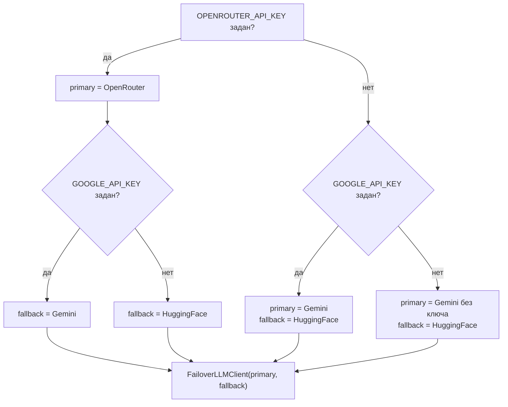
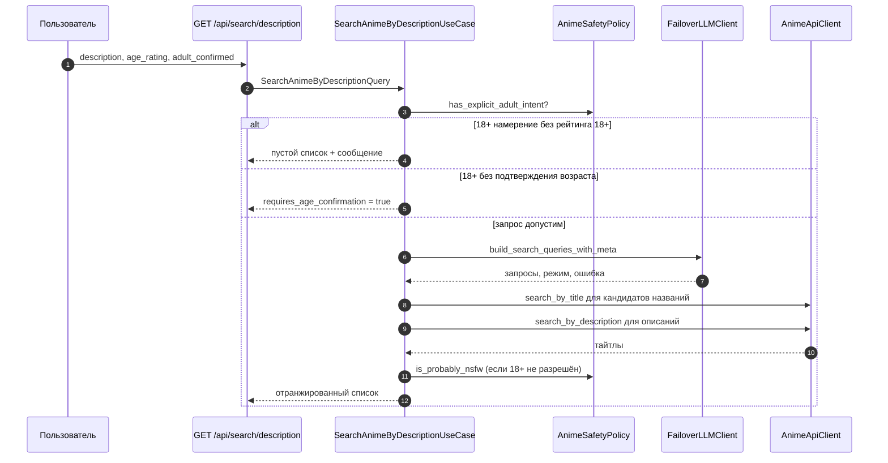

# LLM и умный поиск

## Описание

**Smart Search** в **AEM** — это поиск тайтла по описанию на естественном
языке. Пользователь пишет «аниме про школьника, который становится сильнейшим
мечником и теряет память», а система находит конкретные названия.

Задача решается в два уровня. Первый — языковая модель, которая превращает
описание в несколько правдоподобных названий. Второй — каталог, который ищет
эти названия и описательные запросы уже по своей базе. Языковая модель не
ищет тайтлы: она формулирует гипотезы, а проверяет их каталог.

Документ описывает порт LLM, цепочку провайдеров с переключением при сбое,
сценарий поиска по описанию и деградацию каталога.

Термин **Smart Search** — в [глоссарии](../00-foundation/glossary.md).

## Как это работает

### Порт LLM

Порт `LLMClientInterface` лежит в слое `application` и содержит ровно два
метода — те, которые действительно вызывают сценарии.

| Метод | Назначение | Результат |
| --- | --- | --- |
| `build_search_queries_with_meta(...)` | Собрать варианты названий по описанию | Кортеж «запросы, режим провайдера, текст ошибки» |
| `describe_taste_profile(profile_data, fallback)` | Составить короткое описание вкусов пользователя | Строка либо `fallback` |

Метода «найти тайтл» в порте нет намеренно: поиск по каталогу выполняет
`AnimeApiClient`, и объявление такого метода создавало бы контракт, который
нечем исполнить.

Третий элемент результата — режим. Именно по нему вызывающая сторона понимает,
получен ли ответ модели или сработала детерминированная подстановка, и именно
по нему клиент переключения решает, повторять ли запрос у резервного
провайдера.

### Цепочка провайдеров

Композиция собирается в `ClientProvidersMixin.llm_client()`.

| Провайдер | Класс | Адрес по умолчанию | Модель по умолчанию | Переменные |
| --- | --- | --- | --- | --- |
| OpenRouter | `OpenRouterLLMClient` | `https://openrouter.ai/api/v1/chat/completions` | `openrouter/auto` | `OPENROUTER_API_KEY`, `OPENROUTER_MODEL`, `OPENROUTER_API_URL` |
| Google Gemini | `GoogleGeminiLLMClient` | `https://generativelanguage.googleapis.com/v1beta` | `gemini-2.0-flash` | `GOOGLE_API_KEY`, `GOOGLE_MODEL`, `GOOGLE_API_URL` |
| Hugging Face | `HuggingFaceLLMClient` | `https://router.huggingface.co/v1/chat/completions` | `openai/gpt-oss-120b` через `fireworks-ai` | `HF_TOKEN`, `HF_MODEL`, `HF_PROVIDER`, `HF_API_URL` |

Базовый уровень отказоустойчивости — **Gemini как основной провайдер,
Hugging Face как резервный**. OpenRouter подключается сверху и необязателен:
если его ключ задан, он становится основным, а роль резерва переходит к Gemini
(при наличии ключа Google) либо к Hugging Face.

### Логика переключения

`FailoverLLMClient` реализует два правила.

1. **Пропуск нерабочего основного.** Если у основного провайдера нет ключа
   (`getattr(primary, "api_key", None)` пуст), он не вызывается вовсе —
   запрос сразу уходит резервному. Это устраняет лишний сетевой круг в
   конфигурации без `GOOGLE_API_KEY`.
2. **Повтор по признаку деградации.** Если основной вернул режим, начинающийся
   с `fallback`, значит ответа модели не было: клиент повторяет запрос у
   резервного провайдера.

Для описания вкусов правило то же, но проверка идёт по значению: если
основной провайдер вернул ровно `fallback`-строку, запрос повторяется у
резервного.

### Режимы работы

| Режим | Кто выставляет | Смысл |
| --- | --- | --- |
| `openrouter_llm_text` | `OpenRouterLLMClient` | Успешный ответ модели OpenRouter |
| `gemini_llm_text` | `GoogleGeminiLLMClient` | Успешный ответ модели Gemini |
| `hf_llm_text` | `HuggingFaceLLMClient` | Успешный ответ модели Hugging Face |
| `fallback_empty` | Каждый клиент | Описание пустое — сеть не нужна |
| `fallback_no_token` | Каждый клиент | Ключа нет, запрос собран детерминированно |
| `fallback_empty_reply` | Каждый клиент | Модель ответила, но пригодных названий не нашлось |
| `fallback_exception` | Каждый клиент | Сетевой сбой или исключение; текст ошибки уходит третьим элементом |
| `fallback_invalid_json` | Каждый клиент | Ответ не разобран в список названий |

Успешный режим различает провайдера: один и тот же запрос при разных ключах
даёт `openrouter_llm_text`, `gemini_llm_text` или `hf_llm_text`, и по логу
`ai_search` видно, кто именно ответил.

Режим `fallback_*` — не ошибка сама по себе: пользователь получает
результат, собранный из его же описания и подсказки жанра. Ошибка есть только
тогда, когда третьим элементом пришёл текст исключения.

### Запрос и разбор ответа

Запрос к любой модели — это `POST` с `temperature = 0.1`. Низкая температура
нужна для воспроизводимости: при `0.7` один и тот же запрос давал разные
наборы названий, и кэш каталога не помогал.

Ограничение выдачи различается по провайдерам:

| Провайдер | Параметр | Значение |
| --- | --- | --- |
| Gemini | `maxOutputTokens` | 300 |
| Hugging Face | `max_tokens` | 300 |
| OpenRouter | `max_tokens` | 900 |

OpenRouter получает больший бюджет, потому что часть выдачи у reasoning-моделей
уходит в рассуждения; в запросе стоит `reasoning.exclude = true`, чтобы они не
попадали в `content`, а если модель вернула только рассуждение, текст берётся
из поля `reasoning`.

Системная инструкция требует от модели ровно три наиболее вероятных названия,
по одному на строку, без объяснений, нумерации и JSON; запрещает
перефразировать описание и придумывать детали сюжета; обязывает соблюдать
`age_rating` и при `allow_adult = false` не подставлять 18+ термины. При
низкой уверенности модель всё равно обязана вернуть три названия — пустая
выдача хуже неточной гипотезы, потому что каталог всё равно её отфильтрует.

Пользовательское сообщение — компактный текст «поле: значение», без
JSON-обёртки: лишние скобки и кавычки увеличивали долю ответов, которые потом
не разбирались.

Разбор ответа (`HuggingFaceLLMClient._parse_queries`) выбрасывает всё, что не
похоже на название:

| Правило | Причина |
| --- | --- |
| Строка короче 2 или длиннее 80 символов | Служебная строка или абзац рассуждения |
| Больше 7 слов | Описание сюжета, а не название |
| Начинается с `{` или `[` | Модель вернула JSON вместо списка |
| Содержит маркер `anime`, `series`, `show`, `episodes`, `with`, `about`, `scenes` и подобные | Общая фраза вместо названия |
| Совпадает с `none` или уже встречалась | Пустой ответ или дубль |

Из оставшихся берутся первые три. Для Gemini переопределён только транспорт:
`POST {GOOGLE_API_URL}/models/{model}:generateContent?key=...`, системные
сообщения уходят в `systemInstruction`, ответ читается из
`candidates[0].content.parts[*].text`. Разбор названий наследуется от клиента
Hugging Face — правила «что считать названием» не должны расходиться между
провайдерами.

### Сценарий поиска по описанию

HTTP-вход — `GET /api/search/description` (имя маршрута
`anime.search_anime_by_description`, лимит 30 запросов в минуту на IP).

**Возрастная граница стоит до внешних вызовов.** Если описание выглядит как
18+, а рейтинг ниже 18+, сценарий возвращает отказ, не обращаясь ни к модели,
ни к каталогу. Это экономит квоту и не отправляет сомнительный текст внешнему
провайдеру.

**Запросы к каталогу** идут двумя семействами:

| Семейство | Источник | Зачем |
| --- | --- | --- |
| По названию | Подсказки `AnimeSafetyPolicy.suggest_title_hints` и варианты LLM не длиннее 7 слов | Модель угадала название — попадание точное |
| По описанию | Исходное описание пользователя плюс варианты LLM | Модель не угадала, но описание совпало с синопсисом каталога |

Если выдача с фильтрами года и рейтинга пуста, запрос по описанию
повторяется без фильтров: редкий тайтл не должен теряться из-за слишком узких
ограничений. Лимит на каждый запрос удваивается относительно запрошенного,
потому что после слияния и фильтрации остаётся меньше.

Дубли между выдачами убираются по внешнему идентификатору, а при его
отсутствии — по названию в нижнем регистре.

**Ранжирование.** Критерий приходит из запроса:

| `sort_by` | Ключ сортировки |
| --- | --- |
| `rating` | Рейтинг тайтла по убыванию |
| `year` | Год выпуска по убыванию |
| иначе | Оценка релевантности описанию |

Оценка складывается из совпадения токенов описания с названием и текстом
карточки, бонусов за точное и частичное совпадение с подсказками LLM и
небольшой доли рейтинга. Веса вынесены в константы модуля, поэтому их
правка не требует изменения логики.

### Деградация каталога

`AnimeApiClient.search_by_description` работает через GraphQL AniList. Если
AniList вернул `AniListSearchError`, поиск по описанию деградирует в поиск по
названию тем же текстом: пользователь получит хоть что-то вместо ошибки.

Результаты кэшируются в `KeyValueStore`:

| Метод | TTL успеха | TTL пустой выдачи |
| --- | --- | --- |
| `search_by_title` | 300 с | 60 с |
| `search_by_description` | 300 с | — |
| `get_season_popular` | 900 с | 60 с |
| `get_by_id` | 1800 с | — |

Пустая выдача кэшируется на минуту, чтобы всплеск одинаковых запросов не бил
по внешнему API, но новый тайтл не оставался невидимым на пять минут. Карточка
тайтла живёт полчаса: она меняется редко, а запрашивается на каждой странице.

### Второй метод: описание вкусов

`describe_taste_profile` вызывается при сборке обзора профиля. В сценарий
передаётся словарь сведений (настроение, любимые жанры, средняя оценка, часы
просмотра, заметные тайтлы) и запасной текст, собранный из тех же данных
обычной строкой.

Правила:

- у клиента Hugging Face таймаут этого запроса — 6 секунд, а не 30: резюме
  вкуса не стоит того, чтобы держать страницу профиля;
- при отсутствии ключа, пустом ответе или исключении возвращается `fallback`
  без ошибки;
- ответ обрезается до 300 символов;
- успешный результат кэшируется, запасной — нет, иначе временный сбой модели
  закреплялся бы в профиле.

В сценарии обзора профиля клиент хранится в поле с историческим именем
`_hf_llm_client`, хотя фактически это `FailoverLLMClient`: имя осталось от
времени, когда провайдер был один.

### Логи

| Событие | Уровень | Поля |
| --- | --- | --- |
| Ответ модели получен | INFO | `ai_search mode=... queries=...` |
| Модель не ответила | WARNING | `ai_search_failed mode=... queries=... error=...` |
| Разбор ответа Hugging Face упал | WARNING | `huggingface search query parse failed reason=...` |
| Описание вкусов не получено | WARNING | `huggingface fallback query failed reason=...` |

Режим в логах — единственный способ понять, каким провайдером получен ответ,
и сколько запросов реально дошло до модели. В лог попадают первые три
запроса, а не весь список.

## Почему это сделано так

- Языковая модель формулирует гипотезы, а не ищет. Попытка заставить модель
  отдавать идентификаторы тайтлов давала выдуманные id и несуществующие
  названия.
- Детерминированная подстановка вместо исключения: если модель недоступна,
  пользователь получает поиск по своему же тексту. Пустая страница с ошибкой
  хуже, чем частичный результат.
- Ключ — единственный признак работоспособности провайдера. Проверять живость
  модели отдельным запросом дороже, чем один раз упасть и переключиться.
- Низкая температура и жёсткий лимит токенов — ради предсказуемости и
  стоимости: название занимает несколько токенов, а рассуждение — сотни.
- Разбор названий живёт в одном месте, а транспорт различается: провайдеры
  Gemini и Hugging Face отличаются только форматом запроса и ответа.
- Возрастная граница до внешних вызовов — требование приватности: описание
  с 18+ намерением не должно уходить третьей стороне без подтверждения.
- Кэш пустой выдачи на минуту — компромисс между защитой внешнего API и
  свежестью каталога.

## Где в коде

- `src/backend/application/interface/services/llm_client.py` — порт LLM
- `src/backend/application/use_cases/anime/search_anime_by_description.py` — сценарий поиска по описанию
- `src/backend/application/use_cases/auth/profile/get_profile_overview.py` — описание вкусов профиля
- `src/backend/infrastructure/external/llm/failover_llm_client.py` — переключение провайдеров
- `src/backend/infrastructure/external/llm/huggingface_llm_client.py` — промпт, запрос и разбор ответа
- `src/backend/infrastructure/external/llm/google_gemini_llm_client.py` — транспорт Gemini
- `src/backend/infrastructure/external/catalog/anime_api_client.py` — запросы к каталогу и кэш
- `src/backend/infrastructure/di/providers/clients.py` — сборка цепочки провайдеров
- `src/backend/presentation/api/v1/anime_route.py` — маршрут `GET /api/search/description`

## Связанные документы

- [Провайдеры источников просмотра](providers.md)
- [Медиа-прокси](media-proxy.md)
- [Слои и правила](../01-architecture/layers-and-rules.md)
- [DI на Dishka](../01-architecture/di-dishka.md)
- [Модель данных](../01-architecture/data-model.md)
- [ADR 0004: двухуровневый семантический поиск](../06-adr/0004-llm-fallback-resilience.md)
