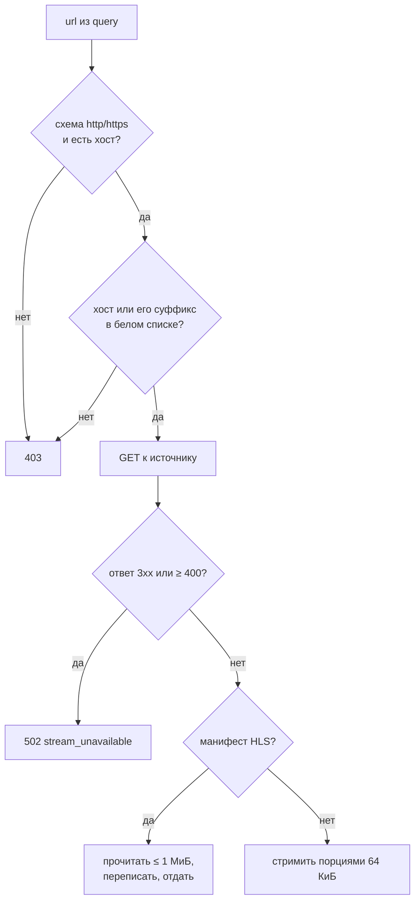

# Медиа-прокси

## Описание

**Media Proxy** — внутренний сервис **AEM**, который отдаёт видеопоток
внешнего провайдера через собственный домен приложения. Браузер получает
`/watch/proxy?url=...` вместо прямой ссылки на чужой CDN.

Прокси решает три задачи:

1. **CORS.** Чужой CDN почти никогда не отдаёт `Access-Control-Allow-Origin`
   для домена AEM, а HLS-плееру нужны и манифест, и сегменты.
2. **Сокрытие реферера.** Браузер обращается к своему домену; чужой сервер не
   получает `Referer` со страницы AEM.
3. **Защита прямых ссылок.** Наружу не уходит адрес источника в том виде, в
   котором его можно переиспользовать в обход плеера, а сервер AEM остаётся
   единственной точкой, где проверяется хост.

Одновременно прокси — это SSRF-граница: без белого списка хостов маршрут
превратился бы в открытый релей к любой внутренней или внешней сети.

## Как это работает

### Маршрут

| Свойство | Значение |
| --- | --- |
| Путь | `GET /watch/proxy?url=...`, `HEAD /watch/proxy?url=...` |
| Имена маршрутов | `watch.proxy_stream`, `watch.proxy_stream_head` |
| Владелец | `media_proxy_router`, вложен в `watch_router` с префиксом `/watch` |
| Зависимость | `FromDishka[MediaProxyClient]` — `Scope.APP` |
| Пустой `url` | `400 Bad Request` |

Маршрут не содержит логики доступа к сети: он читает параметр, собирает
функцию построения прокси-адреса и передаёт управление клиенту.

```python
def proxy_url_builder(absolute_url: str) -> str:
    return f"{request.app.url_path_for('watch.proxy_stream')}?url={absolute_url}"
```

Построитель передаётся клиенту как аргумент, а не импортируется: клиент живёт
в инфраструктуре и не должен знать про `request` и имена маршрутов
presentation-слоя.

### Проверка адреса



Проверка (`is_allowed_media_url`) состоит из трёх условий:

| Условие | Реализация |
| --- | --- |
| Схема | Только `http` и `https`; `file`, `data`, `ftp` отсекаются сразу |
| Наличие хоста | Пустой `netloc` — отказ |
| Разрешённый хост | Точное совпадение с элементом списка или совпадение по суффиксу `.элемент` |

Совпадение по суффиксу нужно, чтобы не перечислять десятки поддоменов CDN:
`cdn.kodik.info` проходит по записи `kodik.info`. Обратная сторона — запись
`vk.com` разрешает и `evil.vk.com`; для доменов, где поддомены не
контролируются владельцем, это осознанный компромисс, а не недосмотр.

Белый список (`ALLOWED_MEDIA_HOST_SUFFIXES`) сгруппирован по источникам:

| Группа | Хосты |
| --- | --- |
| AniLibria | `libria.fun`, `anilibria.top`, `anilibria.tv`, `anilibria.host` |
| SameBand | `sameband.studio` |
| AniBoom | `aniboom.one` |
| HDRezka / Sibnet | `sibnet.ru` |
| Kinobox | `kinobox.tv` |
| Kodik | `kodikplayer.com`, `kodik.info`, `kodik.biz`, `kodikapi.com` |
| YouTube | `youtube.com`, `youtube-nocookie.com`, `ytimg.com`, `googlevideo.com` |
| Одноклассники, VK, Mail | `ok.ru`, `vk.com`, `vkvideo.ru`, `mail.ru` |
| 18+ | `hanime.tv`, `hanime.com`, `mushy.tv`, `hentaigasm.com`, `hgasm1.com`, `hgasm2.com`, `hgasm3.com` |

### Запрос к источнику

Клиент `MediaProxyClient` создаётся в `Scope.APP` с тремя настройками:

| Параметр | Значение | Причина |
| --- | --- | --- |
| `follow_redirects` | `False` | Проверенный адрес не должен незаметно уводить на непроверенный хост |
| `trust_env` | `False` | Прокси-переменные окружения не должны менять маршрут запроса |
| `timeout` | 30 с | Поток читается долго, но соединение не должно висеть вечно |

Если задан `MEDIA_PROXY_PROXY`, клиент дополнительно ходит через указанный
вышестоящий прокси. Это нужно для источников, недоступных из страны
размещения. Остальные клиенты проекта создаются с `trust_env=False`, поэтому
переменные `HTTP_PROXY`/`HTTPS_PROXY` окружения на них не действуют;
исключение — провайдер Eporner, которому `trust_env=True` нужен из-за
региональных ограничений источника.

К источнику уходят ровно два заголовка:

| Заголовок | Значение |
| --- | --- |
| `User-Agent` | `User-Agent` браузера из входящего запроса либо `Mozilla/5.0` |
| `Range` | Только если он был во входящем запросе |

Cookie, `Authorization`, `Origin`, `Referer` и прочее не пересылаются. Это
следствие, а не совпадение: заголовки собираются с нуля, а не копируются.

Отсутствие браузерного `User-Agent` у части CDN приводит к отказу или к
отдаче заглушки, поэтому подстановка значения по умолчанию обязательна.

### Переписывание HLS

HLS-манифест — это текстовый файл со ссылками на другие файлы: вложенные
манифесты вариантов качества и сегменты. Если отдать его как есть, плеер
пойдёт за сегментами напрямую и упрётся в CORS. Поэтому манифест
переписывается: каждая ссылка заменяется на адрес прокси.

Признак манифеста: `.m3u8` в URL источника или `mpegurl` в `Content-Type`.

| Строка манифеста | Действие |
| --- | --- |
| Пустая | Копируется как есть |
| Начинается с `#` | Переписываются значения `URI="..."` внутри тега, остальной текст сохраняется |
| Иначе (адрес сегмента или вложенного манифеста) | `urljoin` относительно адреса манифеста, затем обёртка в прокси-адрес |

`urljoin` относительно адреса манифеста, а не домена приложения: провайдеры
отдают и абсолютные, и относительные ссылки, и оба варианта должны указывать
на один и тот же файл. Результат склеивается через `\n`.

Ответ отдаётся с типом `application/vnd.apple.mpegurl` и тем же статусом, что
вернул источник.

### Ограничение размера манифеста

Манифест буферизуется в память — его нельзя переписать потоком. Чтобы это не
стало способом съесть память процесса, действует предел `1 МиБ`:

| Проверка | Поведение |
| --- | --- |
| `Content-Length` больше предела | Ответ закрывается, возвращается `502` |
| Тело превысило предел при чтении | Чтение прекращается, возвращается `502` |

Тело читается порциями по 16 КиБ: если источник не прислал `Content-Length`,
предел всё равно срабатывает. Отдаваемый клиенту ответ всегда закрывает
входящий поток — и при успехе, и при ошибке.

### Стриминг обычного медиа

Не-манифест (сегмент `.ts`, `.mp4`, `.m4s`) не буферизуется: тело
передаётся порциями по 64 КиБ через `StreamingResponse`. Память процесса
зависит от размера порции, а не от размера файла.

Пробрасываются только четыре заголовка:

| Заголовок | Зачем |
| --- | --- |
| `Content-Type` | Плеер определяет формат по нему |
| `Content-Length` | Прогресс загрузки |
| `Accept-Ranges`, `Content-Range` | Перемотка: без них `Range`-запросы источника не имеют смысла для клиента |

Остальные заголовки источника (в том числе `Set-Cookie`) не пробрасываются.

### Коды ответа

| Код | Тело | Условие |
| --- | --- | --- |
| `400` | пусто | В запросе нет `url` |
| `403` | пусто | Схема или хост не разрешены |
| `502` | `{"error": "stream_unavailable"}` | Сетевая ошибка, ответ `3xx`, ответ `≥ 400`, слишком большой манифест |
| код источника | поток или переписанный манифест | Успешный ответ |

`3xx` считается ошибкой, а не редиректом: клиент не переходит по редиректам
намеренно, и вместо непроверенного перехода отдаёт честный `502`.

Тело ошибки — машиночитаемый код, а не HTML: ответ получает плеер, а не
пользователь.

### Текущее состояние подключения

Маршрут реализован, покрыт тестами и доступен, но **плеер его пока не
использует**: в `src/frontend/static/js/player/core.js` поток подключается по
адресу `source.url` напрямую, ссылок на `/watch/proxy` в шаблонах и
скриптах фронтенда нет.

| Что готово | Что осталось |
| --- | --- |
| Маршрут, политика адресов, переписывание HLS, стриминг | Подстановка прокси-адреса в источник плеера и проверка воспроизведения на живых провайдерах |

Пока прокси не включён в плеер, HLS работает напрямую и зависит от CORS
источника. Это ограничение фронтенда, а не серверной части.

## Почему это сделано так

- Белый список хостов, а не блок-лист: прокси без ограничения адресов —
  это открытый SSRF к внутренней сети и к произвольным внешним ресурсам от
  имени сервера.
- Отказ от следования редиректам: проверка адреса имеет смысл только тогда,
  когда запрос уходит именно на проверенный адрес. Провайдеры и так отдают
  прямые ссылки, а непроверенный переход лучше показать как недоступность.
- Заголовки собираются с нуля — поэтому сессионные cookie пользователя и его
  `Authorization` физически не могут утечь на чужой CDN.
- Манифест переписывается, а не проксируется целиком: иначе сегменты пошли бы
  напрямую и упёрлись в CORS, то есть прокси не решил бы задачу, ради которой
  создан.
- Предел в 1 МиБ на манифест — компромисс: реальные манифесты занимают
  единицы килобайт, а буферизация без предела превращала бы маршрут в способ
  исчерпать память.
- Поток отдаётся порциями, потому что видео нельзя читать в память целиком,
  а `Range` пробрасывается, потому что без него не работает перемотка.

## Где в коде

- `src/backend/presentation/api/v1/watch_route/media_proxy.py` — маршрут `GET|HEAD /watch/proxy`
- `src/backend/infrastructure/external/video/hls_proxy/url_policy.py` — белый список хостов, признаки HLS, `User-Agent`
- `src/backend/infrastructure/external/video/hls_proxy/media_proxy_client.py` — запрос к источнику, стриминг, коды ответа
- `src/backend/infrastructure/external/video/hls_proxy/hls_proxy.py` — переписывание манифеста
- `src/backend/infrastructure/di/providers/clients.py` — сборка `MediaProxyClient` в `Scope.APP`
- `src/frontend/static/js/player/core.js` — подключение источника в плеере
- `tests/unit/infrastructure/external/video/hls_proxy/` — проверки политики и клиента

## Связанные документы

- [Провайдеры источников просмотра](providers.md)
- [LLM и умный поиск](llm-search.md)
- [Безопасность](../01-architecture/security.md)
- [Матрица маршрутов](../01-architecture/route-matrix.md)
- [Поток запроса](../01-architecture/data-flow.md)
- [Глоссарий](../00-foundation/glossary.md)
