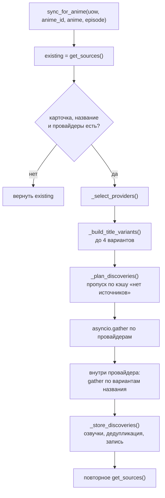

# Провайдеры источников просмотра

## Описание

**AEM** не хранит видео у себя: плеер получает ссылку на поток, найденную
у внешнего провайдера. Провайдер — это адаптер к чужому каталогу (Kodik,
AniLibria, AniBoom, HDRezka и т. д.), который по названию тайтла и номеру
серии возвращает набор ссылок с метками озвучки и качества.

Документ описывает контракт провайдера, реестр подключённых источников и два
контракта подробно: **Kodik** и **AniLibria**. Остальные провайдеры следуют
тому же контракту и отличаются только протоколом внешнего сервиса.

Термины **Provider**, **Title**, **Episode**, **Moment** — в
[глоссарии](../00-foundation/glossary.md).

## Как это работает

### Порт провайдера

Контракт объявлен в `backend.application.interface.services.watch_source_provider`,
а не в инфраструктуре: на него опирается сервис синхронизации из слоя
`application`, а клиенты внешних сервисов — лишь реализации.

| Член контракта | Назначение |
| --- | --- |
| `provider_name: str` | Имя провайдера в базе, логах и подписи интерфейса. Именно оно попадает в `watch_sources.provider_name` |
| `ephemeral_links: bool = False` | Признак ссылки с ограниченным сроком жизни: такой источник перезапрашивается на каждой синхронизации |
| `is_enabled() -> bool` | Готов ли провайдер работать: включён в настройках и имеет адрес либо токен |
| `search_sources(title, episode, year, limit, shikimori_id)` | Найти источники серии |
| `get_translations_availability(title, year, shikimori_id)` | Карта «озвучка → доступные серии»; по умолчанию пустая, реализуют провайдеры с каталогом переводов |

`shikimori_id` — внешний идентификатор тайтла (MAL/Shikimori). Провайдер с
каталогом переводов обязан адресоваться по нему строго и не прибегать к
нечёткому сопоставлению названий: иначе франшиза подменяется другим сезоном.

Результат поиска — `DiscoveredWatchSource` (frozen dataclass домена):

| Поле | Смысл |
| --- | --- |
| `episode` | Номер серии, к которой относится ссылка |
| `translation_name` | Название озвучки в написании провайдера |
| `translation_type` | `voice` или `sub` |
| `provider_name` | Имя провайдера из контракта |
| `source_name` | Внутренний идентификатор материала у провайдера |
| `quality_label` | Метка качества: `1080`, `720p`, `YouTube`, `auto` |
| `stream_url` | Прямая ссылка на поток |
| `source_type` | `stream` (по умолчанию), `embed` или `external` |
| `language` | Язык дорожки, по умолчанию `ru` |

### Реестр провайдеров

Список собирается в `RequestProvider.watch_source_sync_service`. Порядок
в списке — порядок логирования и порядок, в котором провайдеры перебираются
в `get_translations_availability` (побеждает первый непустой ответ).

| № | `provider_name` | Реализация | Доступ | `source_type` | Флаг включения |
| --- | --- | --- | --- | --- | --- |
| 1 | `AnimeGo` | `AnimeGoProvider` | Скрапер страницы + экстракторы Sibnet/AniBoom | `embed` | `ANIMEGO_ENABLED` |
| 2 | `Kodik` | `KodikClient` | API + плеер | `stream` | наличие токена |
| 3 | `Kinobox` | `KinoboxProvider` | API-агрегатор | `embed` | `KINOBOX_ENABLED` |
| 4 | `HDRezka` | `HDRezkaProvider` | Парсер страницы | `stream` | `REZKA_ENABLED` |
| 5 | `SameBand` | `SamebandProvider` | API | `stream` | `SAMEBAND_ENABLED` |
| 6 | `AniBoom` | `AniBoomProvider` | API + экстрактор | `stream` | `ANIBOOM_ENABLED` |
| 7 | `Hanime` | `HanimeProvider` | API | `stream` | `HANIME_ENABLED` |
| 8 | `Hentaigasm` | `HentaigasmProvider` | Парсер, прямые MP4 | `stream` | `HENTAIGASM_ENABLED` |
| 9 | `Eporner` | `EpornerProvider` | API | `stream` | `EPORNER_ENABLED` |
| 10 | `AniLibria` | `AniLibriaClient` | API | `stream` | непустой `ANILIBRIA_API_URL` |
| 11 | `YouTube` | `YouTubeClient` | YouTube Data API | `embed` | непустой `YOUTUBE_API_KEY` |
| 12 | `JustWatch` | `JustWatchClient` | API партнёра | `external` | `JUSTWATCH_PARTNER_TOKEN` |

`Sibnet` не входит в реестр: это экстрактор, который `AnimeGoProvider`
вызывает внутри собственного поиска. Подпись для интерфейса
(`get_provider_label`) собирается из имён включённых провайдеров.

### Конвейер синхронизации



Правила отбора провайдеров на итерацию (`_select_providers`):

```text
опрос = is_enabled() и (force или ephemeral_links или провайдера нет в existing)
```

Смысл третьего условия — не дёргать повторно источник, который уже дал
результат для этой серии. Смысл второго — наоборот, перезапрашивать всегда:
подписанная ссылка истекает, и сохранённая считается недействительной.

Варианты названия строятся из заголовка каталога: исходная строка, отрезанная
по `:`, `(` и `[`, вариант с заменой дефисов на пробелы и вариант без
маркера сезона (`Season 2`, `сезон 2`, `S2`). Каждый вариант — отдельный
сетевой запрос, поэтому варианты одного провайдера опрашиваются параллельно:
у Hentaigasm и Eporner поиск занимает 2–4 секунды и последовательный обход
удваивал время загрузки страницы.

Ошибка провайдера не роняет страницу: `ExternalServiceError` перехватывается,
пишется предупреждение `Watch source provider failed`, провайдер считается
вернувшим пустой результат.

### Кэши

Сервис живёт в `Scope.REQUEST`, поэтому кэши приходят извне: собственные поля
пересоздавались бы на каждый запрос и ни один TTL не наступил бы.

| Кэш | TTL | Ключ | Зачем |
| --- | --- | --- | --- |
| `empty_results` | 600 с, 512 записей | провайдер, `anime_id`, серия, год, id, варианты названия | Не опрашивать провайдера, у которого для этой серии источников нет |
| `availability` | 1800 с, 256 записей | название в нижнем регистре, год или `0`, `shikimori_id` или `0` | Карта «озвучка → серии» переиспользуется каталогом и страницей просмотра |

Кэш «источников нет» удаляется, как только провайдер вернул непустой ответ,
поэтому появление новой серии не ждёт истечения TTL. Флаг `force`
игнорирует оба кэша.

### Дедупликация и запись

При записи (`_store_discoveries`) действуют три правила.

1. Ссылки эфемерного провайдера удаляются целиком (`delete_sources_by_provider`)
   до вставки новых: старая подпись в URL уже недействительна.
2. Повтор пары «озвучка + качество + источник» отбрасывается — провайдер мог
   вернуть один и тот же файл на двух зеркалах.
3. Дорожка `Translation` создаётся один раз на тройку «каноническое имя,
   тип, язык» и переиспользуется всеми качествами.

Имя озвучки канонизируется через `canonicalize_translation_name`: «анидуб»,
`AniDUB` и `Ani Dub` сводятся к одной дорожке, иначе селектор озвучек
показывал бы три одинаковых пункта.

### Контракт Kodik

Kodik — основной источник с каталогом переводов. Реализация состоит из пяти
модулей, у каждого своя ответственность.

| Модуль | Ответственность |
| --- | --- |
| `client.py` | Сеть: подбор токена, пагинация поиска, запрос списка качеств |
| `parsing.py` | Разбор ответов: релевантность, серии, декодирование ссылок |
| `mapping.py` | Превращение материалов в карту доступности серий |
| `token_store.py` | Чтение и расшифровка публичных токенов |
| `token_manager.py` | Проверка токена на живом API и backoff между проверками |

**Поиск.** `GET {KODIK_API_URL}/search` с параметрами:

| Параметр | Значение |
| --- | --- |
| `token` | Подтверждённый токен |
| `title` | Вариант названия |
| `episode` | Номер серии, минимум 1 |
| `limit` | Размер страницы |
| `year` | Год, если известен |
| `camrip` | `false` — без экранных копий |
| `strict` | `false` — мягкий поиск, строгость обеспечивается локальной сверкой |
| `with_material_data`, `with_seasons`, `with_episodes`, `with_episodes_data` | `true` — без них не приходят сезоны и ссылки на серии |

Пагинация идёт по `next_page` ответа, но не более 20 страниц
(`_MAX_SEARCH_PAGES`): это защита от зацикливания внешнего API.

`shikimori_id` в поиск **не передаётся**. Внешний идентификатор каталога может
оказаться AniList-id, а Kodik ожидает MAL/Shikimori-id; неверный id дал бы
либо подмену контента, либо пустую выдачу без сверки по названию. Адресация
идёт по названию со строгой локальной проверкой.

**Сверка релевантности.** `_looks_relevant` отбрасывает материал, если год
расходится более чем на единицу, и требует совпадения названия. Совпадением
считается точное равенство нормализованных строк или вхождение всех слов
запроса в название кандидата с «хвостом» не длиннее трёх посторонних слов.
Нечёткое сходство (`SequenceMatcher` и подобное) не используется: оно
пропускает материалы других тайтлов.

**Ссылка на серию.** У материалов с сезонами сначала пробуется `last_season`,
затем остальные сезоны по возрастанию: у длинных тайтлов в первом сезоне есть
серия с тем же номером, но не та. Материал без `seasons` (фильм, OVA, спецвыпуск)
валиден только для первой серии, иначе страница подменяла бы серию фильмом.

**Список качеств.** Ссылка плеера разбирается регулярным выражением
`{схема}//{хост}/{kind}/{id}/{hash}/{качество}p`; из неё собирается запрос к
ручке `DEFAULT_VIDEO_INFO_ENDPOINT = "/ftor"`. Kodik периодически переименовывает
эту ручку и зашивает новый адрес в base64 внутрь JS-бандла плеера, поэтому при
пустом ответе адрес вычисляется из бандла (`discover_video_info_endpoint`) и
запрос повторяется. Значение `src` в ответе закодировано ROT-18 по латинице без
padding — оно раскодируется и нормализуется в абсолютный HTTPS-адрес. Запросы
качеств ограничены семафором на 8 одновременных.

**Токены.** Kodik не сообщает, какой из публичных токенов жив. Порядок
кандидатов: `KODIK_API_TOKEN` из окружения, затем расшифрованные записи из
`kodik_tokens/tokens.json` в порядке разделов `stable → unstable → legacy`.
Токен проверяется одним лёгким запросом `title=test&limit=1`; если ответ
содержит подсказку о неверном токене (`неверный токен`, `invalid token`,
`доступ запрещён`, `отсутствует`), кандидат отбрасывается. Удачный токен
запоминается до перезапуска процесса, а после полного провала проверки
следующая попытка откладывается на `PROBE_BACKOFF_SECONDS = 300`.

Шифрование в `tokens.json` обратимое и повторяет схему официального парсера:
две половины токена кодируются в base64, затем каждая переворачивается и части
склеиваются в обратном порядке. Это не защита секрета, а способ не попадать в
поисковую выдачу.

**Карта доступности.** `get_translations_availability` использует `shikimori_id`,
когда он известен, и дополнительно фильтрует выдачу по пересечению слов
названия: если id оказался из другого пространства, материалы чужого тайтла
отбрасываются. Без id выполняется строгая сверка `_looks_relevant`.

### Контракт AniLibria

| Шаг | Запрос | Назначение |
| --- | --- | --- |
| 1 | `GET {ANILIBRIA_API_URL}/app/search/releases?query={title}&limit={limit}` | Кандидаты релизов по названию |
| 2 | `GET {ANILIBRIA_API_URL}/anime/releases/{id}?include=episodes` | Серии и ссылки конкретного релиза |

Из ответа берётся серия с `ordinal`, равным запрошенному номеру, и три поля
качества:

| Поле ответа | `quality_label` |
| --- | --- |
| `hls_1080` | `1080` |
| `hls_720` | `720` |
| `hls_480` | `480` |

Ссылки нормализуются: протокол-независимый адрес `//host/path` получает схему
`https`, относительный `/path` — origin API. Тип перевода всегда `voice`,
название дорожки — `AniLibria`, `source_name` — `alias` релиза.

Релевантность мягче, чем у Kodik: допускается расхождение года на единицу и
вхождение нормализованных названий друг в друга по любому из полей `main`,
`english`, `alternative`, `alias`. Если год неизвестен, релиз не отбрасывается.
Провайдер не умеет отдавать карту доступности и использует реализацию порта по
умолчанию.

### Фильтрация по контенту

```text
фильтр = {"eporner", "hentaigasm", "hanime"} — для adult-тайтлов
         все 12 провайдеров                    — для остальных
```

Сравнение идёт по `provider_name` в нижнем регистре, поэтому подмена
регистра в реализации не ломает фильтр. Для взрослого тайтла обычные кинотеки
не опрашиваются: хентая там нет, а запросы стоят секунд.

Kodik в adult-список намеренно не входит. Его каталог отдаёт хентай-тайтлы как
«не-озвучки» (оригинал и спецвыпуски), и текстовый поиск по названию постоянно
цепляет их, засоряя выдачу обычных тайтлов. Обратная сторона решения — для
adult-тайтла Kodik не опрашивается вовсе.

## Почему это сделано так

- Провайдер — порт `application`, а не абстракция инфраструктуры: сервис
  синхронизации должен оставаться в слое сценариев и не зависеть от `httpx`.
- Один провайдер — один внешний сервис. Попытка сделать «универсальный
  агрегатор» внутри одного класса размывала бы правила релевантности: у Kodik
  каталог переводов, у YouTube — ролики без серий.
- Пустой результат кэшируется, а ошибка — нет. «Нет источников» — устойчивый
  факт, «провайдер упал» — временное состояние.
- Ссылки Eporner не хранятся как долговременные: подписанный CDN-адрес живёт
  около двух часов, после чего сервер отдаёт по нему минутный трейлер-заглушку.
  Признак `ephemeral_links` переносит это знание из провайдера в общий алгоритм.
- Строгая сверка названий вместо нечёткой — осознанный выбор в пользу пустой
  выдачи: подмена серии чужого тайтла хуже, чем отсутствие источника.
- Список провайдеров собран в одном месте (`RequestProvider`), потому что
  порядок обхода влияет на карту доступности, а добавление провайдера не
  должно требовать правок в сервисе.

## Где в коде

- `src/backend/application/interface/services/watch_source_provider.py` — порт провайдера
- `src/backend/application/services/watch_source_service.py` — синхронизация, кэши, дедупликация
- `src/backend/domain/value_objects/watch/discovery.py` — `DiscoveredWatchSource`
- `src/backend/domain/policies/watch_policy.py` — приоритет озвучек, ранг качества, `source_type`
- `src/backend/infrastructure/cache/watch_source_caches.py` — TTL и ёмкость кэшей
- `src/backend/infrastructure/di/providers/request.py` — реестр провайдеров и порядок опроса
- `src/backend/infrastructure/external/video/kodik/` — клиент, разбор, токены, mapping
- `src/backend/infrastructure/external/video/ru/anilibria_client.py` — клиент AniLibria
- `src/backend/infrastructure/external/video/` — остальные провайдеры (`ru/`, `adult/`)

## Связанные документы

- [LLM и умный поиск](llm-search.md)
- [Медиа-прокси](media-proxy.md)
- [Модель данных](../01-architecture/data-model.md)
- [Поток запроса](../01-architecture/data-flow.md)
- [DI на Dishka](../01-architecture/di-dishka.md)
- [Глоссарий](../00-foundation/glossary.md)
