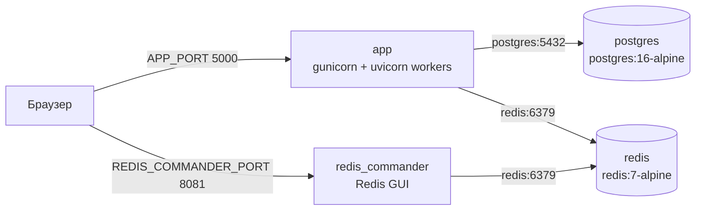
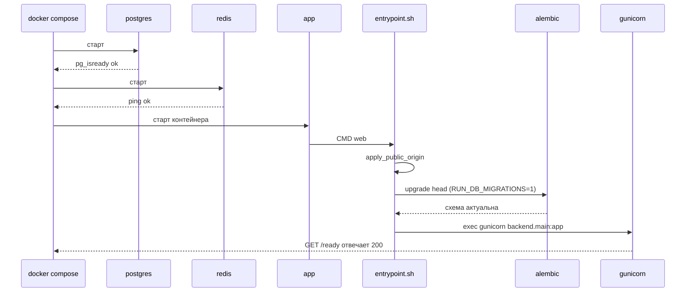

# Развёртывание

## Описание

Документ описывает контейнерный контур **AEM**: состав `docker-compose.yml`,
публикуемые порты, тома для персистентности, двухстадийную сборку образа и
порядок старта приложения. Отдельно перечислены требования к продакшн-окружению,
которые нельзя вывести из compose-файла.

Все артефакты развёртывания лежат в корне репозитория: `Dockerfile`,
`docker-compose.yml`, `scripts/entrypoint.sh`. Единственный источник схемы БД —
`migrations/` (см. [Сопровождение](maintenance.md)).

## Как это работает

### Топология



Внутри compose-сети сервисы обращаются друг к другу по DNS-именам (`postgres`,
`redis`). Наружу публикуются только порты, перечисленные в таблице ниже.

### Сервисы compose

| Сервис | Образ | Публикуемый порт | Тома | Healthcheck | Зависимости |
| --- | --- | --- | --- | --- | --- |
| `postgres` | `postgres:16-alpine` | `${POSTGRES_PORT:-5432}` | `postgres_data` → `/var/lib/postgresql/data` | `pg_isready -U $POSTGRES_USER -d $POSTGRES_DB`, интервал 5 с, 10 попыток | — |
| `redis` | `redis:7-alpine` | `${REDIS_PORT:-6379}` | нет | `redis-cli ping`, интервал 5 с, 10 попыток | — |
| `redis_commander` | `rediscommander/redis-commander:latest` | `${REDIS_COMMANDER_PORT:-8081}` | нет | нет | `redis` здоров |
| `app` | сборка из `Dockerfile` | `${APP_BIND_IP:-0.0.0.0}:${APP_PORT:-5000}` | нет | `GET /ready` через `urllib`, интервал 30 с, 3 попытки, `start_period` 25 с | `postgres` и `redis` здоровы |

У всех сервисов `restart: unless-stopped`: после перезагрузки хоста контур
поднимается сам, но вручную остановленный контейнер остаётся остановленным.

### Порты

| Что | Переменная | По умолчанию | Где используется |
| --- | --- | --- | --- |
| Приложение, HTTP | `APP_PORT` | `5000` | Публикация порта и `gunicorn --bind` внутри контейнера |
| Адрес привязки порта | `APP_BIND_IP` | `0.0.0.0` | Только строка публикации compose |
| PostgreSQL | `POSTGRES_PORT` | `5432` | Только публикация; внутри сети приложение ходит на `postgres:5432` |
| Redis | `REDIS_PORT` | `6379` | Только публикация; внутри сети — `redis:6379` |
| Redis GUI | `REDIS_COMMANDER_PORT` | `8081` | Публикация Redis Commander |

Порт приложения указывается в строке публикации дважды —
`"${APP_BIND_IP:-0.0.0.0}:${APP_PORT:-5000}:${APP_PORT:-5000}"`: левая часть —
порт хоста, правая — порт контейнера. Меняя `APP_PORT`, вы меняете обе стороны,
поэтому дополнительно править `entrypoint.sh` или `EXPOSE 5000` не нужно
(`EXPOSE` в образе носит справочный характер и на публикацию не влияет).

`APP_BIND_IP`, `POSTGRES_PORT`, `REDIS_PORT` и `REDIS_COMMANDER_PORT` не
передаются в контейнер приложения: это параметры хоста, которые читает сам
Docker Compose из `.env` или окружения оболочки.

### Персистентность

| Данные | Где живут | Переживает `docker compose down` | Переживает `down -v` |
| --- | --- | --- | --- |
| База PostgreSQL | именованный том `postgres_data` | Да | Нет |
| Ключи Redis | внутри контейнера `redis` | Нет | Нет |
| Кэши в памяти процессов | внутри контейнера `app` | Нет | Нет |

Том получает префикс имени проекта: при `name: anime-epic-moments` это
`anime-epic-moments_postgres_data`. Уничтожение тома — необратимая потеря данных,
поэтому `docker compose down -v` применяется только к одноразовому окружению.

У Redis тома нет намеренно: содержимое — кэши каталога, счётчики ограничителей,
коды подтверждения почты и список отозванных токенов. Все они восстановимы из
внешних источников самим приложением, а лишний том усложнил бы ротацию. Цена
решения — потеря состояния при пересоздании контейнера `redis`:

- отозванные ранее refresh-токены снова считаются действительными до истечения
  своего срока (запись в `jwt_blocklist:*` пропала);
- выданные коды подтверждения почты и ссылки сброса пароля перестают работать;
- счётчики ограничителей и блокировки аккаунтов обнуляются;
- кэш каталога, рекомендаций и дашборда хайлайтов пуст, первые запросы идут в
  внешние API.

### Сборка образа

`Dockerfile` собирается в две стадии.

| Стадия | Базовый образ | Что делает | Что попадает дальше |
| --- | --- | --- | --- |
| `builder` | `python:3.12-slim` + бинарник `uv` из `ghcr.io/astral-sh/uv:0.12` | `uv sync --frozen --no-dev --no-install-project --no-cache` | `/app/.venv` |
| финальная | `python:3.12-slim` | копирует `.venv`, `src`, `migrations`, `scripts`, чинит CRLF в entrypoint | рабочий образ без `uv` |

Ключевые переменные сборки:

- `UV_PYTHON_PREFERENCE=only-system` и `UV_PYTHON_DOWNLOADS=never` — берётся
  интерпретатор базового образа. В `pyproject.toml` стоит обратная настройка
  (`only-managed`): локально uv сам заводит CPython 3.12.
- `UV_PROJECT_ENVIRONMENT=/app/.venv` — окружение создаётся внутри проекта, а не
  в домашнем каталоге пользователя.
- `--frozen` — `uv.lock` не пересчитывается; расхождение с `pyproject.toml`
  роняет сборку.
- `--no-dev` — группа разработки в образ не попадает.
- `PYTHONPATH=/app/src` в финальной стадии — приложение запускается из `/app` без
  установки проекта в `site-packages`.

Пересобрать после правок кода или зависимостей:

```bash
docker compose up -d --build
```

### Старт контейнера приложения

`scripts/entrypoint.sh` — единственная точка входа. Первый аргумент (его задаёт
`CMD`) выбирает режим.

| Режим | Команда | Что происходит |
| --- | --- | --- |
| `web` (по умолчанию) | `docker compose up -d` | Вывод публичного адреса → миграции → `gunicorn` с воркерами `uvicorn` |
| `dev` | `docker compose run --rm --service-ports app dev` | Миграции → `uvicorn --reload` по `/app/src` и `/app/migrations` |
| любой другой | `docker compose run --rm app sh` | Аргумент выполняется как команда, миграции не применяются |

Порядок старта режима `web`:



Особенности:

- **Отказ без миграций.** Если в `migrations/versions` нет ни одного `*.py`,
  entrypoint завершается с ошибкой и подсказкой, как создать ревизию. Тихого
  создания схемы в обход истории версий не будет.
- **Повторы.** `alembic upgrade head` выполняется до `MIGRATIONS_ATTEMPTS` раз
  (по умолчанию 5) с паузой `MIGRATIONS_RETRY_DELAY` (по умолчанию 3 с). Это
  закрывает гонку с ещё не готовым PostgreSQL, но не заменяет собой устранение
  реальной ошибки миграции.
- **Публичный адрес.** Если задан `APP_PUBLIC_HOST`, entrypoint собирает
  `APP_PUBLIC_SCHEME://APP_PUBLIC_HOST:APP_PUBLIC_PORT` (порт по умолчанию равен
  `APP_PORT`), подставляет его в `APP_BASE_URL` вместо пустого или localhost-
  значения и добавляет в `APP_ALLOWED_ORIGINS`.
- **Логи.** `gunicorn` пишет access- и error-лог в stdout/stderr, поэтому вывод
  собирается стандартными средствами Docker.
- **Воркеры.** `GUNICORN_WORKERS` (по умолчанию 2), `GUNICORN_TIMEOUT`
  (120 с), `GUNICORN_GRACEFUL_TIMEOUT` (30 с).

### Проверка работоспособности

| Маршрут | Смысл | Что вернёт |
| --- | --- | --- |
| `GET /health` | Живость процесса, зависимости не опрашиваются | `200` всегда, пока процесс отвечает |
| `GET /ready` | Готовность зависимостей | `200` при готовности, `503` при отказе |

`/health` — проба liveness для оркестратора: её провал означает, что процесс
надо перезапустить. `/ready` — проба readiness: её провал убирает контейнер из
балансировки, но не требует перезапуска. Docker-healthcheck контейнера `app`
ходит именно в `/ready`, поэтому первые 25 секунд (`start_period`) приложение
считается нездоровым — это время на миграции.

### Продакшн-окружение

Compose-файл описывает запуск, а не политику безопасности. Перед публикацией
контура в интернет обязательны:

| Требование | Как проверить |
| --- | --- |
| Задан стойкий `SECRET_KEY` | при `APP_DEBUG=0` без него приложение не стартует |
| `APP_DEBUG=0` | значение по умолчанию в compose, но `.env` его перекрывает |
| `COOKIE_SECURE=1` | cookie уходят с флагом `Secure`, включается HSTS (`HSTS_MAX_AGE`) |
| `APP_PUBLIC_SCHEME=https` и `APP_PUBLIC_PORT=443` | ссылки в письмах ведут на внешний TLS-адрес |
| `APP_PUBLIC_HOST` заполнен | `APP_BASE_URL` и `APP_ALLOWED_ORIGINS` собираются из него |
| `APP_ALLOWED_ORIGINS` содержит внешний origin | иначе CORS и проверка источника записи режут запросы |
| `TRUSTED_PROXIES` заполнен адресами вашего прокси | иначе `X-Forwarded-For` игнорируется и `client_ip` — это адрес прокси |
| `REDIS_REQUIRED=1`, если важна согласованность состояния | иначе при сбое Redis хранилища молча уходят в память процесса |
| `LOG_FORMAT=json` | структурированные логи для агрегатора |
| `redis_commander` не опубликован | GUI не имеет аутентификации: не выводите `8081` наружу |

TLS в контуре не терминируется: AEM ожидает HTTPS от внешнего reverse proxy.
Приложение в этом случае должно быть уверено в заголовках прокси —
`TRUSTED_PROXIES` и есть тот список, которому `X-Forwarded-For` доверяется.

Три ограничения вытекают из самого compose-файла:

- `redis_commander` публикует порт без аутентификации. В продакшене поднимайте
  только нужные сервисы: `docker compose up -d postgres redis app`, либо
  ограничьте публикацию до `127.0.0.1:${REDIS_COMMANDER_PORT:-8081}:8081`.
- Порты PostgreSQL и Redis тоже опубликованы на хост. Ограничить их снаружи
  строкой `ports` нельзя: `POSTGRES_PORT` и `REDIS_PORT` задают только номер,
  поэтому нужен либо правка строки публикации на `127.0.0.1:<порт>`, либо
  правила firewall.
- `app` собирается из локального `Dockerfile`, а не из готового образа реестра.
  На хосте продакшена нужен исходный код и `docker compose build`.

### Масштабирование

`GUNICORN_WORKERS` задаёт число процессов-воркеров внутри одного контейнера.
Каждый воркер — отдельный процесс Python со своими объектами:

- кэш источников просмотра (`WatchSourceCaches`) живёт в памяти процесса,
  поэтому промахи кэша умножаются на число воркеров;
- при `REDIS_ENABLED=0` счётчики ограничителей тоже живут в памяти: лимит
  фактически умножается на число воркеров, а рестарт обнуляет блокировки.

Вывод: горизонтальное масштабирование и `REDIS_ENABLED=0` несовместимы.
Несколько экземпляров приложения требуют Redis как общий backend состояния.

При нескольких репликах `app` миграции должен применять ровно один процесс:
оставьте `RUN_DB_MIGRATIONS=1` на первом экземпляре (или выполните
`upgrade head` отдельной задачей) и выставьте `RUN_DB_MIGRATIONS=0` на
остальных, чтобы параллельный `alembic upgrade head` не конкурировал за схему.

### Очередь изменений в окружении

| Что меняете | Что перезапустить |
| --- | --- |
| Код приложения | `docker compose up -d --build app` |
| `uv.lock` / `pyproject.toml` | `docker compose build --no-cache app`, затем `up -d` |
| Переменные в `.env` | `docker compose up -d` (compose пересоздаёт затронутые контейнеры) |
| `POSTGRES_*` на существующем томе | ничего не изменится: пользователь и пароль создаются при инициализации тома. Нужен дамп, новый том и восстановление |
| Новая ревизия Alembic | достаточно `up -d`: миграции применит entrypoint |

## Хостинг одним контейнером

Compose-контур рассчитан на один хост с Docker. Платформы с managed PostgreSQL
(Render, Fly.io, Railway, Koyeb) собирают тот же `Dockerfile` и запускают один
контейнер приложения, а база и TLS терминируются снаружи. Отличия от локального
контура:

| Аспект | Что делает хостинг | Что делает AEM |
| --- | --- | --- |
| База | внешний PostgreSQL-сервис, строка подключения приходит в `DATABASE_URL` | entrypoint применяет миграции при `RUN_DB_MIGRATIONS=1` |
| Сборка | `docker build` по `Dockerfile` | зависимости ставит `uv sync --frozen --no-dev --no-install-project`, pip не используется |
| Порт | публикует порт контейнера и шлёт на него трафик | приложение слушает `APP_PORT` (по умолчанию 5000); значение обязано совпасть с ожиданием платформы |
| TLS | терминирует прокси снаружи | приложение требует `COOKIE_SECURE=1` и корректный `TRUSTED_PROXIES`, иначе HSTS и `client_ip` работают неверно |
| Redis | обычно отсутствует | при `REDIS_ENABLED=0` хранилища уходят в память процесса |

Минимальный набор переменных для такого запуска:

```
SECRET_KEY=<случайная строка>
DATABASE_URL=<строка подключения провайдера базы>
DATABASE_AUTO_INIT=0
RUN_DB_MIGRATIONS=1
REDIS_ENABLED=0
REDIS_REQUIRED=0
COOKIE_SECURE=1
COOKIE_SAMESITE=Lax
APP_BASE_URL=https://<ваш домен>
APP_DEBUG=0
LOG_FORMAT=json
```

Значения и дефолты каждой переменной — в
[справочнике окружения](env-reference.md); здесь важна только логика выбора:
`DATABASE_AUTO_INIT=0` обязателен, потому что схема создаётся миграциями, а не
`create_all`, а `REDIS_REQUIRED=0` сознательно оставляет деградацию в память
процесса.

### Ограничения бесплатных тарифов

- **База с сроком жизни.** Managed PostgreSQL на бесплатном тире живёт
  ограниченное время (Render — 90 дней). Перед истечением обязателен дамп и
  восстановление на новый инстанс: рецепты — в
  [сопровождении](maintenance.md).
- **Эфемерная файловая система.** Записанные в контейнер файлы исчезают при
  перезапуске, а `ImageStorage` пишет загрузки в каталог статики. Для аватаров и
  изображений нужно внешнее S3-совместимое хранилище либо постоянный том.
- **Прогрев после простоя.** Первый запрос после паузы запускает контейнер, и
  пользователь ждёт от нескольких секунд до десятков секунд; entrypoint в этот
  момент ещё и применяет миграции.
- **Один экземпляр без общего состояния.** При `REDIS_ENABLED=0` счётчики
  ограничителей и блокировки живут в памяти процесса: несколько воркеров или
  реплик умножают лимиты и теряют состояние при рестарте (см.
  «Масштабирование» выше).
- **Проба готовности не перезапускает контейнер.** Хостинг сам решает, что делать
  с unhealthy-инстансом; при недоступной базе `/ready` отвечает `503`, и это
  корректное поведение, а не сигнал для рестарта.

Альтернативы одному тарифу: Fly.io (кредиты вместо бесплатного тира, нужен
собственный конфиг), Railway (триал, далее платно), Koyeb (бесплатный тир без
спячки, но один сервис).

## Почему это сделано так

Разделение стадий сборки даёт образ без компилятора и без менеджера пакетов:
`uv` нужен только на этапе установки зависимостей, а `.venv` переносится как
есть. Это сокращает поверхность атаки и размер образа, но означает, что любая
правка зависимостей требует пересборки, а не доустановки в работающем
контейнере.

Миграции применяет entrypoint, а не отдельная задача деплоя: при одном хосте
это исключает забытый шаг и живёт по принципу «схема не может отставать от
кода». Цена — время старта растёт на длительность `upgrade head`, поэтому
healthcheck получил `start_period`, а для нескольких реплик предусмотрен
`RUN_DB_MIGRATIONS=0`.

Healthcheck смотрит на `/ready`, а не на `/health`: контейнер считается готовым
только когда доступна база, иначе оркестратор начнёт отправлять трафик в
инстанс, который отвечает пятисотками. Liveness отделён, чтобы недоступность
PostgreSQL не вызывала перезапуск живого процесса по кругу.

Redis сознательно оставлен без тома: это кэш и состояние безопасности, а не
источник истины. Персистентность здесь создавала бы иллюзию гарантии — при
смене схемы ключей старое содержимое только мешало бы.

## Где в коде

- [`docker-compose.yml`](../../docker-compose.yml)
- [`Dockerfile`](../../Dockerfile)
- [`scripts/entrypoint.sh`](../../scripts/entrypoint.sh)
- [`src/backend/presentation/api/v1/health_route.py`](../../src/backend/presentation/api/v1/health_route.py)
- [`src/backend/config/sections/server.py`](../../src/backend/config/sections/server.py)
- [`src/backend/config/sections/redis_.py`](../../src/backend/config/sections/redis_.py)
- [`src/backend/infrastructure/di/providers/cache.py`](../../src/backend/infrastructure/di/providers/cache.py)

## Связанные документы

- [Переменные окружения](env-reference.md)
- [Сопровождение](maintenance.md)
- [Безопасность](../01-architecture/security.md)
- [DI на Dishka](../01-architecture/di-dishka.md)
- [ADR 0003: uv как менеджер пакетов](../06-adr/0003-uv-package-manager.md)
