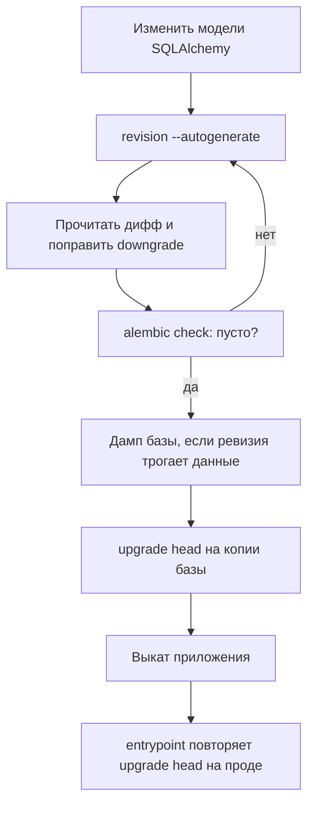

# Сопровождение

## Описание

Документ описывает рутинные операции эксплуатации **AEM**: работу с миграциями
Alembic, снятие и восстановление дампов PostgreSQL, сброс кэшей Redis и разбор
типовых отказов. Всё, что здесь описано, выполняется поверх уже развёрнутого
контура (см. [Развёртывание](deployment.md)).

Единственный источник схемы базы — Alembic. Приложение не создаёт таблицы само:
`DATABASE_AUTO_INIT=1` оставлен для разовых локальных экспериментов и в
контейнере принудительно выставлен в `0`.

## Как это работает

### Миграции: конфигурация

| Файл | Роль |
| --- | --- |
| `migrations/alembic.ini` | Единственная конфигурация Alembic; `script_location = %(here)s`, `prepend_sys_path = %(here)s/..` |
| `migrations/env.py` | Добавляет `src` в `sys.path`, берёт URL из `Settings.database_url`, подключает `Base.metadata` |
| `migrations/versions/` | Ревизии; базовой считается `a0c0657fa309` (`down_revision = None`) |

Строка подключения в `alembic.ini` намеренно пуста: её подставляет `env.py` из
тех же настроек, что читает приложение. Поэтому миграции и рантайм всегда ходят
в одну базу, а менять адрес нужно в одном месте — `DATABASE_URL` или
`POSTGRES_*`.

Запуск идёт через async-движок: `env.py` создаёт `async_engine_from_config` с
`NullPool` и выполняет ревизии внутри `connection.run_sync`. Схема драйвера
нормализуется так же, как в рантайме: `postgresql://` превращается в
`postgresql+asyncpg://`, `sqlite:///` — в `sqlite+aiosqlite:///`.

`compare_type=True` означает, что `--autogenerate` видит изменения типов колонок
и предложит их в диффе.

### Миграции: команды

Все команды выполняются из корня репозитория и не зависят от ОС.

| Задача | Команда |
| --- | --- |
| Применить все ревизии | `uv run alembic -c migrations/alembic.ini upgrade head` |
| Новая ревизия по разнице моделей | `uv run alembic -c migrations/alembic.ini revision --autogenerate -m "add index on highlights"` |
| Новая пустая ревизия (ручной SQL, данные) | `uv run alembic -c migrations/alembic.ini revision -m "backfill original titles"` |
| Проверить, что модели и база совпадают | `uv run alembic -c migrations/alembic.ini check` |
| История ревизий | `uv run alembic -c migrations/alembic.ini history` |
| Текущая ревизия базы | `uv run alembic -c migrations/alembic.ini current` |
| Откатить одну ревизию | `uv run alembic -c migrations/alembic.ini downgrade -1` |
| Откатить до конкретной ревизии | `uv run alembic -c migrations/alembic.ini downgrade a0c0657fa309` |
| Откатить всё | `uv run alembic -c migrations/alembic.ini downgrade base` |
| Печать SQL без подключения к базе | `uv run alembic -c migrations/alembic.ini upgrade head --sql` |

Внутри контейнера те же команды доступны без локального окружения: `alembic`
лежит в `/app/.venv/bin` и уже находится в `PATH`.

```bash
docker compose exec app alembic -c migrations/alembic.ini current
docker compose exec app alembic -c migrations/alembic.ini upgrade head
```

Для одноразового запуска без старта веб-процесса используется `run`: режимы
`web` и `dev` не срабатывают, аргумент выполняется как есть.

```bash
docker compose run --rm app alembic -c migrations/alembic.ini history
```

`db-*`-цели `Makefile` (`db-upgrade`, `db-revision`, `db-check`, `db-history`) —
короткие обёртки над теми же командами; они требуют установленного `make`, тогда
как `uv run alembic ...` работает везде, где есть `uv`.

### Миграции: правила ревизии

1. **Автогенерация — черновик.** `--autogenerate` сравнивает метаданные с базой и
   не знает намерений: переименование колонки он видит как `drop` + `add`, то
   есть как потерю данных. Дифф читается глазами целиком.
2. **Одна голова.** Расхождение веток лечится `merge`, а не удалением файлов
   ревизий. Проверка `history` не должна показывать две `head`.
3. **`downgrade` обязателен.** Автосгенерированный откат для переименований и
   переносов данных почти всегда неверен; его правят вручную до коммита.
4. **Деструктивные изменения — в два выката.** Сначала добавить новую колонку и
   научить код писать в обе, затем отдельной ревизией удалить старую. Так откат
   приложения не требует отката схемы.
5. **Миграция не ходит во внешний мир.** Никаких HTTP-запросов и обращений к
   Redis: ревизия должна выполняться на машине без доступа в интернет. Массовые
   заполнения данных делаются отдельными скриптами (`scripts/`), а не внутри
   `upgrade`.
6. **Тяжёлые индексы.** `CREATE INDEX CONCURRENTLY` нельзя выполнять в
   транзакции; в Alembic для этого используется блок
   `with op.get_context().autocommit_block():`.
7. **Ревизия коммитится вместе с моделями.** Гейт `alembic check` ловит
   ситуацию «модель изменили, ревизию забыли». CI дополнительно прогоняет
   полный цикл на чистой базе: `upgrade head` → `check` → `downgrade base` →
   `upgrade head`, поэтому неработающий `downgrade` роняет сборку.

### Миграции: порядок выката



Если ревизия меняет данные, а не только схему, дамп снимается **до** выката:
откат кода без отката схемы безопасен, а откат деструктивной миграции — нет.

Автоматический `upgrade head` в entrypoint повторяет попытки пять раз с паузой
три секунды; это защита от гонки с ещё не готовым PostgreSQL, поэтому отдельный
шаг деплоя нужен только для ревизий, которые должны применяться вручную или на
нескольких репликах (см. `RUN_DB_MIGRATIONS` в
[Развёртывании](deployment.md#масштабирование)).

### Бэкапы PostgreSQL

Дампы снимаются утилитами из контейнера `postgres`, а файл забирается через
`docker compose cp`. Так команда одинаково работает в любой ОС и не зависит от
перенаправления бинарного потока в оболочке.

Снять дамп в custom-формате (сжатый, восстанавливается выборочно):

```bash
docker compose exec postgres pg_dump -U anime_epic_moments_user -d anime_epic_moments_db -Fc -f /tmp/aem.dump
docker compose cp postgres:/tmp/aem.dump ./backups/aem.dump
```

Снять только схему (удобно для сравнения ревизий):

```bash
docker compose exec postgres pg_dump -U anime_epic_moments_user -d anime_epic_moments_db --schema-only -f /tmp/aem-schema.sql
docker compose cp postgres:/tmp/aem-schema.sql ./backups/aem-schema.sql
```

Проверить дамп, не восстанавливая его:

```bash
docker compose exec postgres pg_restore --list /tmp/aem.dump
```

Восстановить:

```bash
docker compose stop app
docker compose cp ./backups/aem.dump postgres:/tmp/aem.dump
docker compose exec postgres pg_restore -U anime_epic_moments_user -d anime_epic_moments_db --clean --if-exists --no-owner /tmp/aem.dump
docker compose start app
```

`--clean --if-exists` удаляет существующие объекты перед восстановлением: это
разрушающая операция, и `app` на время восстановления нужно остановить, иначе
воркеры будут писать в наполовину восстановленную схему. `--no-owner` избавляет
от ошибок, когда дамп снят под другим пользователем.

Если база пустая, восстановление идёт без `--clean`:

```bash
docker compose exec postgres pg_restore -U anime_epic_moments_user -d anime_epic_moments_db --no-owner /tmp/aem.dump
```

Восстановление дампа отменяет действие миграций: версия схемы в дампе — та,
что была на момент снятия, поэтому после восстановления `alembic current`
показывает старую ревизию, а `alembic upgrade head` доводит схему до кода.

Практика хранения:

- дамп снимается перед каждой ревизией, меняющей данные, и по расписанию
  (например, ежедневно через cron/systemd timer хоста);
- глубина хранения — не меньше интервала, за который обнаруживается порча
  данных; типовая схема: 7 ежедневных и 4 недельных;
- дампы уезжают за пределы хоста с базой, иначе потеря тома уносит и данные, и
  бэкапы;
- раз в квартал выполняется пробное восстановление на отдельной базе — дамп без
  проверки восстановления бэкапом не считается.

### Redis: что лежит и как сбрасывать

Все ключи AEM лежат в одном пространстве имён `anime_epic_moments` и хранят
JSON с метками типов, а не pickle: читать их глазами можно, править вручную —
нельзя.

| Префикс ключа | Кто пишет | TTL | Что означает |
| --- | --- | --- | --- |
| `search_by_title_v2:*`, `search_by_description:*` | `AnimeApiCache` | 300 с (60 с для пустого ответа) | Ответы поиска каталога |
| `season_popular:*`, `top:*` | `AnimeApiCache` | 900 с (60 с для пустого) | Сезонные и топовые подборки |
| `filter_catalog_v2:*` | `AnimeApiCache` | 600 с (60 с для пустой страницы) | Отфильтрованные страницы каталога |
| `anime:<id>` | `AnimeApiCache` | 1800 с | Карточка тайтла |
| `ru_title:<id>`, `ru_desc:<id>` | `ShikimoriClient` | 30 дней | Русские название и описание по MAL-id |
| `recommendation:<user_id>:<limit>` | `RecommendationCache` | 180 с | Персональные рекомендации |
| `profile_overview:<user_id>` | `ProfileOverviewCache` | 180 с | Сводка профиля |
| `profile_ai_summary:<user_id>` | `ProfileOverviewCache` | 1800 с | ИИ-описание вкусов |
| `highlight_dashboard:public:*` | `HighlightDashboardCache` | 120 с | Публичная лента хайлайтов |
| `rate_limit:<scope>:<subject>` | `RateLimiter` | окно лимита | Счётчики ограничителей |
| `lock:user:<email>` | `AccountLockService` | `ACCOUNT_LOCK_DURATION_SECONDS` (1800 с) | Блокировка входа после серии неудач |
| `email_verification:<email>` | `EmailVerificationStore` | `EMAIL_VERIFICATION_EXPIRE_MINUTES` | Код подтверждения почты |
| `jwt_blocklist:<sha256>` | `TokenBlocklist` | срок жизни токена | Отозванные refresh-токены |

Полный сброс — когда Redis выделен только под AEM:

```bash
docker compose exec redis redis-cli FLUSHDB
```

Точечный сброс по префиксу (безопасно на общем Redis). Скрипт выполняется внутри
контейнера, поэтому одинаково работает в любой ОС:

```bash
docker compose exec redis redis-cli EVAL "local c='0' repeat local r=redis.call('scan',c,'match',ARGV[1],'count',500) c=r[1] for _,k in ipairs(r[2]) do redis.call('del',k) end until c=='0' return 1" 0 "anime_epic_moments:rate_limit:*"
```

Типовые точечные операции:

| Задача | Что удалить |
| --- | --- |
| Разблокировать аккаунт | `lock:user:<email>` **и** `rate_limit:login_failures:<email>` |
| Сбросить лимиты по конкретному действию | `rate_limit:<scope>:*` |
| Заставить каталог перечитать внешние API | `search_by_title_v2:*`, `season_popular:*`, `anime:*`, `top:*`, `filter_catalog_v2:*` |
| Перечитать русские названия | `ru_title:*`, `ru_desc:*` |
| Сбросить рекомендации пользователя | `recommendation:<user_id>:*` |

Удалять только `lock:user:<email>` недостаточно: счётчик неудачных попыток живёт
в `rate_limit:login_failures:<email>`, и первый же неверный пароль после
разблокировки вернёт блокировку. Успешный вход снимает блокировку сам — ручное
удаление нужно лишь тогда, когда пользователь не может войти.

Кэши сервиса источников просмотра (`empty_results`, `availability`) живут не в
Redis, а в памяти процесса: их единственный способ сброса — перезапуск `app`.

```bash
docker compose restart app
```

После сброса Redis приложение продолжает работать: хранилище деградирует в
память процесса и обслуживает запросы до восстановления соединения. При
`REDIS_REQUIRED=1` поведение обратное — ошибка Redis всплывает наружу.

### Готовность и отказ Redis

`/ready` опрашивает базу запросом `SELECT 1` и Redis через `PING` (в ответе это
поле `redis`). Если Redis настроен, но не отвечает, маршрут возвращает `503` —
даже при `REDIS_REQUIRED=0`, когда приложение фактически продолжает обслуживать
запросы на in-memory запасном пути. Docker-healthcheck контейнера `app` ходит
именно в `/ready`, поэтому во время сбоя Redis контейнер помечается
`unhealthy`.

Docker сам по себе не перезапускает контейнер из состояния `unhealthy`;
перезапуск может инициировать оркестратор с такой политикой. Поэтому при
длительном сбое Redis ожидаемый эффект — `503` на readiness и работа на памяти
процесса, а не цикл рестартов.

### Диагностика

| Симптом | Причина | Действие |
| --- | --- | --- |
| `ERROR: no revision files in /app/migrations/versions` при старте | каталог ревизий пуст: сборка из ветки без ревизий или пустой смонтированный каталог | проверить `migrations/versions` в контексте сборки; `migrations` не исключён `.dockerignore` |
| `WARN: alembic upgrade head failed (attempt 1/5)` ×5, затем выход | база недоступна, у пользователя нет прав DDL, конфликт ревизий | `docker compose logs app`, затем `alembic current` и `alembic upgrade head` вручную |
| `alembic check` показывает непустой дифф на чистой базе | модель изменена без ревизии либо ревизия не применена | создать ревизию или применить `upgrade head` |
| Сайт работает, `/ready` отдаёт `503` с `"redis":"unreachable"` | Redis лежит | поднять `redis`, при необходимости `docker compose restart app` |
| Браузер долго ждёт ответа на страницах каталога | внешние API медленные, кэш пуст после сброса | подождать прогрева, проверить `LOG_LEVEL=INFO` и записи о деградации |
| Пользователь получает «аккаунт заблокирован» | сработала защита от перебора | удалить `lock:user:<email>` и `rate_limit:login_failures:<email>` |
| После перезапуска `redis` все сессии стали недействительны не сразу | пропал `jwt_blocklist:*` | ожидаемо; для принудительного выхода всех — смените `SECRET_KEY` |
| Коды подтверждения почты «не принимаются» | Redis пересоздан, `email_verification:*` потерян | запросить код заново |
| Ссылка сброса пароля не работает | сменился `SECRET_KEY`: reset-токен — это JWT | запросить новую ссылку |

Ротация `SECRET_KEY` инвалидирует все выданные токены сразу: access, refresh,
подтверждение почты и сброс пароля. Это самый быстрый способ разлогинить всех,
и его же побочный эффект — необходимость повторной выдачи ссылок.

## Почему это сделано так

Схема базы управляется только ревизиями, потому что `create_all` в рантайме
невидим: он не оставляет истории, не откатывается и по-разному ведёт себя на
разных диалектах. Отсюда и жёсткое поведение entrypoint: лучше упасть на старте
с понятным сообщением, чем поднять приложение поверх базы без истории версий.

Строка подключения живёт в одном месте — `env.py` читает её из `Settings`.
Дублирование адреса в `alembic.ini` рано или поздно привело бы к миграции не той
базы, а это самая дорогая из возможных ошибок эксплуатации.

Дампы снимаются через `pg_dump` в custom-формате, а не копированием файлов тома:
копия каталога данных PostgreSQL корректна только при остановленной базе, тогда
как дамп согласован на живой. `--clean --if-exists` в восстановлении выбран
сознательно: восстановление поверх непустой базы должно давать её точную копию
дампа, а не смесь.

Точечный сброс Redis сделан скриптом `SCAN`+`DEL`, а не `KEYS`: `KEYS` блокирует
сервер на всё время перебора и на рабочей базе превращается в источник отказов.
Полный `FLUSHDB` оправдан только тогда, когда база Redis целиком принадлежит AEM.

## Где в коде

- [`migrations/alembic.ini`](../../migrations/alembic.ini)
- [`migrations/env.py`](../../migrations/env.py)
- [`migrations/versions/a0c0657fa309_initial_schema.py`](../../migrations/versions/a0c0657fa309_initial_schema.py)
- [`src/backend/infrastructure/cache/key_value_store.py`](../../src/backend/infrastructure/cache/key_value_store.py)
- [`src/backend/infrastructure/security/account_lock_service.py`](../../src/backend/infrastructure/security/account_lock_service.py)
- [`src/backend/infrastructure/security/rate_limiter.py`](../../src/backend/infrastructure/security/rate_limiter.py)
- [`src/backend/infrastructure/health/health_check.py`](../../src/backend/infrastructure/health/health_check.py)
- [`scripts/entrypoint.sh`](../../scripts/entrypoint.sh)

## Связанные документы

- [Развёртывание](deployment.md)
- [Переменные окружения](env-reference.md)
- [Модель данных](../01-architecture/data-model.md)
- [Безопасность](../01-architecture/security.md)
- [Провайдеры источников](../02-integrations-and-services/providers.md)
