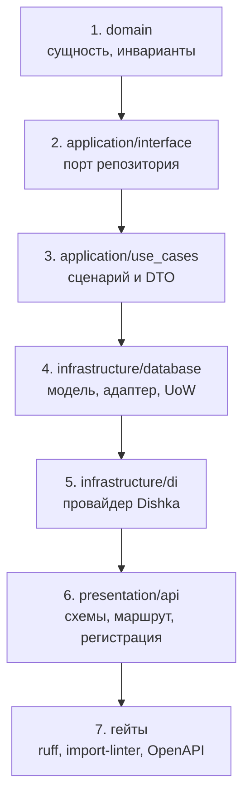

# Как добавить фичу

## Описание

Пошаговый маршрут новой сущности или сценария в **AEM**: от модели предметной
области до HTTP-маршрута и зелёных гейтов. Порядок шагов не случаен — он
повторяет направление зависимостей Clean Architecture, поэтому на каждом шаге
компилируется только то, что уже объявлено ниже по стеку.

Примеры построены на существующей вертикали избранного: `favorite` содержит
ровно один шаг каждого слоя и читается целиком за несколько минут.

## Маршрут по слоям



| Шаг | Каталог | Что нельзя импортировать |
| --- | --- | --- |
| 1 | `src/backend/domain/` | Ничего из других слоёв и никаких сторонних библиотек |
| 2 | `src/backend/application/interface/` | `infrastructure`, `presentation` |
| 3 | `src/backend/application/use_cases/` | `infrastructure`, `presentation`, SQLAlchemy |
| 4 | `src/backend/infrastructure/` | `presentation` |
| 5 | `src/backend/infrastructure/di/` | `presentation` |
| 6 | `src/backend/presentation/` | `infrastructure` напрямую (кроме исключений в `pyproject.toml`) |

Контракты проверяет `import-linter`; подробности — в
[слоях и правилах](../01-architecture/layers-and-rules.md).

## Шаг 1. Модель и инварианты в домене

Новая сущность — обычный класс без ORM и Pydantic. Правила живут в конструкторе
и в методах, время берётся из `backend.domain.clock`, ошибки — из
`backend.domain.exceptions`.

```python
"""Сущность заметки о моменте."""

from backend.domain.clock import utc_now
from backend.domain.exceptions import ValidationError


class MomentNote:
    """Короткая заметка пользователя к моменту просмотра."""

    def __init__(self, user_id: int, moment_id: int, text: str) -> None:
        """Создать заметку, проверив инварианты.

        Args:
            user_id: Автор заметки.
            moment_id: Момент, к которому относится заметка.
            text: Текст заметки.

        Raises:
            ValidationError: Если текст пуст или длиннее предела.
        """
        normalized = str(text or "").strip()
        if not normalized:
            raise ValidationError("Заметка не может быть пустой")
        if len(normalized) > 500:
            raise ValidationError("Заметка длиннее 500 символов")
        self.user_id = int(user_id)
        self.moment_id = int(moment_id)
        self.text = normalized
        self.created_at = utc_now()
```

Раскладка: `src/backend/domain/entities/<feature>/<name>.py` и реэкспорт в
`src/backend/domain/entities/<feature>/__init__.py`. Если сущность нужна
сценариям под коротким именем, добавьте её в `src/backend/domain/__init__.py` —
оттуда импортируют и `application`, и `infrastructure`.

## Шаг 2. Порт репозитория

Порт — абстрактный класс с асинхронными методами, которые говорят на языке
домена и не знают о SQL.

```python
"""Порт хранилища заметок о моментах."""

from abc import ABC, abstractmethod

from backend.domain.entities.moment.moment_note import MomentNote


class MomentNoteRepository(ABC):
    """Хранилище заметок пользователя."""

    @abstractmethod
    async def add(self, note: MomentNote) -> MomentNote:
        """Сохранить заметку."""

    @abstractmethod
    async def get_by_moment(self, moment_id: int) -> list[MomentNote]:
        """Вернуть заметки момента."""
```

Файл — `src/backend/application/interface/repositories/moment_note_repository.py`,
реэкспорт в `src/backend/application/interface/repositories/__init__.py`.
Технические зависимости прикладного слоя (LLM, кэш, почта) объявляются там же,
в `application/interface/services/`, если им нужен собственный порт.

## Шаг 3. DTO и сценарий

Команда или запрос — `frozen dataclass` в `application/dto/<feature>/`,
сценарий — класс с единственным публичным методом `execute`.

```python
"""Сценарий создания заметки к моменту."""

from backend.application.dto.moment.add_moment_note_command import AddMomentNoteCommand
from backend.application.interface.repositories.moment_note_repository import (
    MomentNoteRepository,
)
from backend.application.interface.unit_of_work import UnitOfWorkInterface
from backend.domain.entities.moment.moment_note import MomentNote


class AddMomentNoteUseCase:
    """Создаёт заметку в границах одной транзакции."""

    def __init__(self, uow: UnitOfWorkInterface) -> None:
        """Сохранить единицу работы.

        Args:
            uow: Единица работы, задающая границу транзакции.
        """
        self._uow = uow

    async def execute(self, command: AddMomentNoteCommand) -> MomentNote:
        """Создать заметку и зафиксировать транзакцию.

        Args:
            command: Данные заметки.

        Returns:
            MomentNote: Сохранённая заметка.
        """
        note = MomentNote(
            user_id=command.user_id,
            moment_id=command.moment_id,
            text=command.text,
        )
        async with self._uow as uow:
            return await uow.repository(MomentNoteRepository).add(note)
```

Правила сценария:

- граница транзакции — блок `async with self._uow as uow`, внутри него только
  операции репозиториев; сброс кэшей и внешние вызовы — после выхода из блока;
- репозиторий берётся через `uow.repository(Port)`, а не инжектится в
  конструктор: адаптер создаётся один раз на единицу работы;
- пользовательские ошибки возвращаются через `UseCaseResult`, если вызывающая
  сторона должна различать причины отказа; для «сделай или упади» достаточно
  доменных исключений;
- файл — `application/use_cases/<feature>/<verb>_<noun>.py`, реэкспорт в
  `application/use_cases/__init__.py`.

## Шаг 4. Модель БД и адаптер репозитория

Модель SQLAlchemy 2.0 — в `infrastructure/database/models/<feature>/`,
адаптер — в `infrastructure/database/repositories/<feature>_repository/`.

```python
"""SQLAlchemy-модель заметки к моменту."""

from datetime import datetime

from sqlalchemy import Column, DateTime, ForeignKey, Integer, String

from backend.infrastructure.database.session import Base


class MomentNoteModel(Base):
    """Таблица ``moment_notes``: пользовательские заметки к моментам."""

    __tablename__ = "moment_notes"

    id = Column(Integer, primary_key=True, autoincrement=True)
    user_id = Column(
        Integer, ForeignKey("users.id", ondelete="CASCADE"), nullable=False, index=True
    )
    moment_id = Column(
        Integer, ForeignKey("viewing_moments.id", ondelete="CASCADE"), nullable=False, index=True
    )
    text = Column(String(500), nullable=False)
    created_at = Column(DateTime, default=datetime.utcnow)
```

Обязательные действия шага:

1. Реэкспортировать модель в `infrastructure/database/models/<feature>/__init__.py`
   и в `infrastructure/database/models/__init__.py`: без импорта модель не
   попадает в `Base.metadata`, и `--autogenerate` её не увидит.
2. Реализовать адаптер с той же сигнатурой, что у порта; `flush()` — в
   репозитории, `commit()` — только в единице работы.
3. Зарегистрировать пару «порт → адаптер» в словаре `_REPOSITORY_TYPES` в
   `infrastructure/database/unit_of_work.py`. Без этой строки
   `uow.repository(Port)` бросит `LookupError`.
4. Если порт нужен вне единицы работы, добавить провайдер репозитория в
   `RequestProvider` (`infrastructure/di/providers/request.py`).

### Миграция схемы

```bash
uv run alembic -c migrations/alembic.ini revision --autogenerate -m "add moment notes"
uv run alembic -c migrations/alembic.ini upgrade head
uv run alembic -c migrations/alembic.ini check
```

Дифф читается глазами: переименования Alembic видит как удаление и создание
колонки. Требования к ревизии и порядок выката — в
[сопровождении](../03-ops/maintenance.md).

## Шаг 5. Провайдер Dishka

Сценарии живут в `Scope.REQUEST`, потому что зависят от сессии базы. Провайдер
добавляется в `infrastructure/di/providers/<feature>.py` и наследует `Provider`.

```python
"""Провайдеры сценариев заметок."""

from dishka import Provider, Scope, provide

from backend.application.interface.unit_of_work import UnitOfWorkInterface
from backend.application.use_cases.moment.add_moment_note import AddMomentNoteUseCase


class MomentNoteUseCaseProvider(Provider):
    """Провайдер сценариев заметок."""

    @provide(scope=Scope.REQUEST)
    async def add_moment_note(self, unit_of_work: UnitOfWorkInterface) -> AddMomentNoteUseCase:
        """Создать сценарий добавления заметки."""
        return AddMomentNoteUseCase(unit_of_work)
```

Дальше — три регистрации:

1. `infrastructure/di/providers/__init__.py` — импорт и `__all__`;
2. `infrastructure/di/dishka_container.py` — экземпляр в `make_async_container`;
3. если провайдер относится к существующей области (`cache`, `clients`,
   `security`, `policies`, `storage`, `video_sources`, `notifications`), его
   достаточно подмешать в `AppProvider`; для новых клиентов и кэшей — именно
   этот путь, `Scope.APP`.

Для провайдера источников просмотра шаг другой: реализуется
`WatchSourceProviderInterface` и добавляется строка в список `RequestProvider`,
порядок в списке задаёт приоритет источников. Контракт описан в
[провайдерах источников](../02-integrations-and-services/providers.md).

## Шаг 6. Маршрут, схемы и регистрация

Слой представления делит работу на три файла:

| Файл | Содержимое |
| --- | --- |
| `presentation/api/requests/<feature>_requests.py` | Pydantic-модели входных данных |
| `presentation/api/responses/<feature>_responses.py` | Pydantic-модели ответов |
| `presentation/api/v1/<feature>_route.py` | `APIRouter`, обработчики, коды ответов |

```python
"""Маршруты заметок к моментам."""

from __future__ import annotations

from http import HTTPStatus

from dishka import FromDishka
from dishka.integrations.fastapi import DishkaRoute
from fastapi import APIRouter, Request

from backend.application.dto.moment import AddMomentNoteCommand
from backend.application.use_cases.moment.add_moment_note import AddMomentNoteUseCase
from backend.presentation.api.errors import ErrorResponse, unauthorized_error
from backend.presentation.api.helpers import get_current_user
from backend.presentation.api.requests.moment_requests import AddMomentNoteRequest
from backend.presentation.api.responses.moment_responses import MomentNoteResponse

moment_note_router = APIRouter(prefix="/moments", route_class=DishkaRoute)


@moment_note_router.post(
    "/{moment_id}/notes",
    name="moment.add_note",
    response_model=MomentNoteResponse,
    status_code=HTTPStatus.CREATED,
    responses={HTTPStatus.UNAUTHORIZED: {"model": ErrorResponse}},
)
async def add_note(
    request: Request,
    moment_id: int,
    body: AddMomentNoteRequest,
    use_case: FromDishka[AddMomentNoteUseCase],
):
    """Добавить заметку к моменту от имени авторизованного пользователя.

    Args:
        request: Текущий HTTP-запрос.
        moment_id: Момент из пути.
        body: Тело запроса с текстом заметки.
        use_case: Сценарий добавления заметки.

    Returns:
        MomentNoteResponse: Созданная заметка.
    """
    user = await get_current_user(request)
    if user is None:
        return unauthorized_error()
    note = await use_case.execute(
        AddMomentNoteCommand(user_id=user.id, moment_id=moment_id, text=body.text)
    )
    return MomentNoteResponse(
        id=note.id,
        moment_id=note.moment_id,
        text=note.text,
        created_at=note.created_at.isoformat(),
    )
```

Правила маршрута:

- `route_class=DishkaRoute` и `FromDishka[...]` для получения сценария;
- имя маршрута — `<область>.<действие>`, оно попадает в `url_for` и в артефакты;
- владелец ресурса берётся из сессии, а не из тела запроса; для приватных
  данных путь сверяется с сессией через `require_self`;
- коды ответов и модели ошибок объявляются в `responses`, иначе контракт
  OpenAPI будет неполным;
- если обработчик может вернуть готовый ответ ошибки (`unauthorized_error()`),
  аннотация возвращаемого типа не ставится: форма ответа задаётся
  `response_model` и объявленными в `responses` кодами;
- маршрут регистрируется в `create_app()` (`presentation/app_factory.py`) вызовом
  `app.include_router(...)`;
- новый маршрут попадает в [матрицу маршрутов](../01-architecture/route-matrix.md),
  которая пересобирается скриптом экспорта.

## Шаг 7. Гейты и документация

```bash
uv run ruff check src tests migrations
uv run ruff format src tests migrations
uv run python scripts/check_imports.py
uv run python scripts/check_style.py
uv run python scripts/export_openapi.py
uv run python scripts/export_route_matrix.py
uv run python scripts/export_openapi.py --check
uv run pytest
```

Порядок важен: два скрипта экспорта обновляют артефакты, затем `--check`
подтверждает, что они соответствуют коду. Если `--check` падает в CI, значит
артефакт забыли пересобрать после правки маршрута или схемы.

Документация обновляется в том же изменении:

| Что менялось | Что обновить |
| --- | --- |
| Публичное HTTP API | [route-matrix.md](../01-architecture/route-matrix.md), `docs/api/openapi.json` |
| Схема БД | [data-model.md](../01-architecture/data-model.md) |
| Доменные правила | [glossary.md](../00-foundation/glossary.md), [product-vision.md](../00-foundation/product-vision.md) |
| Переменные окружения | [env-reference.md](../03-ops/env-reference.md) |
| Внешняя интеграция | [providers.md](../02-integrations-and-services/providers.md) или [llm-search.md](../02-integrations-and-services/llm-search.md) |
| Архитектурное решение | новый файл в [06-adr](../06-adr/) |

## Чек-лист

- [ ] Сущность и инварианты — в домене, без ORM и Pydantic
- [ ] Порт репозитория объявлен в `application/interface` и реэкспортирован
- [ ] DTO лежит в `application/dto/<feature>/`, сценарий — в `application/use_cases/<feature>/`
- [ ] Транзакция ограничена блоком `async with self._uow as uow`
- [ ] Модель импортирована в `models/__init__.py`, адаптер зарегистрирован в `_REPOSITORY_TYPES`
- [ ] Провайдер Dishka добавлен в контейнер, сценарий — `Scope.REQUEST`
- [ ] Маршрут зарегистрирован в `create_app()`, у него есть `name` и `responses`
- [ ] Ревизия Alembic создана, проверена и применяется на чистой базе
- [ ] Артефакты OpenAPI и матрицы маршрутов пересобраны
- [ ] Документация обновлена в том же изменении

## Почему это сделано так

Порядок «домен → порт → сценарий → адаптер → DI → маршрут» задан направлением
зависимостей: каждый следующий слой знает о предыдущем, а обратное запрещено
`import-linter`. Если начать с маршрута, неизбежно появится SQL или HTTP прямо в
сценарии, и граница восстановится только рефакторингом.

Сценарий получает единицу работы, а не репозитории: репозиторий создаётся
внутри транзакции на конкретной сессии, поэтому его нельзя передать в
конструктор без привязки к ещё не открытой транзакции. Отсюда и
`uow.repository(Port)` — порт остаётся в прикладном слое, адаптер подставляется
словарём в инфраструктуре.

Регистрация в `_REPOSITORY_TYPES` сделана явной, хотя могла быть неявной через
имя класса: явный словарь читается как карта «какой порт обслуживает какой
адаптер» и падает с `LookupError` при забытой строке, а не подставляет
случайную реализацию.

Схемы запросов и ответов лежат отдельно от маршрутов, потому что они —
публичный контракт: их читает мобильный клиент и генератор OpenAPI. Держать их
в одном файле с обработчиками значит смешивать контракт и его использование.

## Где в коде

- `src/backend/domain/entities/favorite/favorite.py` — пример сущности
- `src/backend/application/interface/repositories/favorite_repository.py` — пример порта
- `src/backend/application/use_cases/favorite/add_favorite.py` — пример сценария
- `src/backend/infrastructure/database/repositories/favorite_repository/favorites.py` — пример адаптера
- `src/backend/infrastructure/database/unit_of_work.py` — карта портов
- `src/backend/infrastructure/di/providers/favorite.py` — пример провайдера
- `src/backend/presentation/api/v1/favorite_route.py` — пример маршрутов
- `src/backend/presentation/app_factory.py` — регистрация маршрутов

## Связанные документы

- [Слои и правила](../01-architecture/layers-and-rules.md)
- [DI на Dishka](../01-architecture/di-dishka.md)
- [Поток запроса](../01-architecture/data-flow.md)
- [Соглашения кодовой базы](conventions.md)
- [Сопровождение: миграции](../03-ops/maintenance.md)
