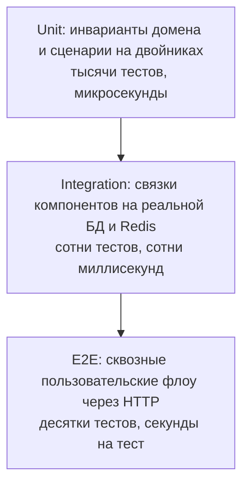

# Стратегия тестирования

## Описание

Документ определяет, на какие три уровня делится тестирование **AEM**, по какому
критерию тест относится к уровню, чем каждый уровень запускается и как именуются
файлы. Это разделительная линия: у теста сначала спрашивают «что ты проверяешь и
с чем реально работаешь», потом «как ты назван».

Канон уровня — в документах [Unit](02-unit-testing.md),
[Integration](03-integration-testing.md), [E2E](04-e2e-testing.md);
иерархия фикстур и изоляция состояния — в
[Fixtures and isolation](05-fixtures-and-isolation.md).

## Как это работает

### Пирамида



Основной объём проверок живёт снизу. Тест, который можно написать на уровне
ниже, пишется на уровне ниже: инвариант таймкодов момента — в Unit, его
сохранение и выборка с фильтром — в Integration, публикация момента через HTTP с
проверкой заголовков и состояния базы — в E2E.

### Матрица различий

| Критерий | Unit | Integration | E2E |
| --- | --- | --- | --- |
| **Цель** | Изолированная бизнес-логика | Взаимодействие двух и более компонентов | Сквозной бизнес-сценарий |
| **Область** | Доменные инварианты, политики, value objects, Use Cases | Use Case + Repository, Repository + БД, кэш в Redis, сборка DI-графа | Вся система через HTTP: middleware → сценарий → адаптеры → ответ |
| **База данных** | ЗАПРЕЩЕНА (только in-memory двойники портов) | Реальный тестовый PostgreSQL | Реальный тестовый PostgreSQL |
| **HTTP-запросы** | Отсутствуют | Необязательны (тест на уровне Python API) | Обязательны (`httpx.AsyncClient`) |
| **Внешние API** | Не вызываются | Двойники тяжёлых провайдеров (Kodik, LLM, JustWatch) | Двойники на границе, приложение — настоящее |
| **Моки** | Моки портов и интерфейсов | Минимизированы: только то, что дороже теста | Минимизированы: система как чёрный ящик |
| **Скорость** | Микросекунды (сотни в секунду) | Десятки и сотни миллисекунд | Секунды |
| **Маркер** | `@pytest.mark.unit` | `@pytest.mark.integration` | `@pytest.mark.e2e` |
| **Каталог** | `tests/unit/` | `tests/integration/` | `tests/e2e/` |
| **Изоляция** | Не нужна: нет общего состояния | Вложенная транзакция с откатом + отдельная Redis-namespace | Полный сброс базы и кэша перед сценарием |

### Отнесение компонентов AEM к уровню

| Компонент | Уровень | Что проверяется |
| --- | --- | --- |
| `domain/entities`, `domain/aggregates` | Unit | инвариант нельзя обойти конструктором: таймкоды момента, номер серии, позиция и громкость сессии просмотра |
| `domain/value_objects` | Unit | нормализация и производные свойства (`CatalogPage`, `GenreFilter`, `EpisodeReactionSummary`) |
| `domain/policies` | Unit | лимит гостя, age-gate, приоритет озвучки, скоринг рекомендаций |
| `application/use_cases` | Unit | оркестрация на двойниках портов: какой порт вызван, с каким `Command`, что возвращено, что сброшено в кэше |
| `application/dto`, `application/services` | Unit | форма команды/запроса, чистые вычисления сервиса рекомендаций |
| `infrastructure/database/repositories` | Integration | SQL и маппинг SQLAlchemy 2.0: сохранение, обновление, выборка с фильтрацией, каскадное удаление |
| `infrastructure/database/unit_of_work` | Integration | граница транзакции: `commit` при успехе, `rollback` при исключении, карта портов |
| `infrastructure/cache` | Integration | клад и проём `KeyValueStore`, TTL, `delete_prefix`, поведение при недоступном Redis |
| `infrastructure/security` | Integration | счётчики `RateLimiter`, блокировка входа, блок-лист токенов на реальном хранилище |
| `infrastructure/external` | Integration | разбор ответа провайдера на записанном фикстуре; сеть не вызывается |
| `infrastructure/di` | Integration | полнота графа: каждый объявленный сценарий резолвится в `Scope.REQUEST` |
| `presentation/api` маршруты | E2E | коды, заголовки, форма JSON, владение ресурсом (`401` анониму, `403` чужому) |
| `presentation/web` страницы | E2E | HTML-ответ, редиректы, cookie-сессия, CSRF |
| Стриминг через медиа-прокси | E2E | манифест и чанки, `Content-Type`, перезапись путей |

### Инструментарий

| Инструмент | Роль |
| --- | --- |
| `pytest` | раннер; сбор и отбор тестов по маркерам |
| `pytest-asyncio` | асинхронный движок; `asyncio_mode = "auto"`, поэтому `async def`-тест пишется без декоратора маркера |
| `pytest-cov` | покрытие по веткам, порог из `[tool.coverage.report] fail_under` |
| PostgreSQL в Docker / `testcontainers` | чистая база под интеграционные и E2E прогоны |
| Redis в Docker | реальное хранилище кэшей и счётчиков |
| SQLAlchemy 2.0 Async | откат транзакции между тестами через вложенный `SAVEPOINT` |
| `httpx.AsyncClient` + `ASGITransport` | HTTP-клиент E2E, упирающий прямо в точку входа FastAPI |
| `unittest.mock.AsyncMock` | двойники портов в Unit |
| `FakeUnitOfWork` (`tests/support/fakes.py`) | единица работы, отдающая заранее подготовленные двойники |
| Dishka `Provider` | подмена зависимостей тестового приложения на границе |
| `faker` | генерация правдоподобных данных в фабриках |

Установка инструментов для тестов выполняется одной командой:

```bash
uv add --dev testcontainers faker
```

### Команды запуска

```bash
uv run pytest -m unit -q                      # быстрые, без базы и сети
uv run pytest -m integration -q --no-cov      # требуют тестовой PostgreSQL
uv run pytest -m e2e -q --no-cov              # сквозные сценарии
uv run pytest                                 # полный прогон с покрытием
```

Отбор по маркеру обязателен: `-m unit` должен проходить без поднятого Docker и
без переменных окружения. Прогон без `-m` — только перед pull request.

### Нейминг

Имя файла отвечает на вопрос «что проверяется», имя теста — «при каких условиях
что ожидается». Generic-имена запрещены: `test_moment.py`, `test_user.py`,
`test_helpers.py`, `test_api.py`, `test_flow.py`.

| Уровень | Файл | Тест |
| --- | --- | --- |
| Unit, домен | `test_<сущность>_invariants.py`, `test_<зона>_policy.py` | `test_<правило>_<условие>_<ожидание>` |
| Unit, сценарий | `test_<verb>_<noun>_use_case.py` | `test_<сценарий>_<условие>_<ожидание>` |
| Integration | `test_<зона>_repository.py`, `test_<зона>_cache.py`, `test_unit_of_work.py`, `test_container_graph.py` | `test_<операция>_<условие>_<ожидание>` |
| E2E | `test_<субъект>_<flow>_flow.py` | `test_<шаг>_<условие>_<ожидание>` |

| Запрещено | Почему | Требуется |
| --- | --- | --- |
| `test_moment.py` | непонятно, сущность, сценарий или репозиторий | `test_viewing_moment_invariants.py`, `test_save_viewing_moment_use_case.py`, `test_moment_repository.py` |
| `test_user.py` | под одним именем живут правила домена и HTTP-контракт | `test_user_invariants.py`, `test_user_repository.py`, `test_user_profile_management_flow.py` |
| `test_api.py` | не отражает ни маршрут, ни сценарий | `test_authentication_flow.py`, `test_smart_search_and_playback_flow.py` |
| `test_helpers.py` | утилита — не тест | `conftest.py` или `tests/fixtures/common/` |

Класс-контекст называется по проверяемому компоненту: `TestMomentRepository`,
`TestAddFavoriteUseCase`, `TestAuthenticationFlow`. Один файл — один класс или
группа классов по одному компоненту.

### Покрытие

Порог `fail_under` из `pyproject.toml` — общий, он ловит молчаливое проседание и
не заменяет проверку качества конкретного теста. Ориентир распределения: домен и
прикладной слой покрыты инвариантами и ветвлениями сценариев, инфраструктура —
реальными прогонами на PostgreSQL и Redis, представление — сквозными сценариями.
Строка, покрытая вызовом «в никуда» (без утверждения о результате), покрытием не
считается.

## Почему это сделано так

Три уровня, а не два, потому что у связок разная природа отказа: Unit ловит
неверное правило, Integration — неверный маппинг, ограничение схемы или TTL,
E2E — нарушение контракта с клиентом. Подмена одного другим даёт иллюзию:
зелёные юнит-тесты не доказывают, что `uq_episode_reaction` работает, а зелёный
E2E не доказывает, что возрастный gate отсечён до обращения к LLM.

База запрещена в Unit не из догмы: доступ к базе делает тест медленным и
зависимым от порядка, а медленный тест разработчик перестаёт запускать часто —
обратная связь теряется ровно там, где она дороже всего.

Реальный PostgreSQL на Integration и E2E обязателен, потому что SQLite не
проверяет внешних ключей по умолчанию: ссылка на несуществующий тайтл проходит в
SQLite и падает в бою. Тест, который «зелён на SQLite», не подтверждает
целостность данных.

Нейминг регламентирован, потому что по имени файла читают карту покрытия:
`test_moment.py` не отвечает на вопрос, что именно сломалось, и превращается в
свалку проверок разного уровня.

## Где в коде

- `pyproject.toml` — `[tool.pytest.ini_options]` с маркерами, `asyncio_mode`, `pythonpath`; `[tool.coverage.*]` с порогом
- `tests/unit/`, `tests/integration/`, `tests/e2e/` — три уровня
- `tests/support/` — двойники портов и фабрики
- `tests/conftest.py` — хуки и регистрация маркеров
- `.github/workflows/ci.yml` — сервисный PostgreSQL и раздельные прогоны

## Связанные документы

- [Unit-тесты](02-unit-testing.md)
- [Integration-тесты](03-integration-testing.md)
- [E2E-тесты](04-e2e-testing.md)
- [Фикстуры и изоляция](05-fixtures-and-isolation.md)
- [Соглашения кодовой базы](../04-dev-guide/conventions.md)
- [Как добавить фичу](../04-dev-guide/feature-workflow.md)
- [Слои и правила](../01-architecture/layers-and-rules.md)
