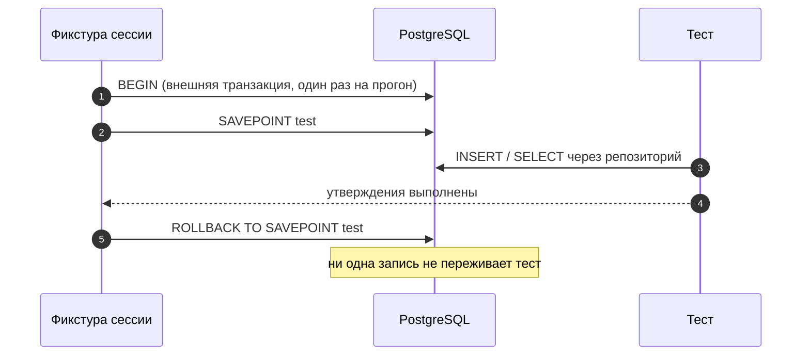

# Integration-тесты

## Описание

Канон интеграционного теста **AEM**: проверяется совместная работа двух и более
компонентов на настоящих зависимостях. Здесь тестируется то, что принципиально
непроверяемо на двойниках — SQL, маппинг SQLAlchemy 2.0, ограничения схемы,
каскадные удаления, TTL в Redis и сборка DI-графа.

Уровень отделён от [Unit](02-unit-testing.md) наличием реальной базы, от
[E2E](04-e2e-testing.md) — отсутствием HTTP: вызов идёт на уровне Python API.

## Как это работает

### Что тестируется в AEM

| Связка | Предмет проверки |
| --- | --- |
| Use Case + Repository | сценарий на реальной транзакции: команда → запись → выборка; сброс кэша после `commit` |
| Repository + PostgreSQL | корректность асинхронных запросов и маппинга сущностей: сохранение, обновление, выборка с фильтрацией, сортировка, пагинация |
| Сущность ↔ таблица | сериализация составных полей (жанры как JSON-строка, `original_title`, метки времени), `expire_on_commit=False` |
| Агрегат + дети | каскадное удаление: удаление пользователя уносит избранное, коллекции, хайлайты, реакции, статусы просмотра |
| `SqlAlchemyUnitOfWork` | `commit` при успехе блока, `rollback` при исключении, `LookupError` на незарегистрированный порт |
| `KeyValueStore` + Redis | клад и проём по namespace, `delete_prefix`, `consume` (SET NX), Lua-инкремент с TTL, `get_ttl` |
| Предметные кэши | `RecommendationCache`, `HighlightDashboardCache`, `ProfileOverviewCache`: попадание, промах, инвалидация по пользователю |
| Ограничения схемы | нарушение уникальности и внешнего ключа даёт конкретную ошибку, которую слой умеет различить |
| DI-граф | каждый объявленный провайдером сценарий резолвится в `Scope.REQUEST`; фасады и провайдеры не расходятся |
| Внешние разборы | парсер ответа провайдера (Kodik, AniLibria, LLM) на записанном теле: сеть не вызывается |

### Принципы

**Реальные зависимости.** Проверяется настоящий `FavoriteRepository` на настоящей
тестовой PostgreSQL, а не его имитация. Подменяется только то, что дороже самого
теста: тяжёлые внешние API провайдеров и LLM, почтовая доставка, Telegram.

**Транзакционная изоляция.** Каждый тест выполняется внутри вложенной транзакции
и откатывается. Схема создаётся один раз на сессию прогона (`upgrade head`
миграций), данные — внутри `SAVEPOINT`, который снимается в финализаторе
фикстуры. База остаётся кристально чистой для следующего теста, а порядок
запуска перестаёт влиять на результат.



**Миграции вместо `create_all`.** Схема тестовой базы поднимается тем же
механизмом, что и боевая, — `upgrade head` из `migrations/alembic.ini`. Это
отдельно проверяет, что ревизии применяются на чистой базе и что модели не ушли
вперёд миграций.

### Подготовка базы

Инфраструктура поднимается из compose-контура, база под тесты — отдельная:

```bash
docker compose up -d postgres
docker compose exec -T postgres createdb -U anime_epic_moments_user anime_epic_moments_test
```

Прогон запускается с указанной тестовой базой в `TEST_DATABASE_URL` — в CI это
`env:` шага пайплайна, локально значение берётся из `.env`. Фикстура
`migrated_schema` поднимает в этой базе схему миграциями (`upgrade head`) один
раз на прогон, поэтому отдельная команда не нужна:

```bash
uv run pytest -m integration -q --no-cov
```

Альтернатива ручному `createdb` — `testcontainers`: контейнер с `postgres:16-alpine`
поднимается на прогон сессии и убивается вместе с ней, поэтому не оставляет
состояния на машине разработчика. Выбор фикстуры — в
[иерархии фикстур](05-fixtures-and-isolation.md).

**Почему нельзя только SQLite.** SQLite по умолчанию не проверяет внешние ключи:
вставка ссылающейся строки с несуществующим родителем проходит и остаётся
невидимой, пока на PostgreSQL не упадёт `ForeignKeyViolation`. Дополнительно
SQLite иначе выполняет `ON DELETE CASCADE`, иначе сортирует `NULL` и иначе
ведёт себя с `UNIQUE`-констрейнтами. SQLite допустим как утилита разработки для
быстрого прогона, но интеграционный тест в основной схеме идёт на PostgreSQL.

### Структура директории

```text
tests/integration/
├── repositories/
│   ├── test_moment_repository.py
│   ├── test_favorite_repository.py
│   ├── test_highlight_repository.py
│   └── test_user_repository.py
├── application/
│   ├── test_add_favorite_use_case.py
│   └── test_publish_viewing_moment_use_case.py
├── database/
│   └── test_unit_of_work.py
├── redis/
│   └── test_redis_cache_service.py
├── external/
│   └── test_kodik_api_client.py
└── di/
    └── test_container_graph.py
```

### Изоляция Redis

Тестовый Redis использует отдельный номер базы и префикс пространства имён,
отличающийся от боевого (`anime_epic_moments_test` вместо
`anime_epic_moments`). Финализатор фикстуры снимает keyspace по префиксу через
`SCAN`, а не `FLUSHALL`: на общем сервере `FLUSHALL` уничтожил бы чужое
состояние. Проверке подлежат: попадание и промах, `delete_prefix` по префиксу
пользователя, TTL после записи, поведение `KeyValueStore` при недоступном
Redis (деградация в память против `required=True`).

### Пример

```python
"""Репозиторий моментов просмотра на реальной PostgreSQL."""

from __future__ import annotations

import pytest
from sqlalchemy.exc import IntegrityError

from backend.domain import User
from backend.infrastructure.database.repositories.moment_repository import (
    MomentRepository,
)
from backend.infrastructure.database.repositories.user_repository import (
    UserRepository,
)


@pytest.mark.integration
class TestMomentRepository:
    """Поведение MomentRepository на транзакции с откатом."""

    async def test_get_by_user_returns_newest_first(
        self,
        transaction_session,
        moment_factory,
    ) -> None:
        """Что тестируем: выборку моментов пользователя с сортировкой.
        Что передаём: три момента с разными метками создания.
        Что ожидаем: все три возвращены, порядок — от нового к старому.
        """
        user = await UserRepository(transaction_session).add(
            User(email="moments@example.com", username="moments-user", password_hash="hash")
        )
        repository = MomentRepository(transaction_session)
        for timestamp in (10.0, 20.0, 30.0):
            await repository.add(moment_factory(user_id=user.id, timestamp=timestamp))
        await transaction_session.flush()

        items = await repository.get_by_user(user.id)

        assert [item.timestamp for item in items] == [30.0, 20.0, 10.0]

    async def test_add_rejects_moment_without_owner(
        self,
        transaction_session,
        moment_factory,
    ) -> None:
        """Что тестируем: ограничение внешнего ключа на автора момента.
        Что передаём: момент с идентификатором несуществующего пользователя.
        Что ожидаем: IntegrityError — SQLite бы это пропустил.
        """
        repository = MomentRepository(transaction_session)

        with pytest.raises(IntegrityError):
            await repository.add(moment_factory(user_id=999_999))
```

Фикстура `transaction_session` и фабрики данных объявляются в
`tests/integration/fixtures/`; в файле теста они только принимаются
(правило — в [иерархии фикстур](05-fixtures-and-isolation.md)).

### Ошибки БД: что обязательно проверяется

| Случай | Ожидаемое поведение |
| --- | --- |
| Повтор пары `(collection_id, anime_id)` | `IntegrityError` на констрейнте `uq_collection_anime` |
| Повтор реакции на серию | `IntegrityError` на `uq_episode_reaction` |
| Повтор лайка хайлайта | `IntegrityError` на `uq_highlight_like` |
| Дублирование оценки тайтла | `IntegrityError` на `uq_user_anime_ratings_user_anime` |
| Ссылка на несуществующего пользователя | `IntegrityError` с нарушением FK |
| Удаление пользователя | каскад: его избранные, коллекции, хайлайты, моменты и реакции исчезают |
| Удаление хайлайта | его лайки, комментарии и сохранённые копии (`uq_saved_highlight`) удалены |
| Гонка двух транзакций | вторая получает ошибку ограничения, а не «тихую» двойную запись |

### Что не относится к Integration

| Не здесь | Куда |
| --- | --- |
| Инвариант сущности, ветвление сценария на двойниках | [Unit](02-unit-testing.md) |
| Коды ответов, заголовки, CSRF, cookie | [E2E](04-e2e-testing.md) |
| Реальный сетевой вызов провайдера или LLM | не тестируется: разбор ответа проверяется на записанном теле |

## Почему это сделано так

Откат через `SAVEPOINT`, а не `drop_all` после каждого теста: пересоздание схемы
на тест стоит дороже самого теста и скрывает ошибки, которые накапливаются
между записями (уникальность, сортировка). Один `BEGIN` на прогон с откатом
точечной транзакции даёт изоляцию при скорости, сравнимой с unit-прогоном.

Схема поднимается миграциями, потому что иначе тест проверяет модель, а не базу:
забытая ревизия остаётся невидимой до выката, где `verify_schema` падает на
пользователе.

Внешние API подменяются на границе, а не внутри репозитория: цель теста —
собственное поведение AEM. Прогон к Kodik или LLM делает проверку недетерминированной
и расходует чужую квоту, а её результат ничего не доказывает о маппинге.

SQLite признан непригодным для интеграционных проверок, потому что он не
исполняет внешний ключ по умолчанию: тест остаётся зелёным при данных, которые
боевая база отвергает.

## Где в коде

- `tests/integration/repositories/` — адаптеры репозиториев на PostgreSQL
- `tests/integration/database/test_unit_of_work.py` — граница транзакции
- `tests/integration/redis/` — `KeyValueStore` и предметные кэши
- `tests/integration/di/` — полнота DI-графа
- `tests/integration/fixtures/` — `transaction_session`, Redis-фикстура, фабрики
- `pyproject.toml` — маркер `integration`
- `.github/workflows/ci.yml` — сервисный PostgreSQL и `TEST_DATABASE_URL`

## Связанные документы

- [Стратегия тестирования](01-testing-strategy.md)
- [Unit-тесты](02-unit-testing.md)
- [E2E-тесты](04-e2e-testing.md)
- [Фикстуры и изоляция](05-fixtures-and-isolation.md)
- [Модель данных](../01-architecture/data-model.md)
- [Сопровождение: миграции](../03-ops/maintenance.md)
