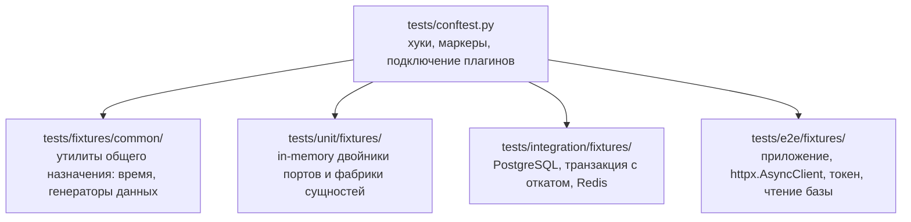

# Фикстуры и изоляция

## Описание

Документ задаёт, где объявляются фикстуры **AEM**, как они разделяются по уровням
и какие механизмы защищают тест от чужого состояния. Это половина канона: сами
правила уровней описаны в [стратегии](01-testing-strategy.md), здесь — способ
подготовить данные, не создав скрытых связей между тестами.

Два запрета действуют на всё дерево `tests/`:

1. В файлах тестов фикстуры не объявляются — только принимаются аргументами.
2. В корневой `tests/conftest.py` не хранятся фикстуры данных — только хуки,
   маркеры и подключение общих модулей.

## Как это работает

### Каскад конфигурации



| Файл | Что содержит | Чего здесь быть не должно |
| --- | --- | --- |
| `tests/conftest.py` | `pytest_collection_modifyitems` с регистрацией маркеров, общие хуки, `sys.path`/настройки окружения прогона, импорт общих плагинов | фикстуры данных; патчинг боевого кода; предположения о базе и сети |
| `tests/fixtures/common/` | фиксированное время, генераторы правдоподобных значений (`faker`), строители таймкодов и внешних идентификаторов тайтлов | подключения к базе и Redis, HTTP-клиент |
| `tests/unit/fixtures/` | `FakeUnitOfWork`, двойники портов репозиториев, сервисов и LLM, фабрики доменных сущностей | импорт `backend.infrastructure`, сессии, сокеты |
| `tests/integration/fixtures/` | тестовая PostgreSQL, схема из миграций, сессия с вложенной транзакцией и откатом, единица работы, Redis-хранилище с тестовым namespace, фабрики ORM-моделей | двойники проверяемого поведения |
| `tests/e2e/fixtures/` | приложение из `create_app()` с подменёнными адаптерами, `httpx.AsyncClient` на ASGI-транспорте, клиент с Bearer-токеном и с cookie+CSRF, функция чтения базы для утверждений | прямые вставки данных, минуемые пользовательские шаги |

### Правила объявления

| Правило | Формулировка |
| --- | --- |
| Область видимости | фикстура объявляется в том `conftest.py`, который является общим для всех её потребителей, и ни уровнем выше |
| Скоуп | `function` — всё, что содержит данные; `session` — только инфраструктура: контейнер базы, engine, Redis-соединение |
| Имя | имя описывает то, что отдаётся: `transaction_session`, `migrated_schema`, `redis_store`, `bearer_client`, а не `setup`, `common`, `data` |
| Фабрика вместо значения | тестовые данные отдаются вызываемой фикстурой (`moment_factory(**overrides)`), чтобы два теста не поделили один изменяемый объект |
| Финализатор обязателен | всё, что создано, снимается после `yield`: откат транзакции, `SCAN`+`DEL` по префиксу, закрытие клиента, отмена подмены провайдера |
| Без `autouse` для данных | `autouse` допустим только для инфраструктуры прогона (фиксированное время, сброс переменных контекста); данные с `autouse` делают тест нечитаемым |
| Без conditional-логики | фикстура не выбирает поведение по имени теста: нужны разные данные — разные фикстуры |

### Защита от утечки контекста

Утечка контекста — ситуация, когда результат теста зависит от того, что
произошло в другом тесте, в другом файле или раньше в том же прогоне.

| Вектор утечки | Механизм защиты |
| --- | --- |
| Общие строки и словари в фикстуре `session` | фабрика: каждый вызов строит новый объект |
| Изменение модуля боевого кода на этапе сборки тестов | запрещён; подстановка делается через `monkeypatch` в фикстуре `function` или через Dishka-провайдер с отменой в финализаторе |
| Протекающая транзакция базы | сессия внутри `SAVEPOINT`, откат в финализаторе; `commit` сценарию разрешён, внешняя транзакция снимается целиком |
| Последовательности PostgreSQL | не сбрасываются — и не используются в утверждениях: идентификатор берётся из результата записи, а не предполагается |
| Кэш Redis между тестами | отдельный namespace прогона + `SCAN` по префиксу в финализаторе; `FLUSHALL` запрещён |
| Внутрипроцессные кэши (`WatchSourceCaches`, `TTLCache`) | фикстура создаёт новый экземпляр на тест; разделение кэша между прогонами недопустимо |
| Переменные контекста запроса (`request_id`, `user_id`) | фикстура очищает `ContextVar` после теста |
| Подменённые провайдеры Dishka | override регистрируется в фикстуре и снимается в её финализаторе; контейнер не переживает тест |
| Цикл событий asyncio | `asyncio_mode = "auto"`, event loop уровня `function`; для `session`-инфраструктуры явно задаётся `asyncio_default_fixture_loop_scope = "session"` в `pyproject.toml`, иначе сессия, открытая в одном цикле, не работает в другом |
| Порядок запуска | проверяется двойным прогоном: сначала файл изолированно, затем весь набор; тест, падающий только во втором случае, зависит от соседа и считается дефектным |

### Пример: транзакционная сессия

```python
"""Фикстуры интеграционного уровня: база с откатом и тестовый Redis."""

from __future__ import annotations

import pytest
import pytest_asyncio
from sqlalchemy.ext.asyncio import async_sessionmaker

from backend.infrastructure.cache.key_value_store import KeyValueStore


@pytest_asyncio.fixture
async def transaction_session(migrated_schema):
    """Отдать сессию внутри вложенной транзакции и откатить её после теста.

    Args:
        migrated_schema: engine с тестовой PostgreSQL и применёнными миграциями.

    Yields:
        AsyncSession: сессия, чьи записи не переживают тест.
    """
    connection = await migrated_schema.connect()
    external = await connection.begin()
    session = async_sessionmaker(bind=connection, expire_on_commit=False)()
    nested = await connection.begin_nested()
    try:
        yield session
    finally:
        await session.close()
        await nested.rollback()
        await external.rollback()
        await connection.dispose()


@pytest_asyncio.fixture
async def redis_store(test_database_url):
    """Отдать хранилище ключ-значение в отдельном namespace прогона.

    Args:
        test_database_url: URL тестового Redis, отличный от боевого.

    Yields:
        KeyValueStore: хранилище, чьи ключи снимаются после теста.
    """
    store = KeyValueStore(redis_url=test_database_url, namespace="anime_epic_moments_test")
    try:
        yield store
    finally:
        await store.delete_prefix("")
```

Фикстура `migrated_schema` поднимает схему миграциями (`alembic upgrade head`
на тестовой базе) и живёт со скоупом `session`: перестраивать её на каждый тест
значит потерять обратную связь по времени.

### Пример: клиент E2E с токеном

```python
"""Фикстуры сквозного уровня: приложение и HTTP-клиент."""

from __future__ import annotations

import httpx
import pytest_asyncio

from backend.presentation.app_factory import create_app


@pytest_asyncio.fixture
async def app(llm_double, watch_source_doubles):
    """Собрать настоящее приложение с двойниками внешних адаптеров.

    Args:
        llm_double: подмена LLM-клиента на границе.
        watch_source_doubles: подмены провайдеров источников просмотра.

    Yields:
        FastAPI: приложение, готовое к приёму HTTP-запросов.
    """
    application = create_app()
    override_test_providers(application, llm=llm_double, sources=watch_source_doubles)
    try:
        yield application
    finally:
        await close_test_container(application)


@pytest_asyncio.fixture
async def client(app):
    """Отдать async-клиент, упирающийся прямо в точку входа FastAPI.

    Args:
        app: собранное приложение.

    Yields:
        httpx.AsyncClient: клиент с base_url и без разыменования редиректов.
    """
    transport = httpx.ASGITransport(app=app)
    async with httpx.AsyncClient(
        transport=transport,
        base_url="http://testserver",
        follow_redirects=False,
    ) as async_client:
        yield async_client
```

Подмена ставится на границе адаптера (LLM, провайдер, почта, Telegram), а не на
уровне сценария или маршрута: иначе проверяется пустая обёртка.

### Антипаттерны

| Антипаттерн | Почему ломает |
| --- | --- |
| `@pytest.fixture` внутри файла теста | фикстура недоступна другому файлу и копируется; дубли расходятся |
| Фикстура `session`, возвращающая изменяемые данные | первый тест мутирует состояние, остальные зависят от порядка |
| Патч боевого метода в момент сборки (`pytest_collection_modifyitems`) | подмена видна всем уровням и исчезает из текста теста; поиск причины занимает прогон целиком |
| `autouse`-фикстура, пишущая в базу | тест получает данные, которых нет в его тексте |
| Общие `AsyncMock` на уровне модуля | журналы вызовов накапливаются между тестами, `assert_called_once` врёт |
| Фикстура, читающая `.env` разработчика | прогон становится машино-зависимым |
| `FLUSHALL` и `drop_all` в финализаторе | уничтожают чужое состояние на общем сервере; медленнее отката транзакции |
| Подмена самого проверяемого сценария | тест подтверждает заглушку |

## Почему это сделано так

Корневой `conftest.py` остаётся тонким, потому что он применяется ко всему
прогону: фикстура данных, положенная сюда, становится видна всем уровням
одновременно, и изоляция между unit и integration перестаёт существовать.
Отсюда и правило «хуки и маркеры — здесь, данные — в своём каскаде».

Откат через `SAVEPOINT` вместо пересоздания схемы выбран по цене обратной связи:
`BEGIN`/`ROLLBACK` стоит десятки микросекунд, `create_all`/`drop_all` —
пересборку всего набора таблиц на тест, а вместе с ним теряется проверка
ограничений и накопительного состояния (уникальность, каскады).

Фабрика вместо готового значения убирает общий изменяемый объект. Один и тот же
`Highlight` в двух тестах означает, что второй видит правки первого, и падение
начинает зависеть от порядка, который pytest не обещает.

Подмена на границе адаптера сохраняет смысл сквозной проверки: приложение,
middleware, сценарии и репозитории остаются настоящими, недетерминированный
внешний мир — единственным двойником.

## Где в коде

- `tests/conftest.py` — хуки и регистрация маркеров
- `tests/fixtures/common/` — время, генераторы данных
- `tests/support/` — `FakeUnitOfWork` и двойники портов
- `tests/unit/fixtures/`, `tests/integration/fixtures/`, `tests/e2e/fixtures/` — уровневые фикстуры
- `pyproject.toml` — маркеры `unit`, `integration`, `e2e`, `contract`, `asyncio_mode`

## Связанные документы

- [Стратегия тестирования](01-testing-strategy.md)
- [Unit-тесты](02-unit-testing.md)
- [Integration-тесты](03-integration-testing.md)
- [E2E-тесты](04-e2e-testing.md)
- [Поток запроса](../01-architecture/data-flow.md)
- [DI на Dishka](../01-architecture/di-dishka.md)
- [Соглашения кодовой базы](../04-dev-guide/conventions.md)
