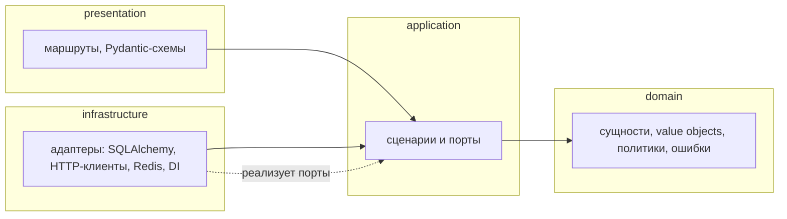

# 0001. Clean Architecture и доменное ядро

Статус: принято
Дата записи: 2026-10

## Контекст

К началу работы над асинхронной версией **AEM** представляла собой Flask-
наследие, переписанное на FastAPI: обработчик маршрута мог одновременно открывать
транзакцию, собирать SQL, вызывать внешний API и форматировать HTML. Последствия
такой связности:

- изменение схемы БД требовало правки маршрутов, поэтому любой рефакторинг
  затрагивал всё сразу;
- проверить правило домена (например, «момент не длиннее эпизода») можно было
  только подняв приложение с базой;
- подмена внешнего провайдера (Kodik → AniLibria, Gemini → Hugging Face)
  означала искать, кто и где дёрнул httpx;
- объём кода `src/backend` — 558 Python-модулей и около 33 000 строк: на таком
  масштабе договорённость «не клади SQL в роут» уже не работает, нужен
  проверяемый механизм.

Требовалось выбрать разделение, которое можно машинно защитить и при этом
не раздувающее простейшие сценарии до нечитаемого состояния.

## Драйверы решения

| Драйвер | Что требует |
| --- | --- |
| Проверяемость границ | правило «кто кого импортирует» должно падать в CI, а не обсуждаться на ревью |
| Тестируемость правил | доменная логика проверяется без БД, HTTP и контейнера |
| Сменяемость адаптеров | провайдер видео, LLM, хранилище кэша и драйвер БД меняются без правки сценариев |
| Читаемость вертикали | путь «одна фича» читается за один заход: сущность → сценарий → адаптер → маршрут |
| Умеренная цена | переиспользование FastAPI, SQLAlchemy 2.0 и Pydantic без слоя-прослойки ради слоя |
| Один-два разработчика | правила должны помещаться в голову и поддерживаться без архитектора |

## Рассмотренные варианты

| Вариант | Суть | Итог |
| --- | --- | --- |
| Четыре слоя Clean Architecture | `domain` → `application` → `infrastructure` → `presentation`, зависимость только внутрь | **Принят**: единственное разделение, которое выражается декларативным контрактом import-linter |
| Технические слои (`api/`, `db/`, `services/`) | разделение по типу инструмента | Отклонён: бизнес-правила остаются в маршрутах и сервисах, правила импортов нечего проверять |
| Вертикальные срезы по фичам | `favorites/`, `highlights/` со всеми слоями внутри | Отклонён как основной: общие механизмы (UoW, кэш, безопасность) приходится дублировать в каждом срезе; как дополнительный используется внутри слоёв — пакеты по зонам |
| Гексагональная с доменными событиями и шинами | порты + событийная шина между сценариями | Отклонён: событийная модель не окупается при единственном исполняющем процессе, а отладка асинхронных цепочек дороже прямой вызываемости |
| Фасад сервисов поверх SQLAlchemy-моделей | модели как ядро, сервисы над ними | Отклонён: модель SQLAlchemy есть знание о драйвере и колонках, инварианты в неё не помещаются, тесты правил требуют БД |

## Решение

Приняты четыре слоя с направлением зависимостей внутрь и доменным ядром без
сторонних библиотек.

| Слой | Обязанность | Чем разрешено быть зависимым |
| --- | --- | --- |
| `domain` | инварианты и правила: сущности, value objects, политики, `DomainError` | только стандартная библиотека (`secrets`, `urllib.parse`, `dataclasses`, `datetime`) |
| `application` | сценарии (`*UseCase.execute`), порты репозиториев и технических служб, DTO | `domain`, стандартная библиотека, константы `starlette.status` |
| `infrastructure` | SQLAlchemy-модели и репозитории, HTTP-клиенты провайдеров и LLM, Redis-кэш, безопасность, файловое хранилище, уведомления, сборка Dishka | `application`, `domain`, сторонние библиотеки |
| `presentation` | маршруты, middleware, Pydantic-схемы запросов и ответов, Jinja2-рендеринг | `application`, `domain` (и два исключения в `infrastructure`) |

Границы защищают два контракта import-linter из `pyproject.toml`:

- «Layer Boundaries» — слойный порядок `presentation > infrastructure >
  application > domain`;
- «Presentation does not reach Infrastructure» — прямой запрет представления
  касаться инфраструктуры, с `allow_indirect_imports = true` и двумя
  исключениями.

Единица работы (`UnitOfWorkInterface`) — способ провести границу транзакции в
прикладном слое, не зная о сессии SQLAlchemy: сценарий открывает блок
`async with self._uow as uow` и берёт репозиторий по порту
(`uow.repository(FavoriteRepository)`), а словарь порт → адаптер живёт в
инфраструктуре.

### Принятые компромиссы

| Компромисс | Формулировка | Почему оставлен |
| --- | --- | --- |
| `from starlette import status` в `application` | 24 модуля прикладного слоя используют константы HTTP-статусов вместо «сырых» чисел и вместо собственного словаря кодов | это единственный сторонний импорт слоя; он не тянет транспорт и не мешает заменить FastAPI, а своя таблица констант дублировала бы общедоступные значения |
| два исключения в контракте «Presentation does not reach Infrastructure» | `media_proxy → hls_proxy` (транспорт проксируемого потока) и `app_factory → dishka_container` (composition root) | описать проксируемый поток портом в `application` значит протянуть HTTP-типы через весь слой; карта нарушений и обоснование — в отдельном документе |
| домен не знает о ORM, но знает о времени | источник текущего времени — `domain/clock.py` (`utc_now`) | детерминизм тестов важнее: генераторы дат ORM (`datetime.utcnow` в колонках) остались в инфраструктуре |
| фасад `application/use_cases/__init__.py` | 203 строки реэкспорта всех сценариев | единая точка импорта сценариев для DI и тестов; согласованность фасада и DI-графа проверяется тестом |

## Последствия

### Положительные

- направление импортов проверяется машиной: новый «SQL в маршруте» роняет
  `uv run python scripts/check_imports.py` до ревью;
- правила домена покрываются тестами без поднятия приложения: 233 тестовых
  модуля, из них заметная часть — чистые юнит-тесты `domain` и `application`
  на подставных портах;
- добавление второго LLM-провайдера или второго провайдера видео — новый класс в
  `infrastructure/external/...` плюс строка в провайдере DI, сценарии не меняются;
- «куда положить новый класс» имеет короткий ответ, а вертикаль фичи читается
  за один проход;
- смена PostgreSQL на другой SQL-движитель затрагивает `infrastructure/database`
  и миграции, а не сценарии.

### Отрицательные

- на одну сущность приходится до шести файлов (сущность, порт, DTO, сценарий,
  модель, адаптер) плюс регистрация в `_REPOSITORY_TYPES`, провайдер DI и
  маршрут; тривиальные CRUD-действия это удорожает;
- цена нарушения границы видна не сразу, а только на гейте, поэтому без
  pre-commit локальные коммиты расходятся с CI;
- анализ графа импортов занимает заметное время на полном пакете, поэтому
  `check_imports.py` — самый медленный из «быстрых» локальных гейтов;
- два исключения в «Presentation does not reach Infrastructure» — постоянный
  долг: их нужно перечислять при каждом разборе графа и перепроверять при
  рефакторинге маршрутов.

## Условия пересмотра

Решение пересматривается, если:

- объём `application` вырастет настолько, что плоский список слоёв перестанет
  отражать связи (появится потребность в модулях верхнего уровня или
  пакетно-ориентированном контракте);
- появится асинхронная обработка вне HTTP-запроса (очереди, воркеры) — тогда
  граница «один запрос — одна REQUEST-скоуп» рушится и придётся вводить
  событийную модель;
- число исключений в контракте forbidden превысит два: это признак того, что
  слои перестали описывать реальную архитектуру.

## Где в коде

- `pyproject.toml` — оба контракта import-linter
- `src/backend/domain/` — ядро без сторонних библиотек
- `src/backend/application/interface/` — порты
- `src/backend/infrastructure/database/unit_of_work.py` — словарь порт → адаптер
- `src/backend/application/use_cases/result.py` — `from starlette import status`

## Связанные документы

- [Обзор архитектуры и C4](../01-architecture/overview.md)
- [Слои и правила](../01-architecture/layers-and-rules.md)
- [Обоснование исключений import-linter](../01-architecture/importlinter-baseline.md)
- [Поток запроса](../01-architecture/data-flow.md)
- [0002. Dishka вместо нативного DI](0002-dishka-di.md)
- [0005. Раскладка infrastructure по назначению](0005-infrastructure-packages.md)
