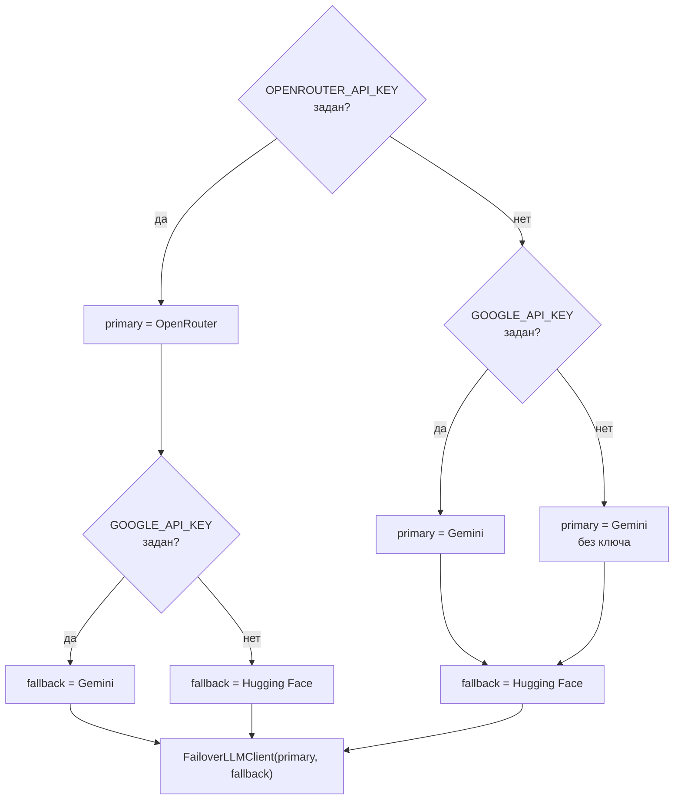

# 0004. Двухуровневая стратегия семантического поиска

Статус: принято
Дата записи: 2026-10

## Контекст

**Smart Search** в **AEM** отвечает на запрос вроде «аниме про школьника, который
становится сильнейшим мечником и теряет память». В каталоге нет семантического
индекса и нет эмбеддингов: поисковый индекс провайдера понимает только название и
текст синопсиса. Поэтому смысл запроса должна переводить в конкретные названия
языковая модель.

Внешняя модель — это единственный недоступный контролируемым образом ресурс
функции: у неё есть квоты, лимиты запросов в минуту, платные ключи, таймауты и
формат ответа, который модель может нарушить. При этом умный поиск — не
критическая операция: отказ должен ухудшить качество выдачи, но не сломать
страницу поиска.

Отсюда требования к архитектуре: поиск обязан работать при отсутствии любого
ключа, при исчерпании квоты, при сетевом сбое и при «болтовом» ответе модели.

## Драйверы решения

| Драйвер | Что требует |
| --- | --- |
| Доступность | ответ пользователю без обращения к модели, если модель недоступна |
| Нулевая стоимость входа | приложение запускается и работает без единого LLM-ключа |
| Предсказуемость | одинаковый запрос даёт одинаковую выдачу, иначе кэш каталога бесполезен |
| Безопасность контента | 18+ намерение отсекается до обращения к внешнему провайдеру |
| Наблюдаемость | в логе видно, кто именно ответил — модель или подстановка |
| Простота добавления провайдера | новый поставщик модели не должен требовать правки сценария |

## Рассмотренные варианты

| Вариант | Суть | Итог |
| --- | --- | --- |
| Один провайдер без резерва | только Gemini, ошибка = пустая выдача | Отклонён: страница поиска падает вместе с чужой квотой |
| Эмбеддинги и векторный индекс | собственный индекс синопсисов, pgvector | Отклонён на текущем этапе: требует перекачивания каталога, хранения векторов и cost-модели, которой у проекта нет; поиск по названию перекрывает большинство запросов |
| Повтор запроса у того же провайдера | retry с backoff | Отклонён как единственный механизм: при исчерпанной квоте повтор бесполезен, а задержка удваивается |
| N провайдеров с ротацией по очереди | список из четырёх-пяти клиентов, обход по кругу | Отклонён: лишняя сложность при двух реально доступных поставщиках, а порядок «кто основной» должен задаваться наличием ключа, а не ротацией |
| Два уровня с автоматическим переключением и детерминированной деградацией | основной провайдер, резервный провайдер, детерминированная подстановка вместо отказа | **Принят**: удовлетворяет всем шести драйверам при минимальном числе движков |

## Решение

Цепочка строится в `ClientProvidersMixin.llm_client()` и отдаётся сценарию как
один порт `LLMClientInterface`.

Базовый уровень, заложенный решением, — **Gemini как основной и Hugging Face как
резервный**; OpenRouter подключается сверху и необязателен: со своим ключом он
становится основным, а роль резерва переходит к Gemini либо Hugging Face.

Три правила переключения:

1. **Нерабочий основной пропускается.** Если у основного нет ключа, запрос
   сразу уходит резервному — лишний сетевой круг не добавляется.
2. **Признак деградации — режим.** Клиент возвращает кортеж
   «запросы, режим, текст ошибки». Режим, начинающийся с `fallback`, означает,
   что ответа модели не было; в этом случае запрос повторяется у резервного
   провайдера.
3. **Отказ не исключение.** Исключение фиксируется третьим элементом кортежа и
   не доходит до сценария: путь поиска не прерывается.

Второй уровень — детерминированная подстановка: если оба провайдера не дали
названий, запрос для каталога собирается из описания пользователя и подсказок
`AnimeSafetyPolicy.suggest_title_hints`. Пользователь получает выдачу без
участия модели, и это не считается ошибкой.

| Режим | Кто выставляет | Смысл |
| --- | --- | --- |
| `openrouter_llm_text`, `gemini_llm_text`, `hf_llm_text` | соответствующий клиент | ответ модели получен |
| `fallback_no_token` | любой клиент | ключа нет, запрос собран детерминированно |
| `fallback_empty` | любой клиент | описание пустое, сеть не нужна |
| `fallback_empty_reply`, `fallback_invalid_json` | любой клиент | модель ответила, пригодных названий нет / ответ не разобрался |
| `fallback_exception` | любой клиент | сетевой сбой или исключение, текст ошибки передан дальше |

Остальные решения, поддерживающие устойчивость:

- `temperature = 0.1` и бюджет `max_tokens` 300 у Gemini и Hugging Face, 900 у
  OpenRouter (у reasoning-моделей часть выдачи уходит в рассуждения);
- единый разбор ответа: правила «что считать названием» живут в базовом клиенте
  `HuggingFaceLLMClient`, Gemini и OpenRouter переопределяют только транспорт,
  поэтому критерии не расходятся между провайдерами;
- проверка возраста и политики безопасности стоит до внешних вызовов, то есть
  сомнительный текст квоту не расходует;
- кэш результатов поиска по описанию — 300 секунд в общем Redis-пространстве
  имён, лимит маршрута — 30 запросов в минуту на IP.

## Последствия

### Положительные

- поиск работает при нулевом наборе LLM-ключей: качество ниже, доступность не
  меняется;
- исчерпание квоты одного провайдера невидимо для пользователя — запрос
  продолжается у резерва;
- режим в составе результата делает деградацию наблюдаемой: по логу `ai_search`
  видно, кто ответил и почему сработало переключение;
- добавление четвёртого провайдера — новый класс в `external/llm/` плюс строка в
  `llm_client()`, сценарий `SearchAnimeByDescriptionUseCase` не меняется;
- детерминированная подстановка превращает отказ внешней системы в обычный
  поисковый запрос по описанию, а не в пустой экран;
- одинаковая температура и единый разбор делают выдачу воспроизводимой, что и
  даёт смысл кэшировать её на пять минут.

### Отрицательные

- переключение «по признаку режима», а не по коду ошибки: режим — строковое
  соглашение между клиентами, опечатка в его имени нарушит логику молча;
- резервный провайдер удваивает задержку в худшем случае: при таймауте основного
  (30 секунд) пользователь ждёт дважды, и это ограничено лишь лимитом маршрута;
- деградация без ключей даёт худшее качество именно у тех, у кого нет доступа к
  моделям, — то есть там, где функция выглядит наименее «умной»;
- второй уровень не проверяет гипотезы модели семантически: совпадение по
  подстроке синопсиса может вернуть не тот тайтл, и отбор остаётся за
  ранжированием;
- состав цепочки задаётся наличием ключей в окружении, поэтому конфигурация
  «что считается основным» не видна в коде приложения, а описана таблицей в
  [справочнике переменных](../03-ops/env-reference.md).

## Условия пересмотра

Решение пересматривается, если:

- число доступных провайдеров превысит три и линейная пара «основной — резерв»
  перестанет описывать выбор;
- появится собственный эмбеддинговый индекс: тогда LLM становится усилителем, а
  не единственным источником семантики, и пороги переключения пересчитываются;
- задержка двойного обращения станет заметной пользователю: тогда придётся
  вводить общий бюджет времени на запрос вместо независимых таймаутов.

## Где в коде

- `src/backend/infrastructure/external/llm/huggingface_llm_client.py` — базовый клиент и разбор ответа
- `src/backend/infrastructure/external/llm/google_gemini_llm_client.py` — транспорт Gemini
- `src/backend/infrastructure/external/llm/openrouter_llm_client.py` — транспорт OpenRouter
- `src/backend/infrastructure/external/llm/failover_llm_client.py` — правила переключения
- `src/backend/infrastructure/di/providers/clients.py` — сборка цепочки по ключам
- `src/backend/application/use_cases/anime/search_anime_by_description.py` — сценарий с деградацией
- `src/backend/application/interface/services/llm_client.py` — порт `LLMClientInterface`

## Связанные документы

- [Умный поиск: LLM и деградация](../02-integrations-and-services/llm-search.md)
- [Провайдеры источников](../02-integrations-and-services/providers.md)
- [Справочник переменных окружения](../03-ops/env-reference.md)
- [Модель данных каталога и кэш](../01-architecture/data-model.md)
- [0001. Clean Architecture и доменное ядро](0001-clean-architecture.md)
